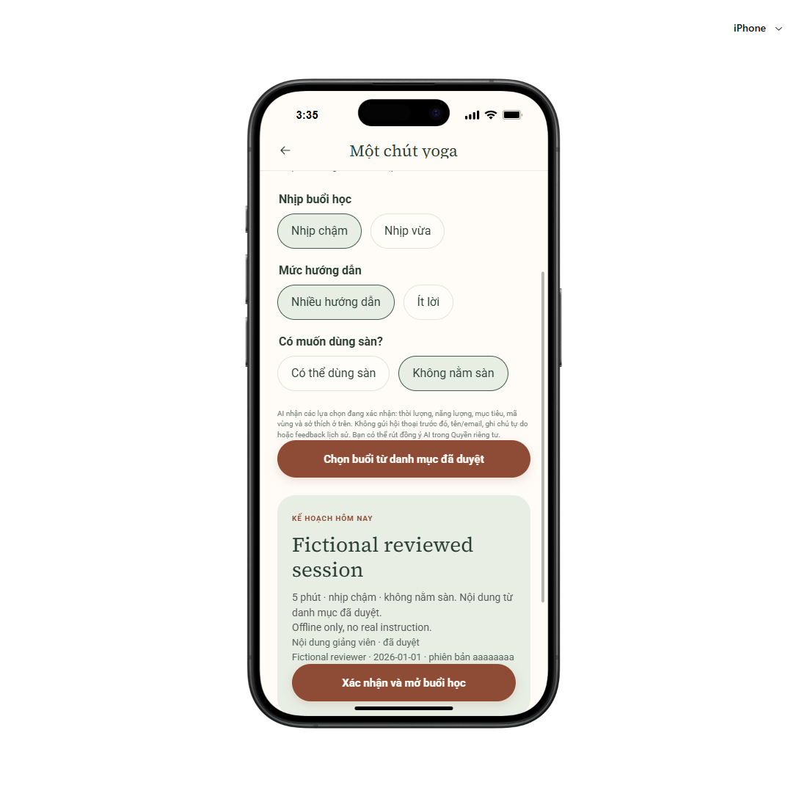

# MCY — bản triển khai luồng AI và bài học để review, 10/10/2026

Checkpoint này giữ bằng chứng bản luồng AI trước. Quyết định Owner phụ trách duyệt và API/UI/database tiếp theo nằm trong [checkpoint mới](MCY_CONTENT_REVIEW_IMPLEMENTATION_2026-10-10.md); receipt trước không đại diện source/build mới. Catalog/AI/cloud gates vẫn giữ nguyên.

Checkpoint này giữ bằng chứng bản luồng AI trước. Quyết định Owner phụ trách duyệt và API/UI/database tiếp theo nằm trong [checkpoint mới](MCY_CONTENT_REVIEW_IMPLEMENTATION_2026-10-10.md); receipt trước không đại diện source/build mới. Catalog/AI/cloud gates vẫn giữ nguyên.

Owner đã đồng ý phương án trong [đánh giá AI/UX](MCY_AI_FLOW_UX_REASSESSMENT_2026-10-10.md), sau đó đề nghị tận dụng serial miễn phí hoặc thử bài giảng AI bằng hình + text + audio trước khi bổ sung bài giảng viên. Bản này đã triển khai **source, UI và mẫu nội dung local**. Đây chưa phải AI chạy thật trên domain: không deploy Edge/Vercel, apply SQL, bật flag hoặc lưu config live trong lượt này.

## Kết quả người dùng có thể review

- Luồng check-in → xác nhận sở thích → kế hoạch → xác nhận mở đúng phiên bản bài → reader → phản hồi. iPhone/Pixel simulator và frameless web dùng cùng luồng. Entry AI dựa vào capability từ server, không dùng cờ frontend luôn tắt hay nút demo để giả sẵn sàng.
- Thẻ kế hoạch cho biết thời lượng, nguồn, phiên bản, lý do từ dữ liệu xác định; learner có thể sửa lựa chọn, tự xem thư viện, dừng hoặc bỏ qua phản hồi. Không tự thử lại inference khi gặp quota, timeout hoặc kết quả chưa xác định.
- Reader hình/text/audio có chọn phần, giữ tỷ lệ hình, audio do người dùng bật, pause khi đổi phần/ẩn màn/rời reader. Mẫu tại `/?workspace=content-review&mode=web` ghi rõ **nháp**, không tạo completion và không nằm trong catalog gợi ý.
- Owner có trạng thái OpenRouter readiness, prompt hội thoại cũ chỉ đọc và không dùng cho selector mới; lỗi save chưa rõ kết quả yêu cầu readback. Có nút tải lại và xác nhận bỏ draft, không tự gửi lại save.
- Quyền AI có trạng thái đang lưu, khóa thao tác song song, request giữ token tài khoản khởi tạo; kết quả tài khoản cũ không cập nhật quyền hoặc kế hoạch của tài khoản mới. Đây là guard client; Auth/RPC server vẫn phải xác minh quyền độc lập.

Preview local đã được build tại [mẫu bài học](http://127.0.0.1:4196/?workspace=content-review&mode=web). Đã xác nhận HTTP200 và kiểm reader trên build bằng Edge: đúng heading, hình1536×1024 tải được, không autoplay, không request Supabase/OpenRouter, không tràn ngang ở320px. Server này phục vụ `dist/client`; tab mở trong Codex có thể đang queued. Preview4195 không lắng nghe đã được dừng đúng process do agent tạo. Không coi URL local hoặc screenshot fixture là bằng chứng bản trên domain đã được cập nhật.

Thẻ Plan và màn Practice dưới đây dùng **fixture giả** để review UI iPhone/Pixel. Tên `Fictional reviewed session`, reviewer/version và các record approval trong ảnh chỉ là dữ liệu test; không phải nội dung tập hoặc phê duyệt thật. Không có provider hoặc staging actor nào được dùng để tạo chúng.

## Serial miễn phí có đủ thành khóa học không?

Metadata local có **38 clip / 3 nhóm**: 18 clip chuyển động nhẹ (11:12), 13 clip tư thế (9:14), 7 clip chuỗi (2:23). Chúng là nguyên liệu để biên tập; chưa đủ bằng chứng về một khóa học hoàn chỉnh. Chưa kiểm toàn bộ playback, mục tiêu/đầu vào, tiến trình sư phạm, chuyển đoạn, nhịp tập, đối tượng phù hợp và phụ đề/audio trong lượt này. Không suy ra độ an toàn, độ khó hay vùng cơ thể chỉ từ tên clip hoặc tổng thời lượng.

Đề xuất dùng một chương trình khởi đầu nhỏ: người biên tập xem toàn bộ clip, chọn và bổ sung lời dẫn/chuyển đoạn, đo thời gian thực hành, rồi người có chuyên môn duyệt đúng phiên bản. AI có thể hỗ trợ soạn hoặc lựa chọn, nhưng không thay người duyệt. Bài AI và bài giảng viên dùng chung reader và hợp đồng nội dung.

Đã tạo bài nháp **“Dành một khoảng cho buổi học”** gồm ba phần, text tiếng Việt, một hình minh họa phòng không có người/tư thế và ba WAV giọng tổng hợp **tiếng Anh** local. Máy chỉ có Zira en-US; chưa có audio tiếng Việt. Tổng lời đọc 61,434 giây không phải thời lượng thực hành yoga. Bài chỉ giới thiệu cách học/quyền lựa chọn, chưa có động tác. [Phân tích, prompt, text audio và provenance](MCY_AI_LESSON_DRAFT_2026-10-10.md), [hash và thời lượng media](MCY_AI_LESSON_DRAFT_EVIDENCE_2026-10-10.json), [quy trình duyệt](../docs/content-review/README.md).

## Hợp đồng AI được triển khai

`practiceAssistant.ts` nhận lựa chọn hiện tại có kiểu và enum chặt: thời gian, năng lượng, mục tiêu, trạng thái cơ thể, mã vùng, nhịp, mức hướng dẫn và lựa chọn dùng sàn. Không nhận text tự do, transcript, actor tự khai hoặc lịch sử. Không gửi tên/email/feedback lịch sử lên provider.

Server lọc các session đã duyệt, còn hạn, đủ thời gian và phù hợp các lựa chọn. AI chỉ trả một ID trong danh sách hoặc `no_match`; app không dùng văn bản AI để tạo động tác hay hướng dẫn sức khỏe. JSON Schema và kết quả được kiểm lại tại runtime. Nếu body state là `reported` hoặc `uncertain`, pilot đầu **không rank bài** vì chưa có hợp đồng severity được duyệt; UI không yêu cầu learner đổi câu trả lời để nhận gợi ý.

Capability và inference cần đúng staging ref, verified Auth, cohort `MCY_AI_PILOT_ACTORS` tối đa 20 UUID (mặc định đóng), các gate spend/key, config enabled và catalog thực tế. Consent phải hiện hành cho terms/privacy/AI. Server kiểm lại consent/config/gate trước và sau provider; start kiểm lại ID/version/eligibility. Quota/idempotency dùng RPC admission/finalization hiện có. Usage biết được vẫn ghi nhận cho output bị từ chối; kết quả finish chưa xác định không trả plan hoặc tự retry.

Provider request dùng schema, `require_parameters=true`, `data_collection=deny`, `zdr=true`, `allow_fallbacks=false`. Tài liệu hiện hành cho biết structured outputs phụ thuộc endpoint và strict không bảo đảm tuân thủ trên mọi endpoint, nên runtime validation vẫn cần. Các bộ lọc privacy không chứng minh tài khoản đã cấu hình đúng hoặc provider hợp lệ cho nội dung này; cần kiểm trước live trial. [OpenRouter structured outputs](https://openrouter.ai/docs/guides/features/structured-outputs), [provider routing/privacy](https://openrouter.ai/docs/guides/routing/provider-selection). Không gọi inference trả phí trong lượt này.

Catalog thật vẫn **rỗng**. Build checker kiểm version của text/metadata/asset SHA và matching expert/rights record; không xác thực người duyệt, chuyên môn hay quyền thật. Không tạo approval giả từ metadata AI. Nháp công khai local trong `public/assets/practice` là nội dung chuẩn bị không nhạy cảm, không phải private teacher draft hoặc nội dung trả phí; chưa xuất bản lên cloud.

## SQL và trạng thái cloud

Candidate mới `20261009181735_ai_read_admission_state.sql`, tên do CLI tạo, chỉ đọc config + current consent cho actor đã verified. `SECURITY DEFINER`, safe empty search path, execute service-only; không grant private schema/table, không ghi quota/audit/consent. PGlite áp dụng baseline 18 migration + Owner repair, rồi candidate để kiểm local. Không gọi đó là Supabase integration hoặc rehearsal multi-session.

Read-only mới trong lượt này:

| Hạng mục | Kết quả | Giới hạn |
|---|---|---|
| Supabase target | `mcy-staging` / `mhumbczqrzutdnraafhs` / MagicpenDigital `rzbpjfrndhrtxagpgdre` | Không đổi tài nguyên hoặc billing. |
| Official CLI 2.119.0 ledger | **PASS exit0**, 19 shared/aligned, zero remote-only, **5 pending** | Dùng explicit project ref; không `db push`. |
| Config / RPC | AI false, version1, model unset; admission-read và actor-bound check-in RPC chưa có | Config đã lưu secret không đồng nghĩa app/provider đã hoạt động. |
| Owner repair | MD5 `5ad67fe52caf79bd07c51caa0c30db92` vẫn giữ | HTTP17/17 và Docker8/8 là evidence 09/10, không rerun trong lượt này. |
| Edge | Chỉ Owner v4 ACTIVE, JWT verification true | Adapter OpenRouter local và AI function chưa deploy. |
| Domain | CNAME đúng, `misconfigured=false`, verified, Preview branch `codex-mcy-p1-preview` | API connector403; CLI đúng scope đọc thành công, worker có timeout/EPIPE warning. |
| HTTPS | **CHƯA XÁC MINH** | Curl TLS bình thường lỗi handshake, web fetch chưa đọc được; không bypass TLS, không kết luận certificate sai. |

5 pending: actor-bound check-in `20261002120000`, teacher RPC `20261002204228`, consent cap `20261003031137`, collaboration `20261005004000`, admission read `20261009181735`. Chúng có gate riêng; không bundle tất cả để bật learner AI. Deployed domain commit `82458fc…` là snapshot 09/10, không được liệt kê lại latest deployment trong lượt này.

Platform-key migration vẫn cần triển khai có kiểm thử trước Production: adapter Edge còn legacy service-role/anon fallback. Hướng dẫn Supabase hiện hành xác nhận legacy keys bị deprecate cuối 2026 và cần auth integration phù hợp khi đổi sang key mới. Không đổi key hoặc tắt `verify_jwt` trong lượt này. [Nguồn Supabase](https://supabase.com/docs/guides/getting-started/migrating-to-new-api-keys).

## Kiểm thử và review

| Check sau code cuối | Kết quả | Phạm vi |
|---|---|---|
| Canonical `npm run build` | **PASS exit0** | Runtime28/28, catalog0 closed, TS, Vite591 modules, Sites packaging. |
| `npm run check:bundle-secrets` | **PASS exit0**, 19 text files | Không chứng minh server secret/account policy đúng. |
| Selected backend/catalog/isolation tests | **PASS 34/34 exit0** | Mock provider/Auth/RPC và asset/evidence fixtures. |
| Shared handler strict TypeScript | **PASS exit0** | Không compile Deno deployment entry bằng Deno. |
| New practice-flow UI | **PASS 11/11 exit0** | Edge, `.invalid` backend + fictional Auth, iPhone/Pixel, mobile/web reader, account/consent/stop/Owner uncertain. |
| Xuất ảnh Plan/Practice iPhone/Pixel | **PASS 2/2 exit0** | Sau full92, chỉ thêm screenshot/scroll/con trỏ vào test; không đổi source/app/assertion. |
| Admission SQL rehearsal | **PASS 3/3 exit0** | PGlite PostgreSQL17 fictional scaffolding/full local baseline; không actual Auth/PostgREST/concurrency. |
| Legacy OpenRouter guard compatibility | **PASS 24/24 exit0** | Legacy handler được giữ, không route của adapter mới. |
| `npm run test:sites` | **PASS 4/4 exit0** | Static packaging/fallback boundaries. |
| Full `npm run test:runtime` cuối | **PASS 92/92 exit0**, 3,2 phút | Edge, managed Vite fixture cô lập, 3 workers; không có actor live. |
| Independent technical R3 review | **PASS trong phạm vi source**, TS exit0, selected17/17 | Không thay review chuyên môn hoặc live actor tests. |

Lỗi tìm thấy và đã sửa: strict enum tránh array-to-string coercion, giữ usage cho output bị reject, prompt Owner không dùng phải chỉ đọc; guard consent từng đặt sai component đã bị TS và browser test bắt, nay chuyển đúng phạm vi, khóa thao tác khi chờ và bind token. Full UI lần trước 90/91 PASS + một assert copy Owner lỗi thời; assert được cập nhật theo hành vi đúng rồi focused recovery PASS1/1. Bản practice trước guard cuối từng 9/11 PASS, hai consent test fail do lỗi scope; final11/11 đã PASS. Không gọi các lần fail là PASS.

Entry bundle cuối **546,15 kB raw /168,19 kB gzip**, warning >500kB còn mở. Các fixture không dùng token `.env.local`, staging hoặc grant thật. [Review độc lập](MCY_AI_FLOW_IMPLEMENTATION_REVIEW_2026-10-10.md), [receipt source/build/test](MCY_AI_FLOW_IMPLEMENTATION_EVIDENCE_2026-10-10.json).

## Phần triển khai tiếp và điều kiện mở

1. Biên tập một số ít buổi hoàn chỉnh từ serial hoặc draft AI; có người duyệt phù hợp, quyền media, audio tiếng Việt/transcript, thời lượng thực hành và nội dung dừng rõ. Pin exact version/evidence; sau đó catalog mới có item thật.
2. Chốt candidate/target packet, rehearsal exact schema và compatibility; selective rollout chỉ RPC cần cho learner/admission, không tất cả pending. Kiểm Auth/actor A/B, stale/revoked consent và ACL qua API thật. Role fixture tạm hết hạn `2026-10-11T10:47:49.876065Z`; kiểm lại identity/role, không gia hạn tự động.
3. Deploy Owner adapter tương thích với config off để readback model/key readiness; kiểm request và model/provider endpoint hỗ trợ schema/ZDR, account privacy/spend cap/quota. Positive Owner save roundtrip trước đây bị automatic approval review từ chối vì tăng version/audit; không lặp lại test này dưới danh nghĩa read-only hoặc bypass rejection. Cần quyền human cụ thể cho side effect test đó nếu muốn chạy.
4. Kiểm kill switch, withdrawal trong request, quota, no-match, output injection và exact content version trên cohort staging; kiểm stop/recovery và dữ liệu gửi thực tế. Sau PASS mới bật config/cohort hạn chế. Native/iOS, legal-policy finalization, clinical evaluation và Production là gate riêng.
5. Web Preview giữ AI đóng có thể là artifact review tiếp theo sau khi source/target packet được duyệt; dùng domain đã cấu hình. Kiểm HTTPS/Auth redirects thật và deployment commit; không báo source local đã live. General release allowlist không đổi.

Gate bắt nguồn từ [mcy-change-review/SKILL.md](../skills/mcy-change-review/SKILL.md), mục4: **“If a required gate fails, fix the cause or stop that release scope”**, và [R3 matrix](../skills/mcy-change-review/references/review-matrix.md): **“reviewer with appropriate expertise … Do not expose without these gates.”** Bản source kỹ thuật đã được review, nhưng chưa có expert/rights approval và live actor/provider evidence cho luồng mới; vì vậy không enable inference hoặc xuất bản bài tập thật. Đây là gate đã có của MCY, không phải yêu cầu xin lại quyền cho các sửa local đã được Owner chấp thuận.

Stop/restore: giữ catalog rỗng, cohort vắng/empty, server enable/spend gate đóng và config off sẽ chặn admission; bất kỳ gate đóng sau provider đều bỏ output. Stop UI vẫn hoạt động offline và hủy request/reader audio. Local tests đã kiểm các đường này; stop/restore thật trên deployed Edge chưa chạy. Không restore database hoặc đổi lịch sử migration. Checkout có nhiều sửa từ trước, không reset/broad-stage/commit/push. Receipt là snapshot local, `releaseAuthorized=false`, không phải release approval manifest đã đủ mọi gate.
