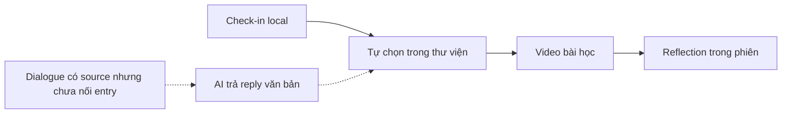
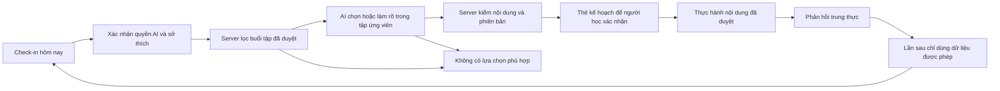

# MCY — đánh giá lại luồng AI và UI/UX trước triển khai

**Báo cáo trước implementation (lịch sử):** sau báo cáo này Owner đã đồng ý triển khai. [Checkpoint triển khai 10/10](MCY_AI_FLOW_IMPLEMENTATION_2026-10-10.md) ghi source/UI mới và mẫu bài AI đã tạo; các mô tả frontend/handler thiếu trong báo cáo dưới là quan sát trước khi sửa, không phải trạng thái source cuối. Cloud rollout/enablement vẫn chưa thực hiện.

Ngày **10/10/2026 · Asia/Bangkok**. Theo yêu cầu Owner: đã cấu hình DNS và AI trên Supabase; **rà soát tài liệu, phân tích luồng và cập nhật báo cáo trước khi triển khai tiếp**. Lượt này chỉ đọc trạng thái, chạy kiểm thử local chọn lọc và cập nhật tài liệu. Không deploy, đổi flag, lưu cấu hình live, apply migration hoặc gọi inference/provider.

## 1. Nhận định và quyết định đề xuất

**Có nền thiết kế và source AI, nhưng chưa có một luồng AI chọn buổi tập hoàn chỉnh để bật cho learner.** Tôi khuyến nghị tiếp tục triển khai một lát cắt nhỏ của vòng học chính, dùng lại UI hiện có: check-in → làm rõ sở thích → xác nhận một buổi tập đã được duyệt → thực hành → phản hồi trung thực. Chưa nên bật code hiện tại và coi đó là hoàn thành tính năng AI của MCY.

Lý do chính là khoảng cách về chức năng, không chỉ thiếu cấu hình: frontend đang đưa người học từ check-in tới thư viện; backend AI chỉ trả một câu `reply` và **chủ động cấm chọn bài khi catalog chưa được duyệt**. Thẻ kế hoạch, hợp đồng chọn nội dung và nối phản hồi vào lựa chọn tiếp theo vẫn thiếu. Key/flag Supabase và DNS không tạo ra các phần này.

Owner đã bày tỏ ý định triển khai và bật AI; yêu cầu “trước tiên” đặt thứ tự cho lượt này. Báo cáo không thay thế việc triển khai sau đó và không tự chứng nhận gate R3 đã đạt. Chỉ phần tài liệu thay đổi là R0; triển khai AI thật, consent, quyền và hướng dẫn sức khỏe vẫn cần bằng chứng R3 theo [mcy-change-review](../skills/mcy-change-review/SKILL.md).

## 2. Đã kiểm chứng gì trong môi trường hiện tại?

| Hạng mục | Kết quả ngày 10/10 | Ý nghĩa và giới hạn |
|---|---|---|
| DNS domain review | **PASS**: public resolver `1.1.1.1` trả CNAME `f65143a73136a0ac.vercel-dns-017.com`; Vercel `misconfigured=false`, không conflict | Owner đã cấu hình đúng target. Không cần đổi lại DNS chỉ để mở AI. |
| Vercel binding | **PASS**: domain verified, branch `codex-mcy-p1-preview` | Đây vẫn là Preview để review. Không có Production promotion. |
| HTTPS từ môi trường kiểm tra | **CHƯA XÁC MINH**: Node/curl không hoàn tất TLS handshake; web fetch cũng không xác nhận được | Chưa đủ bằng chứng kết luận certificate sai hoặc HTTPS hoạt động. Cần kiểm tra lại bằng trình duyệt/kết nối phù hợp trước nghiệm thu domain. |
| Supabase | **PASS metadata**: đúng `mcy-staging`, ref `mhumbczqrzutdnraafhs`, org MagicpenDigital `rzbpjfrndhrtxagpgdre`, `ACTIVE_HEALTHY` | Health không chứng minh luồng AI hay cấu hình ngân sách; không kiểm billing/quota trong lượt này. |
| Secret metadata | **PASS hiện diện**: `OPENROUTER_API_KEY`, `MCY_AI_ENABLE_STAGING`, `MCY_AI_SPEND_CONTROL_APPROVED` | Chỉ xuất boolean tên hiện diện; không truy xuất giá trị secret, không xuất/lưu digest. **Giá trị hiện tại của hai flag, tính hợp lệ key và policy tài khoản chưa kiểm chứng.** |
| Edge Functions | Chỉ `owner-control-plane` ACTIVE v4, `verify_jwt=true`; **không có `mcy-ai-assistant`** | Deployed Owner còn dùng adapter Gateway cũ; source OpenRouter local chưa được deploy. Lưu OpenRouter key chưa làm source cũ chuyển provider. |
| AI config database | `enabled=false`, version **1**, model chưa chọn | Database vẫn chặn inference ngay cả khi secret flags đã đổi. Không lưu hoặc bật config trong lượt này. |
| Migration ledger / learner writes | **19 applied / 4 pending**; RPC `save_my_checkin_for_current_user_with_current_consent` **chưa có** | Local learner gọi RPC này; phải rollout đúng candidate và kiểm actor/consent trước đưa signed-in check-in mới lên staging. Không `db push` tất cả pending. |
| Owner repair | Live fingerprint vẫn `5ad67fe52caf79bd07c51caa0c30db92`; lần nghiệm thu 09/10 **HTTP 17/17, Docker 8/8 PASS** | Fix PT409 đã applied. Không còn coi CLI login, Docker hay repair chưa apply là blocker hiện tại. Positive live save vẫn chưa chạy. |

Bốn pending migration: actor-bound check-in `20261002120000`, teacher RPC `20261002204228`, consent cap `20261003031137`, collaboration `20261005004000`. Chúng có scope và gate riêng; không cần triển khai toàn bộ teacher/collaboration chỉ để làm AI learner. Ba role fixture tạm thời trong receipt 09/10 hết hạn **11/10/2026 17:47:49 Bangkok**; trước mọi actor test tiếp theo phải xác minh lại role hợp lệ, không dựa nhãn helper hoặc tự gia hạn.

Working tree có nhiều thay đổi từ trước; HEAD `82458fc219a2231ccac279112dfc0db5447b0edd` không mô tả đầy đủ source đang review. Latest Ready Preview được ghi nhận ngày 09/10 ở commit này; lượt 10/10 kiểm lại binding, **không liệt kê lại latest deployment**. Không đánh đồng code local với bản đang phục vụ domain. [Receipt mới](MCY_AI_FLOW_UX_REASSESSMENT_EVIDENCE_2026-10-10.json), [Owner acceptance](MCY_OWNER_REPAIR_ACCEPTANCE_2026-10-09.md), [DNS record](MCY_DOMAIN_REVIEW_DNS_2026-10-09.md).

## 3. Design UI/UX đã có đến đâu?

| Lớp thiết kế | Đã có | Phần chưa hoàn tất |
|---|---|---|
| Brand và design system | Khoảng mở, palette ivory/forest/terracotta, Roboto, hệ khoảng cách, trạng thái, component và quy tắc accessibility | Đây là nền tái sử dụng; không phải bằng chứng mọi màn AI đã được dựng/QA. |
| Concept vòng AI | Storyboard hai buổi; anatomy thẻ kế hoạch; nguyên tắc phản hồi xấu/không đổi; no-match, memory, sửa lựa chọn | Tài liệu mô tả mục tiêu và hợp đồng đề xuất, chưa chứng minh API/UI chạy thật. |
| UI hiện chạy local | Check-in, thư viện/video, reflection, Journey, quyền riêng tư và Owner; code Dialogue có chips, composer, loading/error | Dialogue không nằm trên entry bình thường; chưa có màn Plan nối với AI và buổi tập hợp lệ. |
| Concept Plan cũ | [Ảnh thẻ kế hoạch 26/09](ux-audit-2026-09-26/13-plan-iphone.jpg) có thời lượng, lý do và CTA | Đây là fixture lịch sử. Không khôi phục demo thành “kế hoạch AI thật”; nội dung và thời lượng phải được xác minh. |
| AI-on QA | Chưa có bằng chứng live trong lượt này | Cần state matrix đầy đủ, simulator iPhone/Pixel, web mobile/desktop, keyboard, focus/screen reader; native kiểm riêng trước phân phối native mới. |

Căn cứ: [brand](../brand/BRAND_GUIDELINES.md), [design system](../design-system/DESIGN_SYSTEM.md), [vòng AI và prototype](business-plan/06_VONG_LAP_AI_VA_PROTOTYPE.md), [phân tích sản phẩm](business-plan/02_SAN_PHAM_HANH_TRINH_AI.md), [mcy-brand-ux](../skills/mcy-brand-ux/SKILL.md). Tài liệu business plan có các đề xuất lịch sử về history, thương mại hoặc thứ tự native; quyết định Owner/AGENTS mới hơn điều khiển phạm vi hiện tại. Không lấy đề xuất “hội thoại” làm quyền tự gửi lịch sử hay ghi nhớ dài hạn.

**Đánh giá thiết kế:** không cần thiết kế lại toàn bộ app. Cần hoàn thiện thiết kế tương tác của đoạn AI → Plan → Practice, chỉnh copy theo khả năng thật và bổ sung các trạng thái khó. Thẻ kế hoạch nên là điểm quyết định chính; chat giúp làm rõ nhu cầu, không trở thành một màn trò chuyện dài mà người học vẫn chưa biết tập gì.

## 4. Luồng hiện tại so với hướng sản phẩm

[Frontend hiện tại](../src/Prototype.tsx): hằng `AI_INFERENCE_AVAILABLE_FOR_LEARNERS=false`; `CheckinFooter` đi `discover`; `DialogueFooter` cũng đi `discover`. Không có route Plan/Practice của vòng AI. Reflection giữ các lựa chọn không đổi, khó chịu hơn, chưa chắc và bỏ qua, nhưng chưa sync run/reflection vào tài khoản và chưa trở thành input AI.

[Handler AI](../supabase/functions/_shared/aiAssistant.ts) chỉ nhận lượt nhắn hiện tại cùng minutes/energy/intent/region codes; từ chối `turns` có history. Provider nhận hai message system/user và chỉ trả JSON `{reply}`. Quy tắc an toàn hiện yêu cầu không tự chọn bài. Do đó chỉ đổi flag frontend sẽ vẫn thiếu bước chọn nội dung và xác nhận kế hoạch.

Luồng tôi đề xuất triển khai:

Đây là kiến trúc đề xuất, **chưa phải thiết kế/API đã triển khai**. AI chọn hoặc giải thích trong catalog hợp lệ; server giữ quyền quyết định eligibility và version. Không giao mô hình tự sinh động tác, tự chẩn đoán hoặc ghép Shorts thành buổi tập không được chuyên gia review.

## 5. Các khoảng trống cần xử lý

### 5.1. Thiếu hợp đồng Plan và catalog đủ điều kiện — P0 cho vòng học

`CourseLesson` trong [freeCourses](../src/courses/freeCourses.ts) có id/video/title/duration/visibility/caption flags, chưa có metadata eligibility, nhịp, thiết bị, version hoặc evidence reviewer cho lựa chọn AI. 38 clip ngắn khoảng 17–64 giây không tự chứng minh có buổi tập hoàn chỉnh 5/10/15 phút. Có video thật, quyền sử dụng hoặc visibility phù hợp cũng không đồng nghĩa có review chuyên môn cho một kế hoạch.

Cần một catalog nhỏ các **buổi hoàn chỉnh được duyệt**, duration thật, transcript/instructions, chuẩn bị, điều kiện sử dụng và revision bất biến. Có thể biên tập từ nội dung sẵn có nếu đủ quyền và được review. Không cần chờ mở teacher invitations hay collaboration để chuẩn bị catalog này.

Hợp đồng đề xuất: `status` (selected/clarification/no_match/safety_stop), `requestId`, `contextRevision`, tập `candidateIds` do server cấp; nếu selected có `sessionId`, `contentVersion`, `durationSeconds`, nguồn/reviewer evidence và lý do ngắn bám dữ liệu thật. Server xác minh id/version/publication/eligibility trước trả Plan và trước bắt đầu buổi. Không chỉ kiểm JSON schema rồi tin mọi id/text do mô hình trả.

### 5.2. Hội thoại đang hiển thị nhiều lượt nhưng AI không nhận các lượt trước — P1

Dialogue có transcript trong phiên, nhưng request chỉ gửi current message. Nếu người học đã chọn “không nằm sàn”, câu tiếp theo có thể không mang điều kiện đó. Copy nói “nội dung trong cuộc trò chuyện” dễ tạo kỳ vọng AI hiểu toàn bộ trao đổi.

Tôi đề xuất giữ **ngữ cảnh cấu trúc của phiên, do người học xác nhận**: phút, mục tiêu, nhịp, mức hướng dẫn, không nằm sàn/thiết bị và các giới hạn được catalog hỗ trợ. Sau câu làm rõ, cập nhật summary và cho sửa trước Plan. Đây là thay đổi hợp đồng privacy/consent cần review; chưa gửi transcript hoặc phản hồi cũ mặc định. Nếu chỉ làm single-turn pilot, phải ghi đúng khả năng này và không trình bày như hội thoại có trí nhớ.

### 5.3. “Điều được nhớ” có thể diễn giải sai feedback — P1 về tin cậy

`Memory` hiện dùng điều kiện `latest && rememberPace` rồi luôn hiện **“Nhịp buổi trước hơi nhanh”**, kể cả bản ghi không có pace đó hoặc có kết quả khác. Home có điều kiện chặt hơn. Đây là finding từ source, chưa sửa trong lượt này.

Cần thống nhất bộ suy ra memory: chỉ hiện pace thật khi có phép sử dụng và bản ghi phù hợp; bỏ qua/không chắc/khó chịu hơn/kết thúc sớm không được biến thành tiến bộ hoặc sở thích mặc định. Mỗi dòng nêu nguồn, thời điểm, phạm vi và cách tắt/xóa. Chưa đồng bộ tài khoản thì nói rõ “trong phiên”, không quảng cáo cá nhân hóa dài hạn.

### 5.4. Response đến muộn, rút consent và mất draft — P1 trước mở Dialogue

Client kiểm user và user-turn khi nhận reply, nhưng chưa kiểm `contextRevision`, consent hiện hành hoặc màn còn active. Sửa check-in/rút consent/rời màn khi pending cần invalidation và cancellation rõ ràng. Composer bị xóa khi gửi; catch gỡ user bubble mà không khôi phục draft.

Cần giữ draft để người học chủ động sửa/gửi lại; request generation + context revision; loại kết quả cũ sau đổi account/context/consent. Server hiện kiểm consent/config lúc reserve request, trước lần đọc catalog provider; chưa có kiểm lại ngay sát provider call. Cần xác định semantics và thử race: rút trước admission thì chặn, request đã gửi không thể “thu hồi” khỏi provider, rút sau đó chặn request mới và UI không nhận kết quả stale. Retry phải xử lý idempotency/usage, không tự gọi lại gây phí hoặc tạo hai kế hoạch.

### 5.5. Guard regex và prompt chưa đủ chứng minh an toàn — P1 trước inference thật

[aiSafety](../supabase/functions/_shared/aiSafety.ts) và [aiPrivacy](../supabase/functions/_shared/aiPrivacy.ts) là bộ lọc heuristic cho một số câu y khoa/định danh thường gặp. Audit độc lập với dữ liệu giả phát hiện câu diễn đạt ngoài mẫu có thể lọt; không kết luận mọi định danh đã loại hoặc mọi câu trả lời an toàn. Prompt bắt buộc và schema là lớp bổ sung, không thay thế đánh giá chuyên môn.

Cần eval VI/EN với paraphrase, prompt injection, triệu chứng cần dừng, output từ chối, khai báo tên/liên hệ và feedback xấu; có reviewer kỹ thuật độc lập và người có chuyên môn phù hợp review nội dung/hướng dẫn. Nếu guard không quyết định chắc, chuyển trạng thái thận trọng; không dùng vùng cơ thể để suy ra bệnh. Không log prompt/chat/health data để đo chất lượng mặc định.

### 5.6. Owner readiness và lỗi lưu cấu hình — P1/P2

Local Owner chỉ đọc model catalog khi cả inference/spend gate mở; điều này làm khó chọn và kiểm model **trước khi mở inference**. Nên tách kiểm tra readiness/catalog chỉ dành Owner khỏi quyền gửi inference. Chọn model phải đối chiếu khả năng thực của endpoint, không chỉ dựa tên hoặc giá.

Parser OpenRouter cho phép dấu `:` trong model id, nhưng RPC save đang dùng regex không có `:`. Với model variant dạng `provider/model:variant`, UI có thể chấp nhận trong khi database từ chối. Cần thống nhất contract/filter hoặc forward migration được review; không sửa lịch sử migration applied.

[Owner UI](../src/staff/owner.tsx) có hai copy cần sửa trước vận hành: lỗi transport luôn nói “Không có thay đổi nào được lưu”, dù timeout có thể xảy ra sau commit; success nói “Cấu hình chưa tự bật inference”, dù enabled=true cùng gate mở có thể cho backend nhận request. Cần trạng thái **chưa xác định → đọc lại version/audit**, không retry save tự động; nút tải lại khi 409 kèm xử lý draft. Việc bật phải cho thấy chính xác gates/config/model đang có hiệu lực.

### 5.7. Không thể bật bằng một hằng frontend — P1 về khả năng vận hành

Availability/copy AI OFF nằm ở Dialogue, Help, consent và Memory; auth return legacy được chuẩn hóa về thư viện. Cần một capability contract công khai tối thiểu cho frontend, không trả secret/Owner config: available/disabled/not_ready/maintenance, action cần sign-in/consent và phạm vi rollout. Backend vẫn kiểm mỗi request; UI không là ranh giới quyền.

Cho cohort nội bộ trước, cùng đường tự chọn thư viện khi tắt/lỗi/no-match. Copy và entry phải đổi đồng bộ; không hiện nút hứa kế hoạch nếu backend chỉ hỗ trợ reply. Request quota và kill switch cần UI và actor tests thật, không chỉ mock.

## 6. Thiết kế tương tác cần hoàn thiện

| Màn / tình huống | Hành vi đề xuất | Tiêu chí review |
|---|---|---|
| Check-in → AI | Giữ lựa chọn, nêu input sẽ dùng, đăng nhập/consent đúng lúc; có đường tự chọn | Không ép khách dùng AI; không gửi trước consent. |
| Làm rõ sở thích | Chips nhanh, tối đa một câu mỗi lượt; summary có thể sửa; dừng hỏi khi đã đủ | Không lặp hỏi dữ liệu đã biết, không suy diễn bệnh hoặc tự nhớ transcript. |
| Plan chính | Tên buổi, duration thật, nhịp/hướng dẫn/chuẩn bị, lý do ngắn và nguồn/version; CTA bắt đầu | Một thẻ chính rõ ràng; người học xác nhận, không tự phát video. |
| Đổi lựa chọn | Đổi phút/sở thích hoặc chọn phương án khác từ catalog hợp lệ | Không trả cùng phương án trái điều kiện; không mất check-in. |
| No-match | Nói chưa có buổi phù hợp, cho sửa sở thích hoặc chọn phương án hợp lệ khác | Không bịa nội dung cho đủ màn, không tự lấp bằng một bài trái điều kiện. |
| Safety stop | Dừng ngay, hiển thị hướng dẫn tĩnh đã được chuyên môn duyệt kể cả khi offline/Auth/provider lỗi | Không coi sửa filter hoặc chat tiếp là đường vượt trạng thái dừng; không phụ thuộc câu trả lời AI để hiện hướng dẫn. |
| Pending / timeout / quota | Loading có thể rời, giữ draft, trạng thái lỗi đúng nguyên nhân và fallback | Không tự retry, không giả khẳng định provider chưa xử lý khi kết quả chưa xác định. |
| Rút consent / account switch | Hủy/invalidate request, chặn lượt mới, nói rõ ảnh hưởng | Late reply không xuất hiện cho account/consent/context mới. |
| Practice | Phát đúng content version đã xác nhận, pause/stop/ended-early; dừng ngay tại client | Stop vẫn hoạt động khi mạng/Auth/AI lỗi; Plan stale không bắt đầu im lặng; quyền nội dung và media vẫn đạt gate. |
| Reflection | Tốt hơn/không đổi/khó chịu hơn/chưa chắc/bỏ qua, pace riêng, tự nguyện | Thiếu feedback không được tính là tiến bộ; chưa sync thì ghi rõ phạm vi phiên. |
| Lần tiếp theo / Memory | Chỉ dùng feedback được phép và có nguồn; cho sửa/tắt/xóa | Không biến một lần khó chịu hơn thành sở thích mặc định. |
| Báo phản hồi không phù hợp | Đường báo lỗi nội dung ngay tại reply/Plan, mục đích và dữ liệu gửi rõ | Không ngầm gửi toàn bộ chat hoặc tạo lời hứa hỗ trợ chưa có backend. |

Giữ visual hierarchy/brand hiện có, CTA chính rõ ràng, trạng thái không chỉ dùng màu, focus/aria-live phù hợp và reduced motion. Review cả iPhone/Pixel simulator lẫn web frameless: mobile hẹp, landscape/keyboard, desktop ≥900px. Native callback/build/device là bằng chứng riêng, không suy ra từ web PASS.

## 7. Thứ tự triển khai và điểm nghiệm thu

| Bước | Công việc cụ thể | Bằng chứng cần trước bước tiếp |
|---|---|---|
| **A. Chốt lát cắt vòng học** | Contract Plan/context, state matrix và prototype các trạng thái; catalog nhỏ do chuyên gia duyệt; sửa nhãn memory/copy theo dữ liệu thật | Review UX toàn luồng; id/version/duration/source hợp lệ; no-match, worse/skipped và privacy không mâu thuẫn. |
| **B. Nối backend và frontend khi inference vẫn đóng** | Candidate filtering/server validation; cập nhật contract context/consent; capability/cohort; xử lý stale/draft/Owner errors; phối hợp RPC check-in tương ứng nếu triển khai signed-in save | Clean/previous-schema + concurrency rehearsal cho diff; actor/object/consent negative và positive; build, secret scan, runtime/UI/Sites đúng scope; independent R3. |
| **C. Kiểm readiness staging bằng exact artifact** | Đối chiếu ledger/target, triển khai có chọn lọc; OpenRouter Owner + AI function đúng source, JWT auth; chọn model/endpoint qua catalog; kiểm HTTPS/Auth redirect khi cần | Code/hash deployed, quyền hiệu lực, key metadata/readiness và policy thật được kiểm; model structured-output/privacy tương thích; không bundle migration teacher ngoài scope. |
| **D. Thử AI thật với cohort nội bộ** | Dữ liệu giả, consent hiện hành, paid request giới hạn theo controls đã thống nhất; kiểm stop/restore, quota và provider failure | Actor/provider HTTP tests; VI/EN eval + expert review; revoke/kill-switch race, usage và no-match; Owner biết trạng thái bật/tắt thật. |
| **E. Mở learner staging có kiểm soát** | Entry Plan mới, copy/consent/help đồng bộ, cohort rõ; quan sát metadata cần thiết, đường tắt AI và thư viện fallback | Nghiệm thu end-to-end với nội dung được duyệt; không có lỗi còn mở làm sai lựa chọn/quyền/feedback; rollback đã thử. Production và native release mới vẫn là phạm vi riêng. |

**Phần AI reply-only có thể là một pilot kiểm tra provider nội bộ**, sau khi readiness, consent, safety và stop path đạt; không coi pilot đó là vòng AI cốt lõi đã hoàn thành. Tôi ưu tiên bước A/B trước bật learner để lần review kế tiếp trả lời được “hôm nay tập gì và vì sao”.

Ngân sách vẫn do Owner cấu hình trên OpenRouter theo quyết định 05/10; không yêu cầu nhập lại USD/reset qua chat hoặc thêm bộ budget tiền vào backend. Request/token quota và usage phục vụ chống lạm dụng/vận hành, không xác minh ngân sách tài khoản.

Positive live Owner save trước đây bị **automatic approval review** chặn vì tăng version/audit; [receipt](MCY_OWNER_LIVE_SAVE_2026-10-09.json) vẫn `executed=false`. Lượt này không chạy lại hoặc né rejection. Khi cần kiểm thử đó, phải tuân thủ yêu cầu permission cụ thể đã ghi trong [acceptance](MCY_OWNER_REPAIR_ACCEPTANCE_2026-10-09.md), có readback PT409/version mới và không retry. Việc đọc config hôm nay không thay cho positive save.

## 8. Bằng chứng kiểm thử và giới hạn đánh giá

| Kiểm chứng | Kết quả | Phạm vi |
|---|---|---|
| Backend audit độc lập, 5 suites local AI/Owner | **PASS 33/33, exit 0** | Model parser, safety boundaries, handler, current-turn contract, Owner; mocks/offline, không chứng minh provider hoặc semantic safety đầy đủ. |
| Focused Edge Playwright | **PASS 7/7, exit 0** | iPhone/Pixel check-in/guest flow, thư viện khách, Help AI-off, Owner workspace/AI-off save và consent footer. Fixture `.invalid`, không staging/Auth thật. |
| Runtime precheck trước Playwright | **PASS 28/28 protected files** | Không thay runtime/lock. |
| Read-only metadata/DNS/catalog | **PASS theo từng dòng mục 2** | Không thử inference, không tiết lộ key/token/dữ liệu học viên. |
| AI-on selection, plan/practice, provider, consent/kill switch live, semantic eval chuyên gia | **CHƯA CHẠY / chưa có triển khai đủ** | Không có số liệu chất lượng, latency hay tỷ lệ match thật để báo cáo. |
| Full suite/build/native/accessibility đầy đủ ngày 10/10 | **CHƯA CHẠY** | Lượt này không sửa hành vi; không lấy focused tests thay full release evidence. |

Hai agent đánh giá độc lập backend và UI/UX; audit UI/UX dựa source/tài liệu/ảnh concept cũ. Root chạy focused browser tests mới. Báo cáo được review độc lập về source/live, quyền/phạm vi và liên kết; bổ sung phân biệt no-match/safety-stop và client stop khi mất mạng theo review. JSON receipt hợp lệ và các liên kết local mới resolve. Không có screenshot audit AI-on mới, không đọc `.env.local`, không đánh giá dữ liệu sức khỏe thật. Rủi ro còn lại lớn nhất là **chọn nội dung đúng và an toàn**, không phải chỉ kết nối endpoint.

## 9. Tài liệu provider đã đối chiếu

- OpenRouter structured outputs được hỗ trợ theo model/endpoint; giữ `require_parameters` và kiểm schema/runtime server. Không suy ra mọi model trong catalog hỗ trợ từ việc model id tồn tại. [Structured outputs](https://openrouter.ai/docs/guides/features/structured-outputs).
- Request local đặt `data_collection=deny`, `zdr=true`, `allow_fallbacks=false`; đây là policy routing cần kiểm khả năng endpoint và cấu hình tài khoản, không là cam kết regex đã loại hết PII. [Provider selection](https://openrouter.ai/docs/guides/routing/provider-selection).
- Supabase secrets là cấu hình runtime; lưu secret không triển khai function hoặc thay code đang gọi key cũ. Client không nhận server secret. [Edge Function secrets](https://supabase.com/docs/guides/functions/secrets).

Các nhận định kiến trúc và thứ tự A–E là đề xuất của lần đánh giá này. Không có claim “không còn lỗi”, “đã an toàn để bật” hoặc “đã production”.
