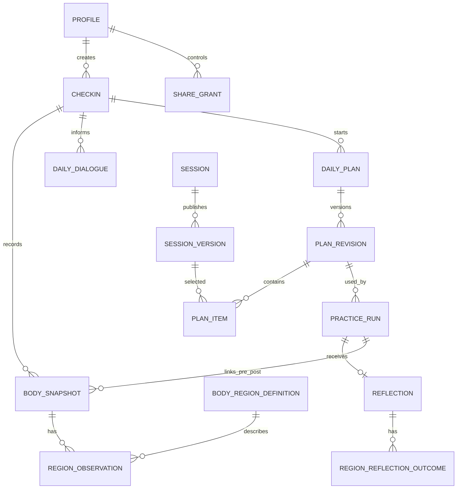

# Một chút yoga — kế hoạch sản phẩm, thương hiệu và nền tảng v0.3

**Ngày:** 25/09/2026 · **Trạng thái:** bản thiết kế để review; chưa phải cam kết lịch, ngân sách, tuân thủ pháp lý hoặc kiến trúc đã triển khai.

## 0. Quyết định nền và cách đọc

**Đã xác nhận làm hướng cho prototype trong `AGENTS.md`:** thị trường Việt Nam dùng tên **Một chút yoga** và câu **“Một chút yoga, vạn chút an yên”**; một biểu tượng lá, nền ngà, chữ xanh rừng, CTA đất nung, ảnh yoga dịu và tiêu đề serif. Việc phát hành công khai tên/asset vẫn cần kiểm tra người dùng và quyền thương hiệu. Sản phẩm chính là **check-in → trao đổi AI ngắn → kế hoạch hôm nay → tập → phản hồi trung thực → lựa chọn lần sau có căn cứ**. Body map chỉ ghi nhận điều người dùng tự báo, theo vùng và thời điểm; các trạng thái như cũ, khó chịu hơn, chưa rõ, bỏ qua và không chọn phải khác nhau.

**Đề xuất trong tài liệu này:** quy cách thương hiệu, danh mục màn, schema, Supabase/PostgreSQL cho pilot, web trước native, ngưỡng nghiệm thu và lịch tương đối. Những đề xuất đó cần được kiểm chứng bằng người học, nội dung thực, đánh giá bảo mật/pháp lý và thử tải.

**Điểm xuất phát:** `src/Prototype.tsx` là prototype tương tác dùng trạng thái trong bộ nhớ, bốn buổi mẫu, hội thoại theo kịch bản và màn tập minh họa. Nó chưa có đăng nhập, cơ sở dữ liệu, AI thật, player nội dung phát hành, CMS hay thanh toán. `design-qa.md` ghi nhận QA giao diện, chưa phải kết quả nghiên cứu người dùng. Bộ tài liệu 0.2 trong `analyse/business-plan/` vẫn hữu ích cho các nhánh thương mại và vận hành nhưng một số ngày/trạng thái đã cũ; bản 0.3 này ưu tiên các quyết định bền vững mới trong `AGENTS.md`.

### Mục tiêu sản phẩm và ranh giới

- Người mới hoặc quay lại sau nghỉ biết **hôm nay chọn buổi nào, vì sao, cách theo được, khi nào dừng và lần sau điều gì thay đổi**.
- AI chỉ chọn trong bài đã duyệt và giải thích dựa trên thông tin người học đã cung cấp; không chẩn đoán, khẳng định quan sát cơ thể hay tự sáng tác chuỗi động tác chưa được rà.
- Khóa học, nội dung giáo viên và lớp trực tiếp bổ trợ vòng lặp. Hành trình riêng của học viên không mặc nhiên mở cho giáo viên.
- Không lấy thời lượng chat, streak, phản hồi tích cực hoặc biểu đồ đẹp làm bằng chứng người dùng hài lòng. Kiểm chứng bằng việc họ bắt đầu, theo được, hiểu lựa chọn và quay lại một cách tự nguyện.

## 1. Bộ nhận diện thương hiệu dùng xuyên ứng dụng và truyền thông

### 1.1. Định vị và giọng nói

| Thành phần | Quy tắc đề xuất | Ví dụ |
|---|---|---|
| Lời hứa | Một khoảng tập phù hợp hoàn cảnh hôm nay, theo nội dung của giáo viên và có quyền điều chỉnh; gói hỗ trợ trực tiếp là quyền riêng | “Chọn một buổi phù hợp với cảm nhận hôm nay.” |
| Tính cách | Ấm, điềm tĩnh, rõ, có chuyên môn, không phán xét | “Bạn có thể đổi sang nhịp chậm hơn.” |
| Cách nói về AI | Nêu nó dựa vào dữ liệu nào, cho sửa hiểu nhầm và nói rõ khi không tìm được bài | “Dựa trên 10 phút bạn chọn và phản hồi lần trước…” |
| Cách nói về sức khỏe | Mô tả tự báo cáo, không hứa chữa trị hoặc gán nguyên nhân | “Bạn ghi nhận mức khó chịu ở vai trái là Nhẹ lúc này.” |
| Khi thiếu dữ liệu | Chấp nhận không biết | “Chưa có phản hồi cho vùng này.” |
| Câu tránh dùng | Tránh hứa “hết đau”, “AI hiểu cơ thể bạn”, “đã cải thiện 20%” khi không có căn cứ | Viết lại theo dữ liệu thực và phạm vi bài tập. |

Tên tiếng Anh **A Little Yoga**, câu **“A little yoga. A little more peace.”** và lời mời **“Make room for a little yoga.”** là giả thuyết cần thử tại một thị trường tiếng Anh cụ thể. Không đưa vào thương hiệu quốc tế như tên đã kiểm chứng. Trước khi xuất bản tài sản, tra cứu nhãn hiệu, tên miền và tài khoản mạng xã hội ở phạm vi dự kiến.

### 1.2. Hệ thị giác đề xuất

| Token | Mã | Dùng cho |
|---|---|---|
| Canvas ngà | `#FBF6ED` | Nền app, slide, ảnh bìa có chữ |
| Giấy ấm | `#FFFCF6` | Card, khối nội dung |
| Xanh rừng | `#25372D` | Chữ chính, biểu tượng, CTA thứ cấp |
| Xanh chữ phụ | `#59675E` | Chú giải trên nền ngà |
| Đất nung đậm | `#91482F` | CTA chính và dấu nhấn hành động |
| Xanh lá nhạt | `#E7EDDF` | Vùng thông tin dịu, trạng thái trung tính |

Các cặp chữ chính/ngà, chữ phụ/ngà và trắng ấm/đất nung đậm lần lượt đạt xấp xỉ **11,7:1; 5,5:1; 6,5:1** theo công thức tương phản WCAG. Đây là kiểm tra màu phẳng, vẫn phải kiểm trên ảnh thật, lớp phủ và kích thước chữ thật. Mốc tham chiếu WCAG 2.2 AA cho chữ thường là 4,5:1 [W3C WCAG 2.2](https://www.w3.org/TR/wcag/). Nên thiết kế vùng bấm 44–48 px cho body map và thao tác chính; WCAG 2.2 AA quy định tối thiểu 24 × 24 CSS px hoặc các ngoại lệ về khoảng cách, nên 44–48 px là mục tiêu thiết kế của MCY, không phải cách diễn giải sai chuẩn [W3C target size](https://www.w3.org/WAI/WCAG22/Understanding/target-size-minimum).

**Chữ:** thử **Lora** cho tên/tiêu đề editorial và **Be Vietnam Pro** cho chữ thao tác, phụ đề và biểu mẫu; cấp bậc đề xuất H1 32–36, H2 24–28, body 16–18, chú giải tối thiểu 14 px trừ nhãn phi thiết yếu. Đây là cặp font thử nghiệm, chưa khóa tài sản. Kho Google Fonts ghi Lora thuộc OFL và có tập ký tự Vietnamese [metadata Lora](https://github.com/google/fonts/blob/main/ofl/lora/METADATA.pb); Be Vietnam Pro là bộ chữ mở do nhóm tác giả công bố [nguồn tác giả](https://github.com/bettergui/BeVietnamPro). Vẫn phải kiểm thử đầy đủ dấu tiếng Việt, độ cao dòng, tải font và giấy phép trước khi chốt. Times New Roman/Georgia trong prototype và bảng xem trước là fallback hiện tại, không phải đặc tả chữ cuối.

**Logo:** giữ một dấu lá chung với prototype. Bàn giao cần có SVG vector và bản raster cho: biểu tượng độc lập, tên Việt một dòng/đứng, bản âm trên xanh rừng, đơn sắc, favicon/app icon và avatar mạng xã hội. Wordmark phải đọc rõ toàn bộ dấu tiếng Việt; khoảng trống tối thiểu bằng chiều cao một lá nhỏ quanh dấu; không kéo méo, thêm hiệu ứng bóng, dùng lá thay chữ hoặc đặt logo trên vùng ảnh thiếu tương phản. Icon ứng dụng phải thử ở kích thước nhỏ trước khi xuất bản. Bản tiếng Anh đổi chữ, giữ cùng dấu lá và tỉ lệ.

**Ảnh/video:** bối cảnh nhà thật, ánh sáng tự nhiên dịu, nhiều độ tuổi/hình thể trưởng thành; động tác an toàn trong phạm vi đã duyệt; ưu tiên giáo viên thật và có quyền sử dụng hình, giọng, nhạc, phụ đề. Tránh ảnh trước/sau ngụ ý chữa khỏi. Body map là minh họa trong suốt, khung đầu đến đùi trên thống nhất cho ba lựa chọn trung tính/nữ/nam, gương mặt trung tính; lựa chọn hình chỉ là sở thích hiển thị.

**Thư viện tài sản cần xuất bản sau duyệt:** logo master và quy tắc dùng; token màu/chữ/khoảng cách/icon; bộ ảnh có quyền và caption; mẫu 9:16 TikTok/Reels, 1:1 social, thumbnail video, email, bìa khóa, trang giáo viên, thông báo trong app; hướng dẫn voice/copy cho CTA, no-match, phản hồi, sự cố và quyền riêng tư. Mọi mẫu cần vị trí tiêu đề, khoảng an toàn, logo, CTA và trạng thái nguồn/số liệu minh họa.

### 1.3. Cổng duyệt thương hiệu

Thử 8–12 người thuộc nhóm mục tiêu, có cả người chưa học với giáo viên. Ghi xem họ hiểu “Một chút” là dễ bắt đầu hay chỉ là buổi rất ngắn; có nhận ra yoga cho người lớn; đọc được tên có dấu ở icon/thumbnail; và cảm thấy câu chữ vừa tin cậy vừa không hứa hiệu quả y tế. Chỉ phát hành bộ asset sau khi quyền font/ảnh/nhạc/giọng và tra cứu tên được ghi lại.

## 2. Trải nghiệm người dùng và luồng vận hành

Kế hoạch bổ sung đầy đủ các màn đăng ký/đăng nhập, tài khoản, workspace giáo viên, console owner, quyền và trạng thái lỗi trước khi lập trình nằm tại [prototype completeness plan v0.1](MCY_PROTOTYPE_COMPLETENESS_PLAN_2026-09-26.md). Danh mục màn lõi dưới đây tiếp tục là trục học viên; bản bổ sung mở rộng các bề mặt nhân sự và cổng bàn giao thiết kế.

### 2.1. Cấu trúc điều hướng

Người học có bốn khu: **Hôm nay** (điểm vào chính), **Hành trình**, **Khám phá** (khóa/nội dung/lớp hỗ trợ) và **Cá nhân**. Màn chào, đăng nhập và quyền dữ liệu chỉ xuất hiện khi cần. Lối thoát “Dừng” luôn rõ trong lúc tập. Bài mẫu và chọn thủ công tồn tại khi người dùng chưa đồng ý AI; hệ thống nói rõ giới hạn cá nhân hóa của đường đó.

```text
Chào / Hôm nay
  → check-in cơ thể + thời gian + năng lượng
  → AI xác nhận, hỏi tối đa điều còn thiếu; có chọn nhanh / sửa hiểu nhầm
  → một kế hoạch cụ thể + lý do + phương án khác được duyệt / no-match
  → chuẩn bị → tập / tạm dừng / dừng
  → phản hồi tổng thể và từng vùng (có thể bỏ qua)
  → hành trình theo snapshot thật → lần sau dùng nguồn được phép
```

**Luồng giáo viên:** đăng nhập → công việc được phân công → chỉ phần người học đã chia sẻ trong đúng khóa/thời gian → nháp lời nhắn → xem trước tên người gửi/phạm vi → gửi, có lịch sử và khả năng sửa/thu hồi theo chính sách. Giáo viên tạo nội dung ở trạng thái nháp, tự xem thử, gửi duyệt; không tự xuất bản bài chưa qua kiểm chuyên môn.

**Luồng admin:** dashboard vận hành → quản lý tài khoản/quyền và yêu cầu dữ liệu → duyệt/phiên bản hóa/xuất bản/thu hồi nội dung → giám sát no-match, lỗi media, chi phí AI và case an toàn → đối soát đơn/quyền nếu bán. Hành động đặc quyền phải có lý do và audit.

### 2.2. Danh mục màn lõi và nội dung chính

| Màn | Thông điệp chính | Hành động và dữ liệu | Trạng thái bắt buộc |
|---|---|---|---|
| Chào / Hôm nay | “Một chút thời gian cho chính mình.” | Bắt đầu, tiếp tục buổi còn dở, xem kế hoạch còn hợp lệ | Lần đầu, đã tập, nghỉ, offline, chưa đăng nhập |
| Giới thiệu / quyền | Giáo viên là ai; AI dùng dữ liệu nào; ai được xem gì | Đăng nhập, đồng ý/từ chối từng mục đích, xem phạm vi | Từ chối, rút quyền, chưa có gói |
| Check-in | “Hôm nay bạn cảm thấy thế nào?” | Bốn vùng cổ/vai/lưng trên/lưng dưới, vai trái/phải, mức, note; năng lượng, thời gian, ý muốn | Chưa chọn, không khó chịu hiện tại, chưa rõ, bỏ qua, sửa |
| Trao đổi ngắn | “Mình hiểu bạn có X phút… cần ưu tiên điều gì?” | Tùy chọn nhanh, câu hỏi làm rõ, sửa điều AI hiểu sai | Chưa consent, timeout, ngoài phạm vi, không cần hỏi thêm |
| Kế hoạch | “Buổi này phù hợp với những điều bạn vừa cho biết.” | Một bài đã duyệt, thời lượng thật, dụng cụ, mục tiêu, nguồn lý do, đổi/phương án khác/xác nhận; chỉ gọi “nhẹ hơn” khi metadata và người duyệt xác nhận | No-match, bài bị thu hồi, plan cũ, AI fallback có nhãn |
| Chuẩn bị / tập | “Theo nhịp của bạn; dừng nếu cần.” | Xem trước, phụ đề, cue, play/pause/tua, dừng lớn | Mạng yếu, media lỗi, chuyển nền, kết thúc sớm |
| Phản hồi | “Bạn nhận thấy gì sau buổi này?” | Từng vùng: dễ chịu hơn/như cũ/khó chịu hơn/chưa rõ/bỏ qua; cảm giác chung riêng | Không ép phản hồi tích cực; lưu lỗi; sửa |
| Hành trình | “Nhìn lại điều bạn đã ghi nhận.” | Timeline ngày thật, chọn từng giờ/bản ghi, body map và note cùng mốc, so sánh cùng vùng | Ngày trống, nhiều bản ghi/ngày, mẫu có nhãn, đã xóa |
| Khám phá | “Học sâu thêm khi bạn muốn.” | Khóa, bài giáo viên, lịch lớp | Chưa bán, không có quyền, hết chỗ |
| Cá nhân / dữ liệu | “Bạn quyết định điều gì được nhớ và chia sẻ.” | Sửa/xóa memory, hình minh họa, nhắc tập, xuất/xóa dữ liệu, hỗ trợ | Đang xử lý, consent rút, tài khoản bị khóa |

Chi tiết màn mở rộng, checkout và lớp học đã có ở `analyse/business-plan/02_SAN_PHAM_HANH_TRINH_AI.md`. Trước khi xây thêm màn, viết kịch bản cho người mới, người quay lại, người bỏ qua và người gặp no-match để tránh một luồng đẹp chỉ chạy với dữ liệu thuận lợi.

### 2.3. Quy tắc thiết kế không được đánh đổi

1. Body map có danh sách tên vùng tương đương. Marker đúng giải phẫu trên cả ba hình, vai trái/phải theo góc nhìn người được minh họa từ phía sau; màn ngắn/ngang dùng bố cục hai cột. Không suy giới, bệnh hay đề xuất từ kiểu hình minh họa.
2. Một vùng chưa chọn không đồng nghĩa “không khó chịu”. `none_now`, `uncertain`, `skipped`, thiếu bản ghi và mức **Không khó chịu** do người dùng xác nhận là các trạng thái khác nhau. Trước và sau tập phải có dữ liệu riêng; không điền sẵn kết quả sau từ bản ghi trước.
3. Hành trình đặt snapshot và thời gian thật làm trung tâm. Khoảng ngày trống không được nối thành tiến bộ; nhiều lần trong một ngày có giờ riêng. So sánh cùng vùng, cùng bên, cùng thang; không dựng phần trăm cải thiện hoặc kết luận yoga chữa đau.
4. Kế hoạch chỉ dùng phiên bản bài đã xuất bản và còn quyền. AI có thể trả `no_match`. Khi feedback cũ bị sửa/xóa, phần giải thích tương lai phải mất nguồn đó; kế hoạch đã tập giữ dấu vết phiên bản nhưng không hiển thị dữ liệu đã rút quyền trái chính sách.
5. Cho người dùng dừng tức thì và xem hướng dẫn dừng đã duyệt ngay cả khi AI hoặc mạng lỗi. Nếu họ nói khó chịu hơn, phản hồi được ghi trung thực và nhánh hỗ trợ có giới hạn chuyên môn rõ.

### 2.4. Nghiên cứu để chứng minh hài lòng

Chạy 6–7 buổi usability có kịch bản **hai lần sử dụng**: chọn bài lần đầu, tập/dừng và phản hồi; quay lại với feedback như cũ, tệ hơn, chưa rõ hoặc bỏ qua. Mục tiêu đề xuất là ít nhất 5/6 người (hoặc 6/7 nếu thử bảy người) tự hoàn tất vòng chính không cần chỉ đường; tất cả tìm được nút dừng và phân biệt AI với giáo viên. Quan sát từng bước, không xem ngưỡng này là kết quả đã đạt; mọi hiểu nhầm nghiêm trọng phải sửa và thử lại. Sau đó thử pilot 10–15 người đủ công suất, so sánh AI với chọn nhanh trên **cùng danh mục**, đo thời gian tới kế hoạch, tỷ lệ bắt đầu tập, perceived fit, no-match, feedback được áp dụng đúng, W2/W4 và lý do bỏ. Báo mẫu số đủ thời gian quan sát, số thiếu dữ liệu và nhóm học viên quen/người mới.

## 3. Dữ liệu, API, quyền và hiệu năng

Kiến trúc chi tiết cho bài giảng của giáo viên, hướng dẫn app, bài kiến thức, SEO/chuyên mục, media, CMS và vòng duyệt nằm trong [kế hoạch nội dung v0.1](MCY_CONTENT_ARCHITECTURE_2026-09-25.md). Bản này mở rộng các bảng nội dung bên dưới; bài thực hành và bài biên tập có mô hình dữ liệu riêng, cùng dùng chung hạ tầng media/quyền/audit.

### 3.1. Nguyên tắc schema

PostgreSQL quan hệ là dạng logic ưu tiên vì vòng `check-in → plan revision → bài đã duyệt → practice run → reflection`, quyền chia sẻ giáo viên, phiên bản nội dung và đơn/quyền truy cập cần khóa ngoại, transaction và kiểm chủ sở hữu. Mỗi ID là UUID; thời điểm chuẩn UTC; lưu timezone IANA và `local_date` khi ý nghĩa theo ngày địa phương. Không có unique trên `(user_id, local_date)` của snapshot. Dữ liệu mẫu tách namespace và luôn gắn `is_synthetic=true`, không đặt trong lịch sử thật của người học.



### 3.2. Từ điển bảng và trường theo từng luồng

Các bảng có `created_at`, `updated_at` nếu chỉnh sửa; bản ghi sự kiện append-only. Trường `?` là tùy chọn, **không có nghĩa tự điền giá trị tốt**. Bảng quyền chia sẻ/giáo viên chỉ kích hoạt khi thực sự bán hoặc thử hỗ trợ giáo viên; beta đầu có thể chỉ cho giáo viên soạn nội dung mà chưa đọc dữ liệu học viên.

| Miền | Bảng và trường nghiệp vụ | Quan hệ / ràng buộc quan trọng |
|---|---|---|
| Danh tính | `profiles(user_id PK, display_name?, locale, timezone, experience?, goal?, illustration_preference, onboarding_version)` | `user_id` tham chiếu Auth; illustration là sở thích hiển thị, không phải giới/health |
| Quyền dữ liệu | `consent_events(id,user_id,purpose,policy_version,action,occurred_at,source)`; `data_requests(id,user_id,type,status,verified_at?,due_at?,completed_at?,receipt_ref?)` | Consent theo mục đích, append-only; xuất/xóa cần xác minh và biên nhận |
| Quyền nhân sự | `role_assignments(id,user_id,role,scope_type,scope_id?,valid_from,valid_to?,granted_by)`; `share_grants(id,user_id,recipient_user_id,scope,enrollment_id?,starts_at,expires_at,revoked_at?)` | Vai trò do server cấp; giáo viên cần assignment **và** share grant còn hiệu lực |
| Check-in | `checkins(id,user_id,observed_at,recorded_at,timezone,local_date,time_budget_seconds?,energy_status,energy_level?,intent?,context_protected?,valid_until)` | Có nhiều lần/ngày; `energy_level` chỉ có khi người dùng trả lời |
| Danh mục vùng | `body_region_definitions(id,taxonomy_version,label_key,view,active)`; `body_region_anchors(region_id,illustration_variant,laterality,x_norm,y_norm)` | Bốn vùng ban đầu; unique `(region_id,illustration_variant,laterality)`, tọa độ chuẩn hóa 0–1 riêng cho ba hình; vai trái/phải có anchor riêng theo góc nhìn từ sau; taxonomy version để đọc bản ghi cũ |
| Bản ghi cơ thể | `body_snapshots(id,user_id,checkin_id?,context,observed_at,recorded_at,timezone,local_date,body_response_status,note_protected?,schema_version)` | `context=checkin/pre/post/independent`; `body_response_status=reported/none_now/uncertain/skipped`; không tự tạo quan sát từ `none_now` |
| Vùng được ghi | `region_observations(id,snapshot_id,region_id,laterality,metric_id,scale_version,response_status,level?,note_protected?)` | Unique `(snapshot_id,region_id,laterality,metric_id,scale_version)`; `laterality=left/right/bilateral/unspecified`; `level=none/light/moderate/high`; CHECK `reported ⇔ level IS NOT NULL`, còn `uncertain/skipped ⇒ level IS NULL`; không có hàng = chưa ghi |
| Hội thoại | `daily_dialogues(id,user_id,checkin_id,state,context_version,expires_at)`; `dialogue_turns(id,dialogue_id,seq,role,text_protected?,retention_until)` | Unique `(dialogue_id,seq)`; nội dung không vào analytics marketing |
| Context nhớ | `context_facts(id,user_id,field_key,value_protected,source_turn_id?,confirmed_at?,scope,valid_until?)`; `preference_memories(id,user_id,key,value_protected,source_reflection_id?,confirmed_at?,scope,expires_at?,revoked_at?)` | Phân biệt khai báo/xác nhận/suy diễn; người dùng sửa/xóa; không nhớ đặc điểm y tế từ một ngày |
| Kế hoạch | `daily_plans(id,user_id,checkin_id,local_date,state,current_revision_id?)`; `plan_revisions(id,plan_id,user_id,revision,source_mode,rule_version,catalog_version,validator_version,status,reason_codes,valid_until,accepted_at?)`; `plan_items(id,revision_id,position,session_version_id)` | V1 đúng một bài hoàn chỉnh đã duyệt; revision bất biến sau accept; `no_match` là kết quả hợp lệ |
| Chứng cứ kế hoạch | `plan_evidence(id,revision_id,user_id,checkin_id?|reflection_id?|memory_id?|content_version_id?,purpose)`; `ai_runs(id,user_id,purpose,model_version,prompt_version,consent_ref,validation_result,latency_ms,estimated_cost_amount, cost_currency,retention_until)` | Mỗi evidence đúng một nguồn, cùng owner/quyền qua composite FK `(source_id,user_id)` và `(revision_id,user_id)`; chi phí AI dùng `numeric` chính xác + đơn vị tiền; server kiểm lại ID, thời lượng, status, phạm vi trước phát |
| Buổi tập | `practice_runs(id,user_id,plan_revision_id,session_version_id,pre_snapshot_id?,post_snapshot_id?,state,started_at?,ended_at?,end_reason?,idempotency_key,version)`; `playback_checkpoints(run_id,device_id,sequence,position_ms,interval_start_ms?,interval_end_ms?,received_at)` | Unique `(user_id,idempotency_key)` và `(run_id,device_id,sequence)`; bắt đầu ≠ hoàn thành; không tính buffering là thời gian tập |
| Phản hồi | `reflections(id,run_id UNIQUE,user_id,overall_response?,difficulty?,pace_fit?,note_protected?,submitted_at?,revision)`; `region_reflection_outcomes(id,reflection_id,region_id,laterality,response,note_protected?)` | Unique `(reflection_id,region_id,laterality)`; `response=better/unchanged/worse/uncertain/skipped`; cảm nhận thay đổi khác mức hiện tại của observation |
| Nội dung | `teachers(user_id,public_name,bio,active)`; `sessions(id,owner_teacher_id,stable_slug)`; `session_versions(id,session_id,version_no,locale,title,objective,level,intensity,pace,duration_seconds,props,positions,exclusion_policy_ref,media_id,caption_id?,status,reviewed_by?,published_at?)` | Published version bất biến; quyền media/phụ đề/reviewer đầy đủ mới publish |
| Media & duyệt | `media_assets(id,private_storage_key,mime,duration_ms,checksum,processing_state,rights_ref,rights_expires_at?)`; `session_segments(id,session_version_id,position,start_ms,end_ms,cue_ref)`; `content_reviews(id,version_id,reviewer_id,decision,reviewed_at)` | File riêng tư/signed URL ngắn hạn; mốc segment nằm trong video; không tự duyệt nội dung của mình |
| Vận hành | `audit_events(id,actor_id,action,object_type,object_id,reason_code?,occurred_at)`; `feature_flags(key,scope,enabled,version)`; `outbox(id,event_type,payload_ref,status,attempts,next_attempt_at)`; `safety_cases(id,user_id,run_id?,state,reason_protected?,opened_at,closed_at?)` | Audit và outbox tách dữ liệu nhạy cảm; kill switch cho AI/bài/media |

`practice_runs.pre_snapshot_id` và `post_snapshot_id` tham chiếu bản ghi **cùng user**; trước tập chấp nhận `context=checkin` hoặc `pre`, sau tập cần `context=post`. Kiểm bằng FK kép và constraint/trigger hoặc transaction server. `region_reflection_outcomes` là điều người học tự đánh giá về thay đổi, không được suy từ chênh lệch hai mức. Vùng bị bỏ qua có hàng `response=skipped` nếu người học chủ động bỏ qua câu hỏi; vùng chưa từng được hỏi không có hàng. Không dùng chỉ số mức khó chịu để kết luận nguyên nhân do yoga. Sửa reflection tăng `revision` với optimistic concurrency; nếu cần giữ toàn bộ bản cũ vì yêu cầu audit đã duyệt, thêm `reflection_revisions` có retention riêng.

**Giai đoạn có lớp/thu tiền:** thêm các bảng sau theo đúng tính năng được bán; không tạo rỗng toàn bộ ở V1.

| Miền | Bảng và trường nghiệp vụ | Quan hệ / ràng buộc quan trọng |
|---|---|---|
| Khóa học | `courses(id,owner_teacher_id,stable_slug)`; `course_versions(id,course_id,version_no,locale,title,audience,syllabus,status,reviewed_by?,published_at?)`; `course_lessons(id,course_version_id,position,session_version_id,required,unlock_rule)` | Enrollment gắn version bất biến; thứ tự lesson unique trong version |
| Lớp và giáo viên | `cohorts(id,course_version_id,start_at,end_at,capacity,primary_teacher_id,state)`; `enrollments(id,user_id,course_version_id,cohort_id?,state,enrolled_at,access_grant_id)`; `teacher_assignments(id,enrollment_id,teacher_user_id,valid_from,valid_to?,status)` | Kiểm sức chứa trong transaction; assignment không tự mở dữ liệu nếu thiếu share grant |
| Phản hồi giáo viên | `feedback_tasks(id,enrollment_id,assignment_id,milestone,due_at,status)`; `feedback_cards(id,task_id,user_id,author_id,body_protected,status,revision,sent_at?)` | Hiển thị rõ tác giả là người hay AI; nháp và đã gửi khác quyền; quota/SLA theo gói |
| Sản phẩm | `products(id,type,benefit_policy_version,status)`; `product_benefits(id,product_id,benefit_type,scope_type,scope_id?,quota?,policy_version)`; `prices(id,product_id,currency,amount_minor,channel,valid_from,valid_to?)`; `channel_skus(id,product_id,channel,external_sku,status)` | Giá/benefit phải snapshot vào đơn; VND lưu số nguyên đồng; scope/quota rõ theo từng quyền |
| Thanh toán | `orders(id,user_id,channel,currency,amount_minor,status,created_at)`; `order_items(id,order_id,product_id,price_id,quantity,unit_amount_minor,benefit_snapshot)`; `payment_events(id,provider,event_id,order_id,type,amount_minor,received_at,verified_at)` | Unique `(provider,event_id)`; webhook phải xác minh chữ ký và xử lý retry trong transaction |
| Quyền truy cập | `entitlement_grants(id,user_id,product_benefit_id,course_version_id?,source_order_item_id?,starts_at,ends_at?,state,revoked_at?)` | Quyền học là union của grant hợp lệ và đúng scope tài nguyên; refund/revoke có audit và đối soát; một đơn pending chưa phải grant |

Bản từ điển sâu hơn cho thương mại, vận hành và tracking nằm trong `analyse/business-plan/03_DU_LIEU_PHAN_QUYEN_TRACKING.md`. Quyền học dựa trên grant còn hiệu lực, không dựa trên màn “thanh toán thành công” của client; webhook lặp phải idempotent, refund/thu hồi có audit.

### 3.3. Các truy vấn chính và hiệu năng

| Luồng | Truy vấn/API | Chỉ mục/chiến lược |
|---|---|---|
| Hôm nay | Lấy check-in/plan revision hiện hành, session version và quyền truy cập nếu đã bán gói theo `user_id` + ngày | Index `(user_id,local_date,created_at DESC)` cho checkin/plan; khi có grant thêm `(user_id,state,starts_at,ends_at)`; trả một payload nhỏ, tránh N+1 |
| Hành trình | Lấy tối đa một trang snapshot theo người + thời gian, kèm observations của các snapshot đó | Index `body_snapshots(user_id,local_date DESC,observed_at DESC,id DESC)`; `region_observations(snapshot_id,region_id,laterality)`; keyset cursor `(local_date,observed_at,id)`, không tải toàn lịch sử |
| Chọn bài | Lọc `session_versions` published theo locale, quyền, thời lượng, mức, dụng cụ, hạn chế trước khi model xếp hạng | Index lọc theo `(status,locale,duration_seconds)` và metadata có thống kê; tập candidate nhỏ, query plan kiểm bằng dữ liệu pilot |
| Giáo viên | Công việc active theo `teacher_user_id`, enrollment và share grant | Index `teacher_assignments(teacher_user_id,status,valid_to)`, `feedback_tasks(assignment_id,status,due_at)` và `share_grants(recipient_user_id,user_id,scope,expires_at)`; truy cập note chỉ sau kiểm assignment + grant ở thời điểm đọc |
| Admin | Danh sách nội dung chờ duyệt, case mở, outbox lỗi, payment pending | Index trạng thái/thời điểm phù hợp, phân trang; dashboard dùng số tổng hợp không lộ text nhạy cảm |

Client chỉ tải dữ liệu màn hiện hành; ảnh responsive, video adaptive qua CDN, phụ đề tải riêng, cache catalog public theo version. Không stream toàn lịch sử hoặc gửi note/cảm giác cơ thể trong URL, log chung hay công cụ quảng cáo. P95 thời gian tải màn Hôm nay và Hành trình, kích thước payload, thời gian tới plan, chi phí AI/buổi hữu ích là **mục tiêu phải đo trên thiết bị/mạng thật** trước khi chốt ngân sách; không hứa chỉ mục tự bảo đảm điện thoại nhanh. Dùng `EXPLAIN ANALYZE` với dữ liệu đại diện và thử tải đọc/ghi đồng thời trước beta.

**Hợp đồng API mỏng đề xuất:** `GET /v1/today` trả check-in/plan hiện hành và trạng thái quyền nếu đã triển khai gói trong một lần gọi; `POST /v1/checkins` ghi check-in và snapshot/observations trong một transaction; `POST /v1/plans` nhận `checkin_id` + idempotency key, lọc candidates, gọi AI nếu được phép, validate server và lưu revision; `POST /v1/practice-runs` kiểm lại quyền/content version trước khi phát; `PUT /v1/practice-runs/{id}/reflection` tạo hoặc sửa reflection, tăng `revision` có concurrency check; `GET /v1/journey?cursor=` phân trang snapshot; các route giáo viên/admin tách namespace và kiểm role/scope mỗi request. Client gửi `If-Match` hoặc version cho sửa đồng thời và có queue retry an toàn cho ghi ngắn khi mạng chập chờn. AI inference, transcode video và đối soát thanh toán chạy phía server, không dùng CPU/secret của thiết bị cho việc đó.

### 3.4. Ma trận quyền và bảo mật

| Actor | Được phép | Không được phép mặc định |
|---|---|---|
| Người học | CRUD bản ghi của mình, xem lịch sử/nguồn, rút consent/share, xuất/xóa theo policy | Đọc ID người khác; tự cấp role/entitlement |
| Giáo viên | Soạn nội dung của mình; **khi gói hỗ trợ được bật**, xem đúng lớp được phân công và dữ liệu người học đã chia sẻ trong scope/thời hạn, gửi feedback trong quyền lợi | Xem toàn bộ check-in/chat/note, đổi role, xuất bản chưa duyệt |
| Biên tập/duyệt | Xem nháp được giao, duyệt phiên bản nội dung với audit | Đọc dữ liệu cơ thể người học nếu không có nhiệm vụ hợp lệ |
| Hỗ trợ khách hàng | Xử lý ticket và trạng thái tài khoản được che bớt, chuyển case đặc biệt đúng người | Tự cấp quyền, xem hàng loạt note/body map, đổi role/flag/publish |
| Owner / security admin | Cấu hình role/flag và xử lý case đặc quyền với MFA, lý do, thời hạn và audit | Quyền đọc dữ liệu nhạy cảm đại trà; truy cập ngoài vụ việc đã giao |
| Dịch vụ AI | Nhận context tối thiểu còn consent, candidate đã lọc; trả ID và reason để server validate | Có DB credential toàn quyền, gọi tool publish/payments, lấy dữ liệu người khác |

Áp dụng **GRANT tối thiểu và RLS cho mọi bảng trong schema phơi bày qua Supabase API**, kể cả role/share grant, nội dung nháp và thương mại; bảng đặc quyền nên nằm trong schema không phơi bày. Kiểm owner bằng FK kép `(id,user_id)` ở các quan hệ cá nhân, `USING` và `WITH CHECK` ở policy, kiểm tại API cho cả luồng dùng service role; view phải giữ quyền người gọi. Supabase nêu rõ service role có thể bypass RLS [Supabase RLS](https://supabase.com/docs/guides/database/postgres/row-level-security), vì vậy không đưa khóa đó vào client và không xem “bật RLS” là đủ. Dữ liệu note/hội thoại/body map cần phân loại nhạy cảm; mã hóa khi truyền và lưu, tách khóa/secret, giới hạn log/retention, backup có thử phục hồi, kiểm quyền âm tính learner A/B và teacher A/B, assignment/grant hết hạn hoặc rút, storage/realtime/view/export và audit mọi hành động đặc quyền. Media trả phí dùng private bucket và signed URL ngắn hạn [Supabase Storage](https://supabase.com/docs/guides/storage/buckets/fundamentals). Bản rà soát migration/control plane hiện tại nằm trong [MCY data schema review](MCY_DATA_SCHEMA_REVIEW_2026-09-26.md).

**Chính sách lưu giữ cần phê duyệt trước beta:** user có thể xem/sửa/xóa snapshot và memory; raw dialogue chỉ giữ tối thiểu cho vận hành/eval với hạn rõ; plan lưu provenance nhưng phải redact evidence không còn quyền; analytics chỉ nhận sự kiện allowlist không kèm note/vùng/mức; audit và payment giữ theo nghĩa vụ áp dụng, tách khỏi lịch sử tập. Việc rút consent chặn AI dùng nguồn mới ngay, vô hiệu cache/draft liên quan và chạy quy trình xóa theo mục đích. Chốt từng thời hạn bằng bảng `purpose → data → processor → retention → deletion/exception → owner` sau rà pháp lý; không ghi một con số tùy ý vào code.

Luật Bảo vệ dữ liệu cá nhân **91/2025/QH15** và Nghị định **356/2025/NĐ-CP** có hiệu lực từ 01/01/2026 [Luật](https://vanban.chinhphu.vn/?classid=1&docid=214590&pageid=27160&typegroup=), [Nghị định](https://congbao.chinhphu.vn/van-ban/nghi-dinh-so-356-2025-nd-cp-468371.htm). Luật Trí tuệ nhân tạo **134/2025/QH15** có hiệu lực từ 01/03/2026 [Cổng Chính phủ](https://vanban.chinhphu.vn/?classid=1&docid=216334&pageid=27160&typegroupid=3). Trước khi chọn vùng lưu trữ hoặc gửi context cho nhà cung cấp AI, phải có rà soát pháp lý cụ thể theo pháp nhân, phân loại chức năng AI, dữ liệu được thu, nơi xử lý/chuyển, consent, quyền truy cập/xóa và hồ sơ cần lập. Tài liệu này không kết luận MCY đã đáp ứng luật.

### 3.5. Chọn nền tảng sau khi đã có schema

| Phương án | Phù hợp | Điểm cần thử |
|---|---|---|
| **Supabase managed PostgreSQL + Auth + Storage** | FK/transaction/RLS cho lịch sử từng vùng, plan, quyền giáo viên và entitlement; ít thành phần cho pilot | Chọn region, rà chuyển dữ liệu, service-role boundary, backup/restore, media egress và chi phí tăng |
| Firebase Auth + Firestore + Storage | Có lợi thế khi offline-first native sync là yêu cầu đã chứng minh | Truy vấn/authorization nhiều quan hệ cần thiết kế denormalization; kiểm chi phí read/index và server SDK bypass rules |
| PostgreSQL tự vận hành/managed tại region phù hợp khác | Kiểm soát vị trí và cấu hình sâu hơn nếu đánh giá pháp lý/nhà cung cấp yêu cầu | Công vận hành, patch, backup, giám sát và nhân sự dự phòng |

**Ứng viên ưu tiên để thử cho pilot:** **Supabase Pro, PostgreSQL tại Singapore**, cộng một lớp API server mỏng cho AI, validate plan, quyền giáo viên/admin và thanh toán về sau. Chỉ ký ADR chọn vendor sau các cổng pháp lý, quyền A/B, truy vấn/tải, backup/restore, chi phí và khả năng xuất dữ liệu; chưa tạo project production. Supabase công bố region Singapore và cơ chế region cụ thể [Regions](https://supabase.com/docs/guides/platform/regions); trang billing công bố Pro từ **US$25/tháng** và các mức sử dụng/overage thay đổi theo tài nguyên [Billing](https://supabase.com/docs/guides/platform/billing-on-supabase). Tính tổng chi phí DB + storage + egress video + AI + backup, không lấy phí nền tối thiểu làm toàn bộ ngân sách. Supabase công bố daily backup ở Pro và PITR là lựa chọn thêm; phải thử restore và đối soát dữ liệu đơn/quyền trước nhận tiền [Backups](https://supabase.com/features/database-backups), [PITR](https://supabase.com/docs/guides/platform/manage-your-usage/point-in-time-recovery).

**Điều kiện loại hoặc đổi lựa chọn DB:** rà pháp lý cho thấy region/data flow hoặc hợp đồng nhà xử lý không phù hợp; không đạt thử quyền A/B và service-role boundary; ba truy vấn chính không đạt ngân sách p95 đã chốt sau tuning; không phục hồi được theo RPO/RTO pilot; chi phí **DB/storage/egress/backup** vượt trần; hoặc không xuất/di chuyển được dữ liệu theo kế hoạch. Chi phí **AI và video CDN** vượt trần trước hết dẫn đến giảm quota, điều chỉnh nội dung/codec/nhà phát video hoặc offer; không tự nó chứng minh phải đổi DB. Nhu cầu offline đồng bộ hai chiều nếu được chứng minh là ưu tiên sớm cũng buộc đánh giá lại kiến trúc. Firestore là phương án đối chiếu thực tế, với pricing theo read/write/index và rules có giới hạn riêng [Firestore pricing](https://firebase.google.com/docs/firestore/pricing), [Security Rules](https://firebase.google.com/docs/firestore/security/get-started). Ghi ADR gồm yêu cầu, thử nghiệm, kết quả và đường chuyển dữ liệu trước khi khóa vendor.

## 4. Lộ trình triển khai, cổng chất lượng và người chịu trách nhiệm

Các khoảng thời gian dưới đây tính từ khi có người phụ trách, quyền nội dung và ngân sách; **gate quyết định ngày**, không đảo lại. Vai trò trong bảng là vị trí cần chỉ định **người có tên cụ thể** trước khi bắt đầu chặng, không giả định đội ngũ đã tồn tại. Với founder một người, có thể mời reviewer theo mốc; thiếu reviewer bắt buộc thì dời mốc. Nếu bắt đầu G0 cuối 09/2026, pilot có thu tiền vào **đầu 2027** là mốc sớm có điều kiện, không phải ngày cam kết.

| Giai đoạn | Dự kiến / phụ thuộc | Chủ trì · người rà độc lập | Đầu ra phải xem được | Tiêu chí qua cổng / nếu không qua |
|---|---|---|---|---|
| **G0 — Khóa bài toán** | 2–3 tuần | Founder · người nghiên cứu/giáo viên phản biện | 8–12 phỏng vấn, 3–5 hoàn cảnh đầu, ma trận nội dung × quyền sử dụng, giờ founder/tuần, trần tiền, risk register, decision log | Có nội dung và năng lực phục vụ nhóm đầu; nếu thiếu thì thu hẹp lời hứa và lịch |
| **G1 — Brand + UX hai buổi** | 3–4 tuần, có thể song song phần cuối G0 | Product/UX · giáo viên và người nghiên cứu không thiết kế màn | Brand kit ứng viên, tra cứu tên/quyền asset, 8–12 lượt kiểm thông điệp/nhận diện; prototype hai lần dùng; body map/timeline đúng trạng thái; script và ghi nhận test có đồng ý | Ít nhất 6 người thử UX: ≥5/6 hoàn tất hai lượt không được chỉ đường (hoặc ≥6/7 nếu 7 người); mọi người tìm được Dừng, phân biệt AI/giáo viên/dữ liệu mẫu; hiểu nhầm nghiêm trọng phải sửa và thử lại; brand chỉ phát hành sau kiểm quyền/độ đọc |
| **G2 — Nội dung + nền dữ liệu/AI** | 4–6 tuần sau kết quả G1; spike kỹ thuật được làm sớm | Tech lead · reviewer yoga, quyền dữ liệu và security | Ma trận hoàn cảnh × bài hợp lệ/loại trừ/no-match; media/caption/cue/quyền đã duyệt và version; schema migration, RLS, API contract, consent/retention, server validator, bộ eval hai lượt, backup/restore, runbook | 100% ID/quyền/thời lượng hợp lệ trong suite, 0 critical failure còn mở; grounding/context mục tiêu ≥95% case thường theo rubric người rà; chạy lặp và báo corpus/n lỗi cho no-match, tệ hơn/bỏ qua, rút consent, prompt injection, nguồn feedback hai lượt; ownership/restore có bằng chứng. Chưa đạt thì giữ prototype/concierge có nhãn |
| **G3 — Beta kín web** | Chỉ sau G1+G2; mỗi người ≥14 ngày dùng, theo dõi đến ngày 28 để tính W4 | Product owner · người nghiên cứu và reviewer safety | 10–15 người opt-in nếu đủ công suất; dashboard no-match, media, latency/cost, report và hỗ trợ; protocol so sánh AI/chọn nhanh **cùng catalog** đăng ký trước | Trước thử chốt quy tắc về perceived fit, time-to-practice, feedback dùng đúng và no-match so với baseline; báo kết quả và lý do định tính, không suy ý nghĩa thống kê từ mẫu nhỏ. Không P0/P1 mở; nếu chưa có bằng chứng giá trị thì kéo dài/sửa beta, chưa mở rộng |
| **G4 — Sẵn sàng nhận tiền** | 2–4 tuần sau beta đạt | Tech + owner thương mại · pháp lý/quyền media và người đối soát | Offer/gói một kỳ/giá thật, checkout sandbox, webhook/entitlement, refund/support/privacy, kịch bản outage; một giao dịch thật có kiểm soát và hoàn tiền/đối soát | Tiền → quyền → tập trên hai thiết bị; webhook lặp không cấp trùng; pending/refund khớp sổ; ký duyệt pháp lý, quyền media và đầu mối hỗ trợ; chưa qua thì không tuyển pilot có thu tiền |
| **G5 — Pilot trả phí trọn kỳ** | Theo kỳ được bán; nếu chọn 30 ngày thì đủ 30 ngày/người từ ngày mua | Founder · người rà số liệu/tài chính | Cohort nhỏ, log chi phí và giờ hỗ trợ, phỏng vấn người mua/không mua, lý do dừng/tái mua | Giao đúng quyền lợi cả kỳ; đo W4 và cơ hội tái mua theo ngày hết kỳ từng người, contribution sau chi phí biến đổi; không kết luận trước khi người cuối đủ cửa sổ |
| **G6 — Mở rộng có chọn lọc** | Sau G5 | Product + tech · người nghiên cứu | Vá gap nội dung có bằng chứng, cải thiện feedback memory, giảm no-match/cost | Retention, perceived fit, vận hành và unit economics cải thiện; chưa đạt thì giữ cohort nhỏ |
| **G7 — Native** | Cổng riêng sau core | Tech/mobile lead · người thử thiết bị thật | Spike iOS/Android, player/push/offline/store entitlement và chi phí bảo trì | Chỉ xây khi giới hạn web đã đo làm mất giá trị lặp lại và native giải quyết được |
| **G8 — Một thị trường tiếng Anh** | Cổng riêng sau mô hình Việt Nam lặp lại | Founder/brand lead · researcher bản địa và pháp lý | Thử tên/“little”, offer, nội dung, channel, hỗ trợ, quyền media và quy định tại một nước | Có nhu cầu, khả năng phục vụ và economics cho nước đó; dịch UI đơn thuần không qua cổng |

**Gate phát hành xuyên giai đoạn:** kiểm thử nghiệp vụ và quyền theo phần thay đổi; kiểm accessibility trên iPhone/Pixel, chữ lớn, màn ngang và mạng yếu; AI eval sau thay model/prompt/catalog; media captions/cue/dừng; backup/restore, rollback, báo lỗi và quyền sửa/xóa. `npm run check:runtime` là gate hiện có của prototype; không thay protected runtime để thực hiện kế hoạch này. Bản `analyse/business-plan/04_QC_SECURITY_CODING_AGENT.md` có test matrix, P0/P1, release manifest và case AI chi tiết; các nhận định về runtime ở mục tình trạng của bản 0.2 là lịch sử, cần đối chiếu lại với lần kiểm tra hiện tại.

### KPI để ra quyết định, không để trang trí

- **Time-to-plan:** từ bắt đầu check-in đến kế hoạch đầu thực sự hiện; báo p50/p90 và người bỏ trước kế hoạch.
- **First-loop activation:** người mới chấp nhận plan và bắt đầu buổi trong 72 giờ / người đủ 72 giờ quan sát.
- **Feedback-to-next-plan:** người có feedback hợp lệ quay lại và thấy kế hoạch sau dùng hoặc giải thích đúng nguồn / người có feedback quay lại; báo cả số không quay lại.
- **No-match/fallback:** quyết định không có bài hợp lệ, chia nguyên nhân nội dung/quyền/context/vendor; không ép hệ thống luôn ra bài.
- **Honest feedback coverage:** phản hồi được gửi / buổi kết thúc hoặc dừng có thể hỏi; tách tốt hơn/như cũ/tệ hơn/chưa rõ/bỏ qua, không tối ưu tỷ lệ tích cực.
- **W2/W4 và tiếp tục trả tiền:** chỉ tính cohort đủ cửa sổ quan sát; phân biệt học viên quen và người mới; gói 30 ngày trả một lần thì gọi “tái mua”, không gọi “gia hạn tự động”.
- **Guardrails:** cấp quyền sai, rò dữ liệu, hướng dẫn vượt phạm vi, false memory, lỗi media/dừng và chi phí mỗi buổi có ích; lỗi nghiêm trọng chặn mở rộng.

Định nghĩa và mẫu số chi tiết nằm trong `analyse/business-plan/03_DU_LIEU_PHAN_QUYEN_TRACKING.md` mục 10. Mọi số ở bản 0.2 và các ngưỡng trên là mục tiêu thử, chưa phải kết quả hay cam kết thương mại.

## 5. Các quyết định cần có trước khi cam kết lịch và chi phí

1. **Nội dung:** video nào dùng được, quyền hình/giọng/nhạc/phụ đề, 3–5 hoàn cảnh đầu và người rà chuyên môn.
2. **Năng lực:** giờ founder ngoài hai lớp, người phụ trách kỹ thuật, reviewer bảo mật và người xử lý sự cố khi founder bận.
3. **Dữ liệu và AI:** mức thông tin cơ thể thật sự cần, retention cho note/chat, văn bản consent, vùng lưu trữ và dữ liệu gửi tới AI; rà pháp lý theo Luật 91/2025, NĐ 356/2025 và Luật AI 134/2025.
4. **Thương mại:** offer và trần chi phí, nhu cầu trả tiền/giá qua phỏng vấn; kênh thanh toán và quy tắc store chỉ chốt khi chọn platform phát hành.
5. **Thiết kế:** wordmark/font có dấu, quyền tài sản hình/âm thanh, đọc body map ở chữ lớn/màn ngang và cách người dùng hiểu tên tiếng Anh.

**Bước triển khai đầu tiên:** G0 tạo content-rights matrix, cohort nghiên cứu, danh sách 3–5 hoàn cảnh và trần thời gian/tiền; đồng thời dùng G1 để thử bản prototype hai lượt. Chỉ ký ADR nền tảng và tạo backend thật sau khi luồng dữ liệu, schema/ownership và điều kiện pháp lý được duyệt. Không cần chờ các quyết định thương mại chưa liên quan để sửa các lỗi hiểu nhầm và trạng thái phản hồi trong prototype.
