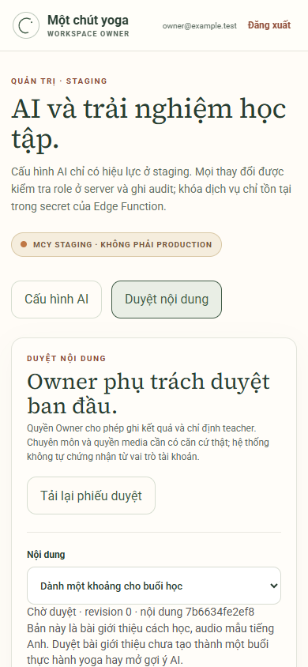
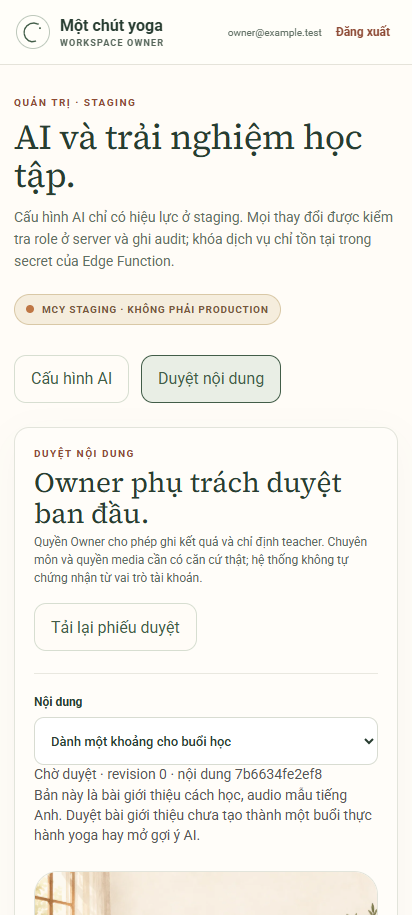

# MCY — Owner duyệt nội dung và giao teacher, 10/10/2026

Đây là checkpoint local lịch sử. [Nghiệm thu staging 11/10](MCY_CONTENT_REVIEW_STAGING_ACCEPTANCE_2026-10-11.md) thay thế trạng thái chưa deploy và hash migration cũ cho scope Owner/content-review; receipt 10/10 vẫn được giữ nguyên làm chứng cứ bản trước. AI và catalog buổi tập vẫn chưa mở.

Owner đã chọn **Owner phụ trách duyệt ban đầu**, sau này có thể chỉ định teacher hoặc cấp quyền qua hệ thống. Lượt này hoàn thiện candidate local: màn hình Owner/teacher, API xác minh tài khoản, database lưu phiếu đúng phiên bản và lịch sử thao tác. **Chưa áp dụng Supabase, deploy Edge/Vercel, bật AI hoặc duyệt bài thực hành thật.**

Quyết định này thay thế việc chờ chỉ định người phụ trách trong báo cáo trước; không tự xác nhận chuyên môn yoga hay quyền media. [Receipt mới](MCY_CONTENT_REVIEW_IMPLEMENTATION_EVIDENCE_2026-10-10.json) ghi source/build hiện tại. Receipt luồng AI trước đó giữ nguyên như bằng chứng của bản trước.

## Hành vi local

Owner mở `/?workspace=owner` → **Duyệt nội dung**. Phiếu hiển thị trạng thái, phiên bản và revision; có reader hình/text/audio, các trường chuyên môn/phạm vi, nhận xét, quyền media và checklist. Không đánh dấu sẵn tiêu chí, không chọn sẵn kết quả được duyệt. Có thể yêu cầu chỉnh sửa, duyệt phiên bản hoặc rút kết quả.

Quyền này dựa vào **Owner global đang hiệu lực và email đã xác minh**. Không hardcode email, cấp role mới hoặc kéo dài expiry. Staging có hai role Owner đã xác minh; số đếm này không xác định ai sẽ ghi phiếu.

Owner có thể chọn teacher có role global, profile active và email đã xác minh để giao **một phiên bản** trong 1–30 ngày, hoặc thu hồi. Teacher mở `/?workspace=teacher` → **Duyệt nội dung được giao**; máy chủ chỉ trả phiếu được giao còn hiệu lực. Teacher không được chỉ định người khác, xuất bản hoặc xem dữ liệu học viên. Owner+teacher không nằm trong roster teacher vì đã có quyền Owner mặc định. Job hệ thống tự cấp quyền chưa được triển khai; sau này cần danh tính dịch vụ, căn cứ cấp quyền và audit riêng.

Thay đổi assignment đưa phiếu về chờ duyệt. Text, metadata hoặc media thay đổi cần hash mới; assignment/approval cũ không áp dụng. Quyền teacher còn phụ thuộc role/profile hiện tại, không được kéo dài bởi assignment. Vai trò và thời gian thực được kiểm lại sau khi chờ khóa; tài khoản chỉ còn teacher không giữ quyền Owner.

Lưu thành công ghi actor, thời điểm, căn cứ, kết quả và phiên bản. Giới hạn 20 thao tác mới/actor/24 giờ; rút kết quả hoặc thu hồi thật vẫn được phép khi đạt giới hạn. No-op lặp không tạo event/row. UI gửi một lần, giữ token tài khoản khởi tạo, khóa lưu khi kết quả chưa rõ hoặc conflict và yêu cầu tải lại. Mất quyền sẽ ẩn phiếu; kết quả muộn không cập nhật tài khoản mới.

## Nội dung và quyền xuất bản

Candidate duy nhất là `preparation-draft`, hash `e73a93ffb990887f22a2bd25a72b87ba29e8761eec86bbb9729c2d4328ee7f2b`: text Việt, hình không người/tư thế, audio mẫu tổng hợp tiếng Anh. Đây chưa là buổi tập yoga. Duyệt `learning_intro` không tạo session, completion hoặc recommendation. Duyệt `practice_session` yêu cầu đủ tám tiêu chí, gồm audio Việt và thời lượng thực hành đã đo.

Bài giới thiệu vốn công khai tại `/?workspace=content-review`, text/assets có trong build. **Không nhập private teacher drafts vào registry/build này.** Review bài riêng tư sau này cần API đọc nội dung phân quyền, media private và retention riêng. API bảo vệ phiếu không biến assets công khai thành private.

Catalog vẫn **0 bài**. Phiếu database và record phát hành catalog là hai bằng chứng riêng; chưa có API publish hoặc tự chuyển `approved` sang catalog. Trước khi phát hành phải kiểm chuyên môn/quyền thật, toàn bộ sequence/adaptation/stop cues và đúng bytes/version. Agent không điền phê duyệt giả để làm build xanh.

## Database và trạng thái staging

Migration CLI-named `20261010113419_owner_content_review.sql`, SHA256 `ff225000c9bd3175462b17c58a8059486ba9bc49374311736a32cd55abefa8c3`, thêm ba bảng private và ba RPC service-only. RLS bật, không có client/service table privilege hoặc private USAGE. RPC `SECURITY DEFINER`, search_path rỗng, actor/role/profile/assignment checks và revision conflict `PT409`. Route mới nằm sau Auth của Owner function; không gọi provider/lưu AI config.

CLI2.119.0 `migration list --project-ref mhumbczqrzutdnraafhs` xác nhận **19 shared/aligned, 0 remote-only, 6 pending**. Lần đầu thiếu ref báo chưa link; sau đó dùng ref tường minh, không link/reset/push. Các candidate còn chờ: check-in, teacher RPC, consent cap, teacher collaboration, admission read và content review. Không gom thành một rollout.

Readback mới: MCY vẫn staging trong MagicpenDigital; AI off/version1/model unset; Owner MD5 `5ad67fe52caf79bd07c51caa0c30db92` không đổi. Admission/check-in/content-review RPC absent, **0 active teacher profiles**. Chỉ Owner Edge v4 deployed ở readback đầu lượt. Không đọc key/token/flag values; không suy ra inference readiness từ secret names.

## Kiểm chứng và triển khai tiếp

- PGlite PostgreSQL17, 18 baseline migrations + Owner repair + duy nhất candidate mới: **9/9 PASS**; effective ACL/EXECUTE/TRUNCATE, giữ grants/RLS/Owner MD5, actors/expiry/revoke, version conflict/checklist/quota/no-op và post-lock role downgrade.
- Một probe rollback-only đổi role fixture ngay sau helper khóa thật; đây là kiểm boundary, **không phải** contention nhiều session/HTTP Supabase.
- Selected backend/API/isolation **52/52 PASS**, provider/safety/scanner offline riêng **23/23 PASS**; không provider call thật.
- UI Owner/teacher mới **9/9 PASS** trước nghiệm thu toàn bộ. Build/runtime28, catalog0+draft1, scanner21, Sites4 PASS. Kết quả UI toàn bộ sau cùng ghi ở receipt.
- [Review độc lập](MCY_CONTENT_REVIEW_TECHNICAL_REVIEW_2026-10-10.md): không còn P1/P2 local; reviewer chạy lại PGlite9 và Owner/handler/catalog20. Không là duyệt chuyên môn/quyền media hoặc clearance cloud.

Docker Engine không có pipe/tiến trình; dịch vụ `com.docker.service` Stopped. Windows từ chối Start-Service vì phiên không mở được quyền điều khiển dịch vụ. Đã yêu cầu Owner mở Docker Desktop bằng Run as administrator. Không reset Docker/WSL, sửa ACL, nâng cấp hoặc tạo database trả phí.

[mcy-change-review/SKILL.md](../skills/mcy-change-review/SKILL.md) yêu cầu: “If a required gate fails, fix the cause or stop that release scope”. Exact-stack/HTTP/concurrency còn chưa chạy nên chưa áp dụng staging. Việc phân công Owner đã quyết định, không cần hỏi lại ai phụ trách. Còn cần verified actor sessions, privacy/retention của review records, readback ACL/schema và exact artifact/target packet theo [release runbook](../docs/release/RELEASE_RUNBOOK.md).

Khi Docker sẵn sàng: rehearsal candidate riêng trên schema-only fresh, kiểm save/assign/revoke cạnh tranh và expiry trong lúc chờ, đối chiếu actor roles/sessions, chuẩn bị rollout chọn lọc rồi deploy API/frontend tương thích và kiểm phiếu thật. Chỉ mở AI cho cohort đã chọn sau khi có buổi tập hoàn chỉnh đã duyệt và consent/provider/quota/kill-switch evidence.

Đường dừng: revert API/frontend tương thích, không xóa audit/bảng hoặc restore đè dữ liệu mới. Giữ AI/cohort đóng. Positive live Owner AI-off save từng bị automatic review từ chối không được chạy lại theo yêu cầu chung này. Không có Production/native release, migration/Edge/Vercel deploy, flag/config save, inference, role grant hay expiry extension trong lượt này.

