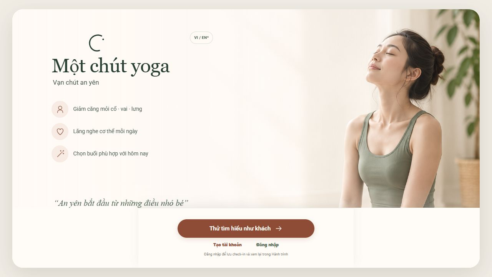
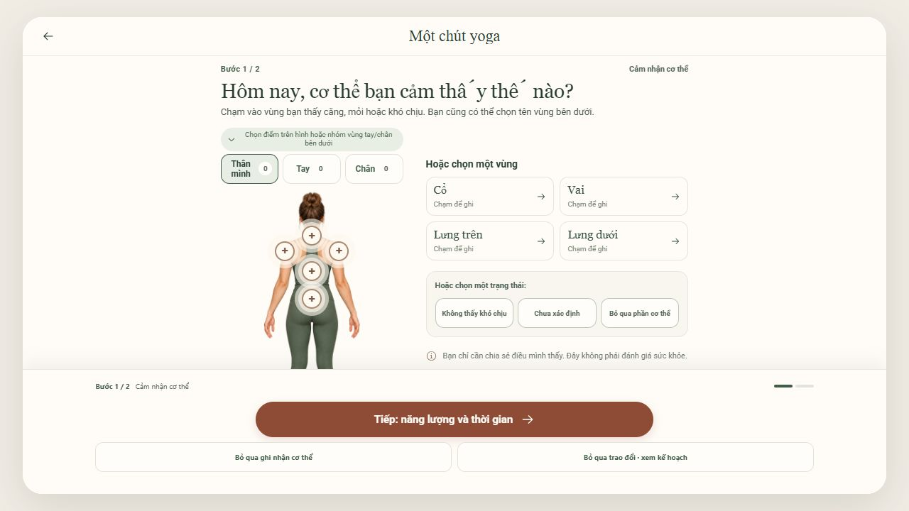
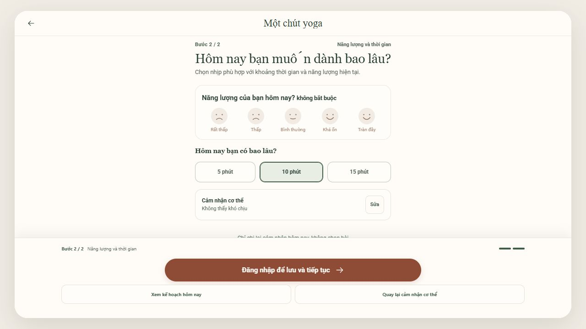
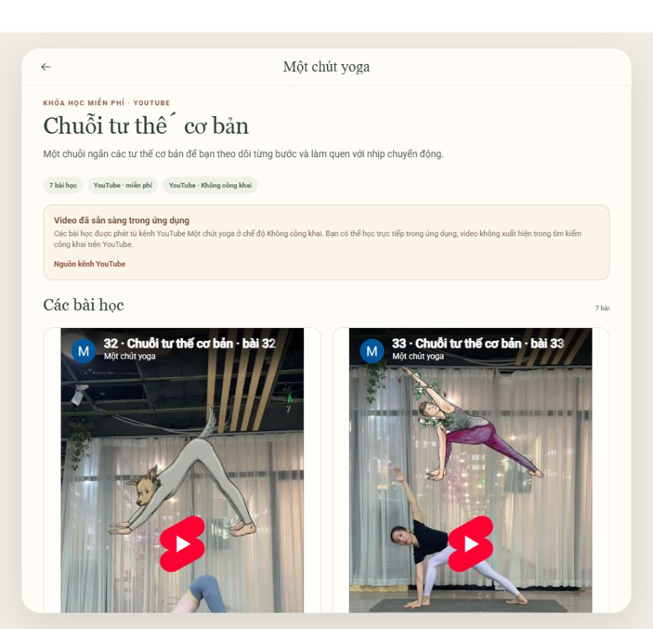
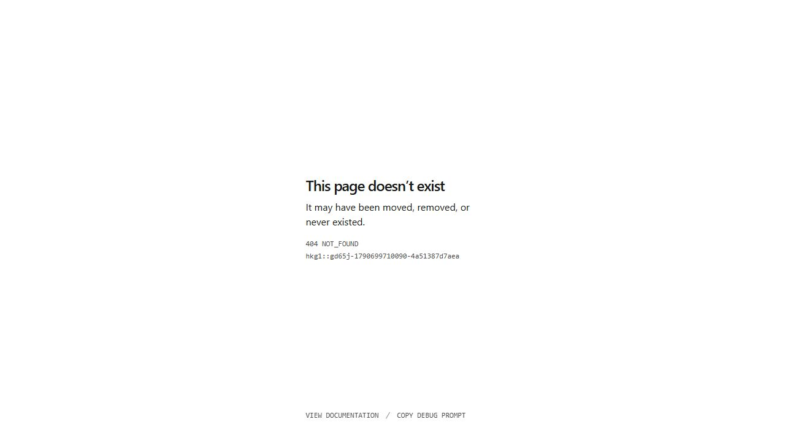
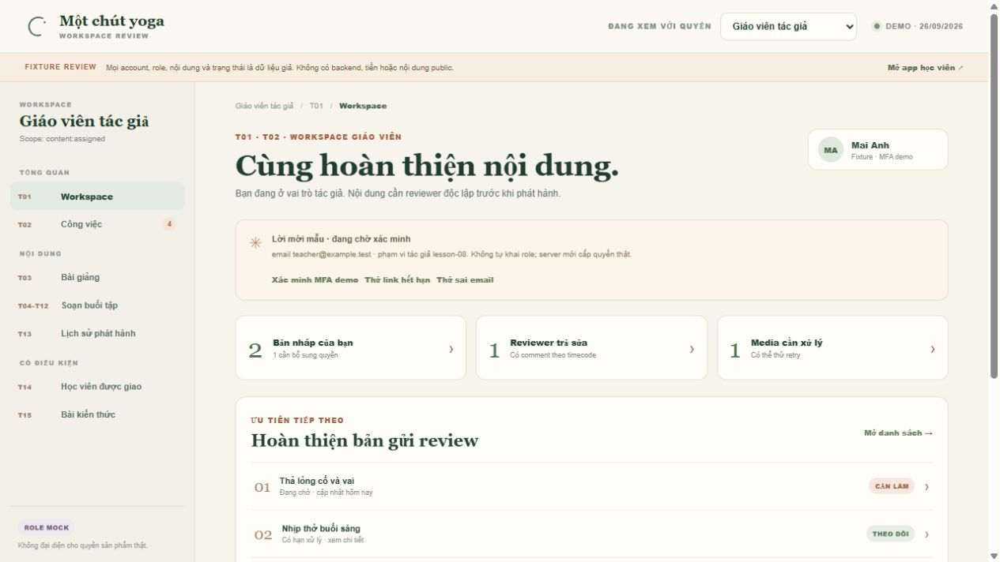
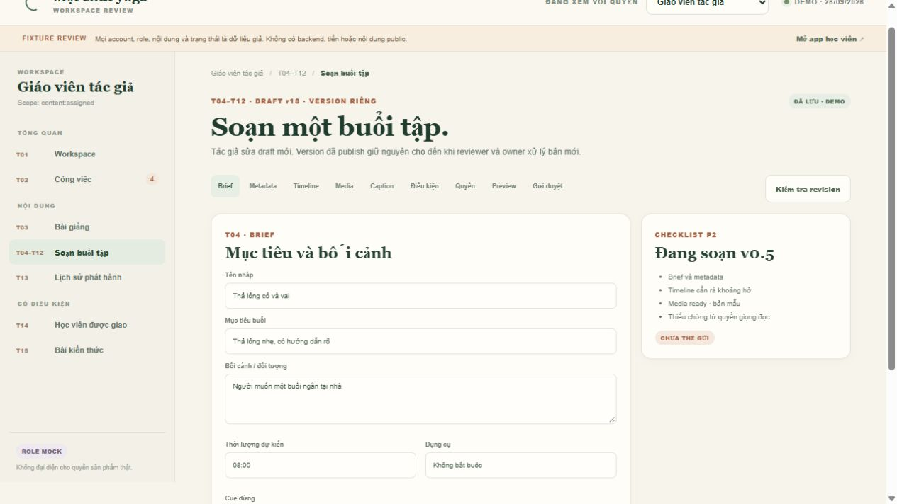

# MCY — audit sẵn sàng MVP đầu tiên

**Ngày:** 29/09/2026 (Asia/Bangkok) · **Mã nguồn:** `d3b2f06` trên `codex-mcy-p1-preview`, cộng các tài liệu chưa commit được giữ nguyên.  
**Phạm vi:** learner web/native code, thiết kế khóa miễn phí, staff fixture, schema/API, kiểm thử, build và ảnh chụp web. Đây là audit theo rủi ro và luồng chính, **không phải** khẳng định đã đọc từng dòng, kiểm mọi video, mọi thiết bị hoặc chứng nhận production.

## Kết luận điều hành

**Chưa đạt tiêu chuẩn phát hành production cho 100 người dùng hoặc mời giảng viên vào vận hành thật.** Bản learner có nền thương hiệu và một phần backend Supabase thật, nhưng luồng thực hành chính vẫn dùng buổi mẫu; catalog YouTube dùng video thật song chưa thành bài học có cấu trúc, có hai ID gắn nhầm, chưa ghi tác giả và chưa qua gate nội dung/quyền. Staff workspace chỉ là fixture local; Preview `/staff.html` trả 404. Không có bằng chứng cho phép biến một trong hai thành vận hành thật bằng cách bỏ chữ “demo”.

### Câu hỏi 1 — khác form là chủ ý hay lệch hướng?

**Cả hai, ở hai tầng khác nhau.** Video ghi sẵn và buổi hướng dẫn bằng timer cần player/điều khiển khác nhau; đây là khác biệt hợp lý. Nhưng bản thiết kế đã duyệt yêu cầu **cùng anatomy bài học** cho dọc/ngang: mục tiêu, giảng viên, thời lượng thực, lưu ý an toàn, nội dung từng bước, trạng thái xem/tập và nguồn. `analyse/MCY_IMPLEMENTATION_PLAN_2026-09-27.md` mốc 5 và `analyse/MCY_CONTENT_ARCHITECTURE_2026-09-25.md` còn định nghĩa khóa tham chiếu phiên bản bài/buổi, không nhân bản media. Hiện `CourseDetailScreen` xếp 7–18 iframe trên một trang; `PracticeScreen` là ba hình + timer tách biệt. Không có `LessonScreen` chung hay tiến độ thật. Đây là **giải pháp tích hợp nội dung tạm thời đã đi lệch thiết kế bài học dài hạn**, không phải một design decision đã chốt để scale.

Không nên ép Shorts 18–64 giây vào UX timer 5–12 phút. Đề xuất một `LessonShell`/contract chung và hai biến thể `VideoLesson`/`GuidedPractice`, cùng metadata và gate, nhưng giữ điều khiển media phù hợp nguồn. Giảng viên cần xác nhận 38 clip là 38 bài độc lập, các segment hay một số buổi ghép trước khi gọi ba nhóm hiện tại là “khóa học” hoàn chỉnh.

### Câu hỏi 2 — design system và khả năng scale

**Có nền, chưa thống nhất ở mức sản phẩm production.** `design-system/tokens.css`, `DESIGN_SYSTEM.md` và runtime `FlowStack`, `MobileScroll`, `Carousel`, `BottomSheet` tạo bộ quy tắc và primitive dùng lại. Learner cũng có `Header`, `Action`, `Choice`, `BodyMap`. Tuy nhiên app-owned UI nằm phần lớn trong `src/Prototype.tsx` (1.672 dòng), CSS trong `src/prototype.css` (991 dòng), staff fixture trong `src/staff/main.tsx` (171 dòng nén nhiều màn thành các dòng rất dài) với style riêng; không có shared lesson/course components hay catalog contract. CSS còn 376 mã màu hex trực tiếp so với 113 tham chiếu `--mcy-*` (chỉ là chỉ dấu, không đồng nghĩa 376 lỗi). `mcy-page h1` ở đầu stylesheet ưu tiên Times New Roman rồi được override theo token ở đoạn sau: specificity/cascade chưa sạch. Metadata khóa/bài chỉ 9–11 px, dưới cỡ body 14–16 px của design system; điều quan trọng như nguồn và trạng thái lại quá nhỏ.

**Scale hiện tại sẽ tăng chi phí bảo trì và tải app, nhưng không phải vì 38 video được lưu vào APK.** Video YouTube được stream, không nằm trong bundle. Tuy nhiên mọi metadata nằm trong main JS; trang khóa tạo tới 18 iframe (dù `loading="lazy"`), cộng nhiều ảnh không khai báo lazy loading. Build hiện PASS nhưng Vite cảnh báo main chunk **842,02 KB minified / 248,02 KB gzip**; `dist/client/assets` khoảng **17,23 MB**, gồm nhiều hình body-map cũ/khác biến thể được copy vào gói static/native. Đây là kích thước phân phối, không phải bằng chứng tất cả ảnh cùng tải hoặc mức RAM thực tế. Khi tăng hàng trăm bài/khóa, hardcode dữ liệu trong JS và nhiều player cùng DOM sẽ nặng hơn; mobile WebView đời thấp cần đo riêng. Cần tách metadata khỏi app shell, mount **một player đang xem**, code-split và dọn/định dạng asset sau kiểm tham chiếu. Chưa có đo LCP/INP, RAM, khởi động APK hay mạng yếu nên không tuyên bố mức ảnh hưởng định lượng lên thiết bị.

### Câu hỏi 3 — giảng viên Huyền My

Người sở hữu xác nhận **Huyền My là giảng viên của 38 video miễn phí hiện có**. Đây là dữ kiện attribution; hiện `CourseLesson`/`FreeCourse` không có trường instructor, giao diện chỉ ghi kênh Một chút yoga, và staff fixture hiển thị “Mai Anh”/“Minh Anh” giả lập. Không tạo role/profile hoặc đổi tên fixture thành hồ sơ thật. Cần xác nhận tên hiển thị công khai, phạm vi quyền dùng 38 clip và thành phần bên thứ ba; lưu `instructor_id`/credit trong phiên bản nội dung, hiện giảng viên ở khóa **và** bài, sau đó mời Huyền My qua owner-controlled invite khi CMS, quyền và actor tests đạt gate.

## Sổ lỗi và rủi ro có chứng cứ

`P0` chặn release/teacher invite; `P1` cần sửa trước beta 100 người; `P2` polish hoặc độ tin cậy. `CHƯA CHẠY` không được suy diễn thành PASS.

| ID | Mức | Phát hiện và bằng chứng | Hướng xử lý / gate |
|---|---|---|---|
| C01 | P0 · PASS (mapping/access metadata subgate, 30/09; spot-check 01/10) | The original 19/21 mismatch was corrected. Current `src/courses/freeCourses.ts` maps lesson 19 to `McOZ1FW5jBM` (“Quỳ gối ngả sau”, 0:24) and lesson 21 to `KtMlgK2cjsU` (“Rắn hổ mang”, 0:49); both were spot-checked against their current public watch pages on 01/10. The read-only 38/38 reconciliation is recorded in `MCY_FREE_CONTENT_RELEASE_GATE_2026-09-29.md`, and sampled E2E covers both IDs. The earlier Studio-row limitation is no longer a blocker for this metadata subgate. | Keep the mapping regression and recheck provider state before release. This PASS does not close iframe/device playback, rights, captions, posters, instructor attribution or instructional/safety review; see C03 and the content release gate. |
| C02 | P0 · PASS (đã loại bỏ buổi tập/timer giả, 30/09; regression thêm 01/10) | Luồng học hiện hành không còn `SESSIONS`, `PracticeScreen`, timeline/timer dựng sẵn hay CTA hoàn thành giả. Người học tự chọn video thật trong app; giao diện nêu rõ hệ thống không xác minh xem hết video và chỉ ghi reflection khi người học tự xác nhận đã thực hành. Thời lượng ở check-in là mong muốn của người học, không phải cam kết thời lượng buổi. E2E xác nhận không render component buổi tập/timer cũ và copy completion trung thực. | Giữ giới hạn này cho tới khi phiên bản nội dung có timeline/thời lượng được duyệt và trạng thái run đáng tin cậy. Nội dung 38 clip vẫn chịu các gate riêng C03/C08. |
| C03 | P0 · BLOCKED | 38 clip chưa có đủ quyền/đồng ý của giảng viên và các thành phần, caption, poster, review chuyên môn/safety; YouTube “Không công khai” chỉ là trạng thái phân phối. Một số title thuộc tư thế khó trong nhóm “Làm quen”, cần giảng viên duyệt đối tượng/thứ tự; chưa kết luận nội dung từng clip nguy hiểm khi chưa xem. | Checklist từng asset, quyền/hình/nhạc, kiểm xem 38/38, caption và pedagogic sequence, reviewer độc lập, publish decision. |
| C04 | P0 · FAIL | Bằng chứng “staff role picker” và `src/staff/main.tsx` đã lỗi thời: hiện file này bị gỡ, thay bởi `src/staff/owner.tsx`; pilot vẫn ghi rõ đang khóa. Ngày 01/10 đã deploy staging-only `owner-control-plane` (`verify_jwt=true`) chỉ để Owner đọc/lưu cấu hình AI; đây không phải teacher API. Staging vẫn chưa có teacher invite/activation, role assignment, draft/private-media workflow, independent review/publish boundary hoặc authenticated teacher actor proof. Preview hiện trả 403 theo lần kiểm tra 01/10; function deploy không đổi Preview. | Cập nhật owner-controlled invite → teacher assignment → private draft/media quarantine → review độc lập → publish/withdraw; chỉ mời giáo viên sau khi server boundary, actor tests, reviewer, rights/retention, media policy, quota và email delivery gate đều đạt. Giữ khu vực pilot khóa. |
| C05 | P0 · BLOCKED | Điều khoản/quyền riêng tư vẫn `terms-review-0.1`/`privacy-review-0.1`; support/data-request chưa có kênh xử lý thật. Hệ thống có dữ liệu check-in cơ thể nên bản production cần chính sách, vận hành hỗ trợ/xóa/xuất rõ. | Biên tập và phê duyệt chính sách, version/locale evidence; quy trình support và privacy requests trước 100 users. |
| C06 | P0 · BLOCKED (Owner giữ AI OFF, 01/10) | Source có Edge Function inference (`supabase/functions/mcy-ai-assistant/index.ts`), nhưng live staging chỉ có `owner-control-plane` dành cho đọc/lưu cấu hình; `mcy-ai-assistant` chưa deploy. Live DB readback xác nhận AI `enabled=false`, model chưa chọn, version 1. Owner đã hoãn spend ceiling/reset và yêu cầu giữ AI tắt. Cả đọc model catalog lẫn inference tiếp tục fail-closed theo staging URL, `MCY_AI_ENABLE_STAGING`, Gateway secret và `MCY_AI_SPEND_CONTROL_APPROVED`; chưa có phê duyệt chi phí/provider budget. Unit coverage fail-closed PASS, nhưng không thay cho actor/HTTP/provider-budget evidence. Luồng learner hiện hành dẫn tới người học tự duyệt video; màn readiness/dialogue còn trong source nhưng không thuộc đường đi chính. | Không quảng bá AI hoặc mở dialogue cho learner khi chưa có server-backed availability và toàn bộ consent/privacy/safety/abuse/cost gates. Chỉ tiếp tục sau khi Owner cung cấp mức chi/reset, provider budget được xác minh server-side, secret/flag được cấu hình có phê duyệt, actor tests và staging inference được kiểm chứng; giữ đường fallback tự chọn bài. |
| C07 | P1 · PARTIAL / ANDROID SAMPLE PLAYBACK PASS (01/10) | Catalog chỉ mount một iframe sau thao tác Play; có trạng thái đang tải, thông báo khung đã mở (không khẳng định playback), timeout 12 giây khi frame chưa phản hồi và tự mở trợ giúp; người học luôn có thể mở trợ giúp thủ công, tải lại trong app hoặc sang video gốc. Edge E2E PASS 2/2 cho retry/fallback và timeout. E2E chứng minh `iframe load` vẫn có thể xảy ra khi request bị abort, nên không dùng sự kiện này để xác nhận video phát hoặc tải media thành công. Trên Air1 Ultra thật (Android API 33, WebView Chrome 154), bài 01 `yKm7aOAWn-k` từng phát/pause thành công; chỉ là một video/phiên/kết nối, không chứng minh 38/38, mạng yếu, resume/error recovery thực hoặc iOS. Player không thể nhận diện đáng tin lỗi playback bên trong cross-origin iframe. | Giữ một player active và thông báo trung thực; duy trì recovery thủ công. Tiếp tục kiểm mạng yếu/resume/device, từng video và iOS; không suy completion hay playback từ iframe load/thời gian. |
| C08 | P1 · FAIL | `CourseLesson` có metadata `channelCaptionLanguages` theo từng bài và UI đã công khai tình trạng chưa có track tiếng Việt; YouTube Studio ngày 01/10 vẫn hiển thị 0 ngôn ngữ phụ đề cho cả 38 video. Hồ sơ vẫn thiếu instructor account binding, mục tiêu/dụng cụ/lưu ý riêng; “Chuỗi tư thế cơ bản · bài 32–38” còn là nhãn chỉ mục. | Giảng viên/reviewer hoàn tất metadata ngôn ngữ âm thanh, phụ đề đã duyệt, contributor, objective, equipment, cautions, rights/version và title/order từng ID. |
| C09 | P1 · PARTIAL / RELEASE FAIL | Check-in có API sync theo consent; run/reflection chưa có API lưu bền và phản hồi chỉ nằm trong state của phiên. Ngày 01/10, UI bỏ `syncStatus` `saved/failed` không có luồng tương ứng; nút, ghi chú và màn kết quả nói rõ phản hồi chưa đồng bộ vào tài khoản, chỉ được giữ tạm trong phiên. Consent `wellbeing_data` hiện hành cho phép lưu check-in/body/energy và nêu rõ reflection sau buổi tập vẫn ở trong session; đây không phải căn cứ consent để lưu bền run/reflection. Khi chưa consent, reflection không vào Journey/memory; khi đã consent, Journey chỉ hiện bản ghi cục bộ trong phiên hiện tại. | Giữ phản hồi/session ở trạng thái session-only cho tới khi có mục đích và consent riêng đã được duyệt, owner-scoped API, consent enforcement phía server, actor/cross-user/revocation tests, retry/idempotency và đọc lại sau đăng nhập. Không giới thiệu Journey như lịch sử phản hồi bền trước các gate đó. |
| C10 | P1 · RELEASE FAIL / ACTOR CHƯA CHẠY (01/10) | Migration hẹp `20261001043554_restrict_staging_public_client_table_acls.sql` được Owner duyệt và áp dụng staging. Xác minh lại 46 bảng: 0 `anon`/`authenticated` TRUNCATE; 18 bảng RLS không policy đã bị thu hồi mọi quyền client; 10 bảng SELECT-policy chỉ còn SELECT. `profiles` giữ own-row SELECT/INSERT/UPDATE; learner tables/RPC, `service_role`, policies và default ACL không đổi. `npm run test:public-acl-scope` 56/56 PASS; teacher ACL, asset-rights ACL, plan-item ACL smoke PASS, không thay dữ liệu. `test:teacher-actors` vẫn **CHƯA CHẠY** vì thiếu 5 disposable distinct actor tokens; profile/consent/Owner/teacher authenticated end-to-end chưa được chứng minh. Default ACL của postgres/supabase_admin vẫn rộng; migration schema-wide/default privilege trước đây bị review từ chối và chưa được duyệt. Security advisor có 40 RLS/no-policy INFO, 5 authenticated SECURITY DEFINER learner RPC WARN đã xác minh owner postgres/`search_path=''`/anon denied, và Auth leaked-password protection WARN. Chi tiết, danh sách bảng và bằng chứng ở `analyse/MCY_STAGING_ACL_ALLOWLIST_2026-09-30.md`. Sau snapshot ACL này, chỉ Owner `owner-control-plane` được deploy staging (C04); actor suite/teacher APIs vẫn chưa đạt. | Cần role-verified disposable actors, positive/negative auth tests và clean migration replay. Bản duyệt chỉ áp dụng đúng migration hẹp staging; mọi thay đổi default/schema-wide cần đề xuất/duyệt riêng và compatibility plan. Không invite teacher, bật/deploy AI inference hoặc release. |
| C11 | P1 · GIẢM THIỂU 01/10, CÒN MỞ | Trước sửa, FlowStack giữ scene trước trong DOM không `inert`/`aria-hidden`; AX tree và Tab/Shift+Tab đưa người dùng về phần tử của danh mục khi đang ở chi tiết khóa. Đã thêm boundary app-owned trong `src/Prototype.tsx`, focus heading khi push/pop, và focus ring trong `src/prototype.css`; regression Edge 1/1 PASS. Bằng chứng/screenshot: `analyse/ux-audit-2026-10-01/`. | Còn phải kiểm screen reader thực, Safari/iOS, TalkBack/Android, zoom/dynamic text và contrast toàn bộ; không tuyên bố WCAG sign-off. Không sửa protected runtime. |
| C12 | P1 · PASS (VI-ONLY RELEASE LOCALE, 01/10) / localization content moved to C08 | Production build khóa giao diện tiếng Việt; English preview và selector ở welcome/profile chỉ có trong development. Giá trị `profiles.locale=en-US` không kích hoạt UI một phần trong production; người dùng cũng không thể ghi lựa chọn English chưa hoàn thiện từ bản phát hành. EN vẫn là preview nội bộ, chưa được biên tập/test đầy đủ. Caption/audio metadata của 38 video tiếp tục là gate C08. | Giữ cổng build VI-only cho beta đầu tiên. Chỉ đưa EN vào release sau khi dịch/biên tập đủ mọi màn, nội dung video có language metadata/caption phù hợp và E2E/accessibility review toàn luồng; không cần migration locale mới. |
| C13 | P1 · PARTIAL / DEVICE FLOW CHƯA ĐẠT | APK debug **đã cài trước đó** song song trên Air1 Ultra (`com.nilaza.motchutyoga.debug`); app production và dữ liệu giữ nguyên. WebView khởi chạy; bài YouTube đầu tiên đã phát thật trong app và pause được ở phiên kiểm tra trước (C07). APK ngày 01/10 (6,601,298 B; SHA-256 `1FBFB1E801AC1257DDF8ECFA9C14C52B714801F56EDD2F7BA47BCF1E2027DB2A`) không còn là artifact mới nhất. Ngày 02/10 thiết bị `Q88549EEXCUOONGA` online, nhưng bundle web debug mới chưa hoàn tất Capacitor sync: Windows trả `EPERM` khi ghi/xóa native assets và Gradle cache. Gradle với project cache tạm dừng vì generated `android/capacitor-cordova-android-plugins/cordova.variables.gradle` chưa được sinh. APK cũ (6,601,395 B; SHA-256 `A05D0EEADB4EC4556ABF1A1CAF5AF42F4DABE77593433521CF8E09C02D96F8E5`) **không được cài lại**; do đó thay đổi route Discover chưa có trên Android. Không gỡ/cập nhật app production. `npm run ios:sync` PASS ở lần kiểm tra trước; callback Auth/native account, keyboard, lỗi/mạng yếu, toàn bộ 38 video, Xcode build/Simulator, Safari/iPhone thật vẫn chưa xác minh. | Khôi phục quyền ghi/khóa file cho Capacitor/Gradle trong môi trường workspace, chạy lại debug build từ đầu và chỉ cài sau khi metadata chứng minh package `.debug`; xác minh WebView trên Air1 Ultra. Tiếp tục test guest/auth/consent, video, recovery/mạng yếu và keyboard. Chạy Xcode build/simulator trên macOS, rồi kiểm Safari/iPhone khi có thiết bị. Không gỡ app production; mọi release vẫn cần signing và review riêng. |
| C14 | P1 · PARTIAL / CÒN MỞ | 01/10 đã tăng phần mô tả/metadata/note khóa học lên token `--text-body` (14px), nhãn lên `--text-caption` (11px), đổi pill sang forest đậm và đo contrast các text course/catalog đã kiểm tra: 5.09:1–6.44:1. Playwright xác nhận không tràn ngang ở 320/390px; desktop 1440px vẫn giữ media cạnh mô tả. | Còn cần rà typography/contrast toàn app và cỡ chữ phóng to/dynamic type, landscape course detail, screen reader và iOS/Android thật. Không tuyên bố WCAG 2.2 AA sign-off chỉ từ các component khóa học đã đo. |
| C15 | P1 · PARTIAL / CÒN MỞ (02/10) | Đã archive ảnh/QA và cung cấp 10 responsive WebP; `public/` giảm 89.6%, không chứa QA/PNG cũ. Sau nâng Vite 8.3.1, chuyển Capacitor CLI sang devDependencies, lazy-load Supabase JS, Owner workspace, khóa học/player và catalog Khám phá. Production build mới: learner entry **615.07 kB raw / 189.63 kB gzip**, Supabase chunk **213.60/54.82 kB**, Owner **15.10/4.96 kB**, Discover **3.70/1.60 kB**, CourseDetail **8.03/2.85 kB**, metadata khóa học **3.30/1.61 kB**. E2E xác nhận Discover/CourseDetail không được request trước route; Microsoft Edge runtime **43/43 PASS**; production learner smoke/chunk deferral nằm trong suite. Welcome preload trước đó: Edge local 390×844, cold browser, CPU 4× và mạng giả lập 150 ms/1.6 Mbps, 3 lần đo; median LCP 3.040 s trước → 2.768 s sau (~9%), không phải đo ngoài đời. Dependency audit trước đó PASS 0 production vulnerabilities; full tree còn 3 moderate dev-only qua `@capacitor/cli → xcode → uuid@7.0.3`, chi tiết tại continuation. `check:runtime` **28/28**, Sites **4/4**, AI Gateway **8/8**, Owner control-plane **9/9**, bundle-secret scan **10 text files**. Vite vẫn cảnh báo entry learner >500 kB; chưa có performance budget hay CWV thật. | Còn chia module nơi lợi ích đo được, đặt performance budget và đo LCP/INP/RAM/startup/mạng yếu trên browser/thiết bị thật; đánh giá route Owner nơi welcome preload có thể không hữu ích. APK cần build lại sau thay đổi mới; thiết bị hiện online nhưng build Android còn vướng Capacitor/Gradle `EPERM` và file generated bị thiếu. Hosted Preview/Production chưa deploy; không nhận C15 là hoàn tất hay production sign-off. |
| C16 | P2 · ĐÃ GIẢM THIỂU TRÊN WEB / CÒN GATE THIẾT BỊ (01/10) | Screenshot mới, chụp sau khi animation ổn định ở 1440×1000, cho thấy canvas desktop tập trung; catalog ba khóa gọn; chi tiết khóa học dùng player + mô tả + danh sách hai cột, metadata/caption/source và CTA rõ. Check-in desktop giữ footer/action trong app; mobile 320×568 giữ CTA cố định và map/list cuộn. Bước 2 nay có cue khi thật sự còn nội dung phía dưới; cue tự ẩn sau khi cuộn tới cuối/viewport đủ cao, tương phản đo được 6.15:1 ở 10px. Full E2E 38/38 PASS và test cue/contrast targeted 1/1 PASS. | Phát hiện poster-grid/metadata nhỏ trong audit 29/09 đã lỗi thời. Còn kiểm font/diacritics, contrast/focus toàn app, zoom và assistive tech trên trình duyệt/thiết bị thật; cue nhỏ 10px cần đánh giá với người dùng/zoom; screenshot không chứng minh WCAG. Giữ disclosure chưa có instructor attribution tới khi role/quyền nội dung được xác minh. |
| C17 | P2 · COPY — ĐÃ SỬA 30/09 | Trước sửa, trang quyền nội dung nói “Chưa có khóa học hoặc giao dịch” trong khi danh mục có ba khóa miễn phí, gộp quyền học miễn phí với giao dịch trả phí. | Đã tách rõ khóa miễn phí đang xem được khỏi thực tế hiện chưa có khóa học trả phí/giao dịch trong ứng dụng; tránh nói như thể đã tra cứu lịch sử mua hàng của từng tài khoản. Playwright xác nhận danh mục 3 khóa và trạng thái không trả phí. |
| C18 | P2 · COPY/SETTING — ĐÃ SỬA 30/09 | Hồ sơ từng hiển thị chip múi giờ `Asia/Bangkok` cố định, không có luồng đổi/lưu thật. | Đã bỏ chip giả; hiển thị múi giờ trình duyệt/thiết bị thực tế dạng chỉ đọc, không tuyên bố lưu vào profile. Playwright đối chiếu trực tiếp với `Intl.DateTimeFormat().resolvedOptions().timeZone` và cỡ chữ 14 px. |
| C19 | P2 · TEST GAP | `quality.yml` khai báo audit/build/runtime/secret/AI/Owner/Sites suites; local relevant suites pass. Có contract/mapping và player-state coverage cho khóa học, nhưng chưa có visual regression hoặc performance budget, và staff/API actor E2E còn thiếu. GitHub commit-status API tại SHA `d3b2f060` chỉ có Vercel success cũ ngày 29/09; rulesets API trả 403 do private/free-plan restriction, branch-protection API trả 403 vì integration thiếu quyền. Worktree hiện dirty nên chưa có bằng chứng CI cho thay đổi hiện hành. | Cần xác nhận GitHub Actions run của đúng commit/PR và required checks/reviewer rule qua Owner/GitHub UI hoặc cấp quyền read phù hợp; không suy từ file workflow hay status Vercel. Bổ sung visual/performance budgets và staff/API actor suites. |
| C20 | P2 · PARTIAL / RELEASE GATE OPEN (01/10) | Notice VI/EN trước player mô tả YouTube và tải trình phát khi người học bấm Phát; có link Google Privacy Policy. E2E xác nhận không có request embed trước thao tác. Android thật xác nhận người kiểm thử thấy notice rồi bấm Phát; video 01 sau đó tải/phát qua WebView và luồng Google video, không có lỗi. | Disclosure không thay privacy policy MCY hay consent/legal review. Policy/data-request còn mở; chưa audit các request/header theo provider requirements, iOS WebView, toàn bộ 38 video hoặc analytics/privacy implications. YouTube-nocookie không có nghĩa là “không cookie”; chưa có release sign-off. |
| C21 | P1 · UX RỦI RO — ĐÃ SỬA 30/09 | Trước sửa, check-in bước 2 đặt đăng nhập làm CTA chính dù AI inference tắt; nút phụ “kế hoạch” thực ra xóa check-in rồi mở thư viện. | CTA chính nay mở thư viện miễn phí cho cả khách và tài khoản; nội dung nói rõ chưa có gợi ý tự động; lựa chọn check-in chỉ ở phiên và được giữ khi quay lại. Tài khoản là tùy chọn, consent lưu vẫn tách riêng. E2E xác nhận không gọi AI và vẫn vào được bằng khách; tác động funnel vẫn cần usability/marketing data. |
| C22 | P2 · UX/COPY — ĐÃ SỬA 30/09 | Trước sửa, bốn chủ đề Hỗ trợ cùng mở một bài `discoverDetail` chung. | Đã tách thành bốn bài hướng dẫn theo chủ đề; E2E kiểm tra đích, tìm kiếm/empty state và trạng thái AI-off. Xem biên bản continuation 30/09. |

## Anatomy và component contract nên chuẩn hóa

`CourseCard` → `CourseOverview` (giảng viên, mục tiêu, số bài, tổng thời lượng thật, điều kiện/nguồn) → `LessonListItem` → `LessonPage` (heading + instructor + objective + duration + equipment + safety/caption + media + next action + source/rights) → `PracticeRun`/`Reflection` khi phù hợp. `LessonPage` dùng một trong hai player adapter: YouTube embed cho bài miễn phí đã duyệt; managed private video hoặc hướng dẫn theo timeline cho nội dung khác. Chỉ tính “đã xem/hoàn thành” theo tín hiệu thực và quy tắc rõ ràng; không suy từ iframe render hay timer đang hiện. Course version tham chiếu lesson/session version bất biến, không copy ID/video vào nhiều nơi. Learner và staff dùng cùng content contract nhưng quyền server và bề mặt UI tách riêng.

## Lộ trình đề xuất đến MVP 100 người

| Mốc | Việc làm | Điều kiện ra cổng |
|---|---|---|
| 0. Sửa sai và xác lập nguồn (trước mọi quảng bá) | Sửa 19/21, đối chiếu đủ 38, xác nhận Huyền My/naming và quyền/asset, review 38/38 safety/caption/poster; quyết định clip là lesson hay segment. | Không còn mapping sai; có sign-off theo ID/video, reviewer, quyền và bản nội dung được chọn. Giữ unlisted khi chưa quyết định release. |
| 1. Nền learner production | Tách `Prototype` thành module theo route/component, unify tokens/copy; course/lesson anatomy và một player; sửa kích thước chữ, EN gate, desktop/mobile a11y; bỏ bốn buổi/timer mẫu hoặc thay bằng session thật đã duyệt. | Golden paths có nội dung thật, không có progress/AI/completion giả; E2E web + native, a11y và mạng yếu PASS. |
| 2. Dữ liệu và vận hành | Versioned content API, run/reflection consented sync, profile/consent/auth actor tests; reconcile migration; chính sách final, support/privacy requests và audit; quan sát/rollback. | Disposable migration replay và RLS/abuse matrix PASS; người dùng biết dữ liệu gì lưu, support/erase/export làm được, rollback thử được. |
| 3. Teacher pilot Huyền My | Owner cấp invite trên server, verify email/MFA theo chính sách, assignment, draft/media private, rights attestation, reviewer độc lập, publish/withdraw. Dùng staff UI thật với API; không tái sử dụng role picker fixture như bảo mật. | Huyền My chỉ thấy draft của mình; tự cấp role, xem learner record, publish bỏ reviewer đều bị chặn; audit đầy đủ. Mời thật **sau** gate này và quyết định của owner. |
| 4. Release và marketing 100 người | Canary nhỏ trên web/Android trước, iOS khi có thiết bị; đo startup, playback, crash, auth, consent/check-in, completion và phản hồi xấu/skip. Landing/CTA/email/support thật; theo dõi funnel 100 người với consent và không gán kết quả sức khỏe. | Owner duyệt artifact/schema/content version, production credentials tách staging, kill switch/rollback, không còn P0/P1 chưa kiểm soát; mở dần và dừng khi signal xấu. |

AI và nội dung trả phí là **quyết định phạm vi riêng**. Nếu AI là lời hứa bắt buộc của MVP đầu, thêm mốc AI an toàn (consent, nguồn bài đã duyệt, giới hạn ngữ cảnh, đánh giá trường hợp xấu, giám sát chi phí, tắt ngay) trước mốc 4. Nếu chưa có, launch bằng “hướng dẫn chọn buổi” minh bạch, không gọi là AI, và chốt với owner rằng đó là phiên bản rút gọn của vòng lặp đã duyệt. Paid video chưa được upload/host; lựa chọn storage phụ thuộc quyền, benchmark playback/access/revoke/egress và ngân sách được duyệt.

## Bằng chứng đã chạy và còn thiếu

| Hạng mục | Trạng thái audit này |
|---|---|
| `npm run build` (bao gồm `check:runtime`, TypeScript, Vite) | PASS, 28 file runtime protected đúng lock; Vite cảnh báo chunk lớn. |
| `npm run check:bundle-secrets` | PASS, 5 text files trong bundle. |
| `npm run test:sites` | PASS, 4/4. |
| Browser Preview learner desktop; Studio 30 hàng đầu read-only; local staff fixture; Preview staff | PASS quan sát trực tiếp; screenshot tại `analyse/ux-audit-2026-09-30/`. Preview staff 404 là FAIL tính năng teacher, không phải bằng chứng admin giả đã public. |
| Playwright runtime **trên code hiện tại**, authenticated learner/teacher actor, iOS Safari, Android APK mới, audit từng video/caption/rights, screen reader, performance trên thiết bị thấp | CHƯA CHẠY. PASS cũ của repo không được nâng thành PASS của audit hiện tại. |

### Walkthrough trực quan đã chụp trong audit

1. **Welcome desktop — tương đối tốt.** Canvas có giới hạn, ảnh/brand rõ, lối vào khách và tài khoản hiện diện. Cần thử cỡ chữ lớn và tương phản CTA nhỏ. 
2. **Check-in vùng cơ thể — cần cải thiện.** Có hai đường chọn hình/chữ và CTA rõ; nhãn/cue rất nhỏ, phần hình tiếp tục dưới fold và footer chiếm nhiều chiều cao. Chưa thay được kiểm screen reader/touch vật lý. 
3. **Check-in thời gian — rủi ro UX.** Guest thấy CTA đăng nhập chính, trong khi xem kế hoạch là đường phụ; nội dung dưới cùng sát footer. Cần đo khả năng cuộn/nhấn trên điện thoại thấp. 
4. **Khóa video miễn phí — chưa đạt lesson anatomy.** Ảnh video thật phát trong app, nhưng poster 9:16 rất lớn theo lưới, source/status nhỏ, chưa có giảng viên, mục tiêu hoặc điều hướng một bài đang học. Screenshot chỉ chứng minh giao diện/poster, không chứng minh 38/38 phát được. 
5. **Staff trên Preview — BLOCKED.** `/staff.html` trả 404; không phải teacher workspace có thể mời dùng. 
6. **Staff local — fixture, không phải sản phẩm.** Màn tổng quan có hệ phân cấp và phạm vi role minh họa, nhưng tên, role switch, số liệu, MFA đều giả lập. 
7. **Editor local — fixture, chưa lưu thật.** Brief/metadata/timeline/rights có concept tốt; không có persistence, private media, reviewer hay quyền server. 

**Quyết định cần owner cung cấp trước gate thực thi:** tên hiển thị công khai và quyền của Huyền My, người review độc lập, roster/email để invite (không ghi trong repo), quy mô/loại media, chính sách và kênh hỗ trợ, AI thật hay đổi phạm vi tên gọi ở MVP, mức ngân sách/tiêu chí host trả phí và quyết định phát hành production. Không cần các quyết định này để sửa mapping, chuẩn hóa UI/component, test và chuẩn bị API an toàn.

## Cập nhật tiếp nối — 01/10/2026

Điều hướng bài học trước/sau đã được thêm vào chi tiết khóa học miễn phí. Trạng thái vị trí được công bố qua live region; nút trước/sau khóa chính xác ở hai biên; đổi bài không tự phát video hoặc khôi phục iframe cũ. Screenshot component-level ở mobile 390×844 và desktop 1440px cùng regression E2E được lưu trong `analyse/ux-audit-2026-10-01/run-20/`. Đánh giá thị giác: Tốt — điều hướng cùng cấp với nội dung bài, vùng chạm 48px, không tràn ở hai viewport.

Verification sau cập nhật: Playwright Edge 39/39; `npm run build` PASS; runtime integrity 28/28; Sites worker 4/4; client-bundle secret check 7 tệp; AI Gateway 7/7 và Owner control plane 9/9. Build vẫn báo main learner JS chunk 837.65 kB (247.08 kB gzip), là công việc performance/code-splitting còn mở. Staging ACL migration hẹp đã được owner duyệt và áp dụng; scope test 56/56 cùng các probe deny cho anon PASS theo biên bản triển khai.

Đây chỉ đóng thiếu sót điều hướng trong C07. Không đóng các gate phát ổn định, 38 ID, rights/caption/reviewer, lỗi player rõ ràng, hosted/native và completion trung thực. Preview source hiện chạy local tại `http://127.0.0.1:4182/?mode=web`. Chưa cập nhật hosted Vercel: connector không liệt kê team nào trong session hiện tại; lần gọi deployment trước trả 403 do thiếu scope `magicpens-projects` (yêu cầu xác thực lại/đúng team).

Đo tham khảo production build local (01/10, Edge, viewport 1440×960, một cold page context, không throttle, loopback): response end 90 ms, DOM interactive 300 ms, DOMContentLoaded 653 ms, load 654 ms; learner JS transfer 245,278 bytes (837,650 byte raw trong output build). Đây chỉ là phép đo local một lần, không chứng minh hosted/mobile/network-slow performance hoặc LCP/INP; giữ code-splitting/performance budget là việc mở.

Native 01/10: ADB thấy một Air1 Ultra. `JAVA_HOME` hiện tại trỏ JDK 17 nhưng PATH có Microsoft JDK 21; với override chỉ trong build process, `gradlew assembleDebug` PASS, APK 6,601,124 bytes. `npm run android:build` gọi Capacitor Release và không thể hoàn tất vì chưa cấu hình release signing credentials. In-place install debug thất bại với `INSTALL_FAILED_UPDATE_INCOMPATIBLE` do chứng thư khác; không gỡ app, app đang cài vẫn nguyên (`lastUpdateTime` không đổi), file tạm đã được dọn. Không thử iOS/YouTube playback trên thiết bị. Readiness tổng thể vẫn CHƯA ĐẠT PRODUCTION.

## Cập nhật tiếp nối — cài Android debug song song, 01/10/2026

Owner cho phép cài bản debug song song. `android/app/build.gradle` chỉ thêm `.debug` cho buildType debug, nhãn `Một chút yoga (Debug)` và callback `motchutyoga-debug`; release `applicationId`/scheme vẫn nguyên. `npm run android:debug:build` đóng gói web với đúng scheme debug, sync Capacitor và build APK. Installer kiểm `output-metadata.json` để từ chối APK sai package trước khi gọi `pm install -r`.

`npm run android:debug:build` PASS bằng Microsoft JDK 21; `npm run android:install:debug -- <serial>` PASS trên Air1 Ultra, WebView `https://localhost/` render root 260 ký tự. `aapt` xác nhận package `com.nilaza.motchutyoga.debug`, label có hậu tố Debug. Trên thiết bị, package cũ `com.nilaza.motchutyoga` và package debug cùng tồn tại; `lastUpdateTime` app cũ vẫn `2026-09-29 12:55:05`. Android intent resolution xác nhận scheme debug chỉ mở app debug, scheme production chỉ mở app cũ. Không gỡ/cập nhật dữ liệu app production.

Gate cuối của thay đổi: `npm run test:runtime -- --workers=1 --reporter=line` trên Edge PASS 40/40; test khóa học riêng PASS 1/1 sau khi thêm assertion chờ đủ ba thẻ (sửa race trong kiểm thử, không thay hành vi người học). `npm run build` trong quy trình debug PASS; learner bundle 837.65 kB raw / 247.08 kB gzip, cảnh báo chunk lớn vẫn mở. `check:runtime` PASS 28/28; `test:sites` 4/4; `check:bundle-secrets` 7 tệp; AI Gateway 7/7; Owner control-plane 9/9; `git diff --check` PASS. Local sandbox từ chối thao tác ghi tạm/dọn Vite (`EPERM`); build được chạy lại thành công qua cơ chế workspace được duyệt, không publish.

Vercel `list_teams` hiện trả 0 team; hosted update chưa thực hiện và connector trước đó báo 403 thiếu scope `magicpens-projects`. Đây không phải Production/Preview deploy. Đăng nhập thật từ callback debug, phát 38 video trong WebView vật lý, iOS Safari, quyền media/attribution, teacher API/actor tests, legal/support và production signing/release vẫn CHƯA CHẠY hoặc BLOCKED theo gate tương ứng. Readiness tổng thể vẫn CHƯA ĐẠT PRODUCTION.

## Cập nhật tiếp nối — khóa chi phí AI và cập nhật Android debug, 01/10/2026

Owner vẫn yêu cầu giữ AI OFF và quyết định mức chi/chu kỳ đặt sau. `_shared/aiGates.ts` hiện là cổng dùng chung cho Owner control plane và inference: chỉ mở trên staging khi có đồng thời server-side staging flag, spend approval flag và Gateway key. Owner UI không gọi model catalog trừ khi cả bốn điều kiện (gồm đúng project URL) đạt; trạng thái chi phí hiển thị riêng và switch AI vẫn bị khóa. Không tạo secret, không bật flag, không gọi provider, không deploy Edge Function.

Kiểm thử thay đổi: Owner control-plane 9/9; AI Gateway/privacy/gates 8/8; isolated Edge shared-code TypeScript check PASS; Playwright Edge 40/40; runtime integrity 28/28; Sites 4/4; client-bundle secret scan 7 text files; production build PASS. Learner bundle còn 837.65 kB raw / 247.08 kB gzip, vẫn có cảnh báo >500 kB.

Thiết bị Air1 Ultra online. Debug APK được build bằng JDK 21 và cài/cập nhật song song vào `com.nilaza.motchutyoga.debug`; installer xác minh APK metadata trước khi cài, WebView `https://localhost/` render root 260 ký tự. Cả package debug và package production cùng tồn tại; `lastUpdateTime` production vẫn `2026-09-29 12:55:05`, debug mới `2026-10-01 14:19:58`. Đây không phải kiểm thử đăng nhập thật, YouTube playback, iOS hoặc release APK ký production.

Historical readback before the 2026-10-01 Owner function deployment: 18 migrations; 0 Edge Functions; AI config `enabled=false`, model rỗng, version 1. That function count is superseded below. Mức chi/reset chưa quyết; authenticated Owner/JWT actors, năm actor suite, legal/safety/abuse review vẫn chưa đạt. Local preview tại `http://127.0.0.1:4182/?mode=web` trả HTTP 200; đây không phải hosted deploy. Readiness tổng thể tiếp tục CHƯA ĐẠT PRODUCTION.

## Addendum — route-level lazy loading cho Khám phá, 01/10/2026

- Tách learner catalog `DiscoverScreen` sang `src/courses/DiscoverScreen.tsx` và chỉ tải qua lazy route khi người học mở Khám phá. Route wrapper giữ quyền sở hữu flow/state ở `Prototype`; callback mở khóa học, bài đầu tiên, hướng dẫn, empty/loading/error/retry, cue cuộn, ngôn ngữ và toàn bộ copy/visual anatomy được giữ nguyên. Không đổi data, schema, runtime-protected files hoặc quyền staging.
- Build chuẩn **PASS**; entry learner **615.15 kB raw / 189.67 kB gzip** so với **618.05/190.46 kB** trước đó; Discover chunk **3.70/1.60 kB**. Đây là tải hoãn theo route, không giảm tổng JavaScript; cảnh báo Vite >500 kB vẫn còn.
- E2E targeted lazy route **1/1 PASS**; full Microsoft Edge Playwright **42/42 PASS**, gồm iPhone/Pixel simulator, mobile web, desktop canvas, free-course navigation/player recovery và short viewports. Runtime integrity **28/28**, Sites **4/4**, bundle-secret scan **10 text files**, Owner control-plane **9/9**, AI Gateway **8/8**.
- Live staging recheck: 18 migrations; duy nhất `owner-control-plane` v1 ACTIVE (`verify_jwt=true`); không có `mcy-ai-assistant`. AI vẫn OFF/model rỗng. Có 0 teacher profile, assignment active, pending invite và storage bucket; một active teacher-role assignment chưa gắn xác nhận danh tính nên không chứng minh có teacher usable. Không tạo/gửi invite, không upload, không thay ACL/schema, không gọi AI provider.
- Owner đã cho phép cài APK debug riêng có `.debug`, nhưng lần build APK gần nhất đứng trước thay đổi Discover; cần build lại. `adb devices -l` không có thiết bị trong lần kiểm tra gần nhất. Preview local 4175; Vercel chưa deploy do chưa có quyền project/team qua connector. Teacher actor tests, HTTP-authenticated Owner actors, media/right/safety review, legal/support/data requests, iOS/assistive-tech/device validation và production release vẫn CHƯA ĐẠT.

## Cập nhật kiểm chứng — production preview, ACL và Android attempt, 02/10/2026

- Bản web chuẩn mới được build qua TypeScript + Vite production build với `--configLoader runner` vào thư mục tạm, vì Windows từ chối ghi/xóa các asset trong `dist/client` đang được preview tham chiếu. Entry **615.07 kB raw / 189.63 kB gzip**; Owner **15.10/4.96 kB**, Discover **3.70/1.60 kB**, CourseDetail **8.03/2.85 kB**. Vite vẫn cảnh báo entry trên 500 kB. Preview tĩnh local mới nhất `http://127.0.0.1:4190/?mode=web` trả HTTP 200; Playwright trên đúng production bundle PASS, gồm lazy-load route chunks. Đây chưa phải Vercel deploy. Sau rà soát copy hỗ trợ/Owner, full Microsoft Edge Playwright **43/43 PASS**; `check:runtime` **28/28**, `test:sites` **4/4**, `check:bundle-secrets` **10 text files**, `test:owner-control-plane` **9/9**, `test:ai-gateway` **8/8**. `git diff --check` exit 0, chỉ cảnh báo line endings.
- Fresh staging readback: 18 migrations; duy nhất `owner-control-plane` v1 ACTIVE với `verify_jwt=true`; AI configurations enabled **0**; `mcy-ai-assistant` chưa deploy; teacher profile, active assignment, pending invite và bucket **0**. One active teacher-role fixture row remains unverified and không có teacher profile. ACL probes staging **PASS**: public scope 56/56, teacher anonymous 3/3, asset-rights 8/8, plan-items 3/3; không ghi dữ liệu. Authenticated actor matrix **CHƯA CHẠY** do thiếu cả năm disposable tokens.
- Air1 Ultra hiện online (`Q88549EEXCUOONGA`), nhưng APK cũ vẫn nguyên: `com.nilaza.motchutyoga.debug`, 6,601,395 bytes, SHA-256 `A05D0EEADB4EC4556ABF1A1CAF5AF42F4DABE77593433521CF8E09C02D96F8E5`, timestamp 01/10. Debug Vite build mới PASS và cập nhật native web assets, nhưng Capacitor sync bị `EPERM` khi copy/unlink asset và mở file generated; Gradle assemble bằng project cache tạm sau đó FAIL vì `android/capacitor-cordova-android-plugins/cordova.variables.gradle` chưa được sinh. Vì vậy APK hiện tại chưa chứa Discover lazy split; chưa cài bản cũ hoặc đụng app/data production.
- Current Vercel recheck: team list 0; project deployment listing trả 403 do integration thiếu scope `magicpens-projects`; không deploy. Owner AI controls vẫn giữ trạng thái staging-only; AI OFF. Teacher invite, authenticated Owner/teacher actor tests, rights/caption/safety review, consent/legal/support/data-request operations, media/quota/reviewer gates, native YouTube WebView requirements, iOS/assistive-tech, production signing and release readiness remain open. Không tuyên bố production-ready.
- Rà soát copy tuyến hỗ trợ/Owner: thay thuật ngữ nội bộ “ticket/biên nhận giả/giả lập” bằng mô tả chức năng chưa sẵn sàng và trạng thái thao tác, không thay đổi API hay claim tính năng. Regression trung tâm trợ giúp **1/1 PASS**; TypeScript + fresh Vite production build PASS; full Edge suite **43/43 PASS** sau chỉnh sửa. Preview `4190` mở trong Codex Desktop. AI remains OFF; teacher actions remain locked. `npm run android:debug:build` chưa tạo APK mới nên không cài artifact cũ dù Air1 Ultra đang online.

## Addendum — cập nhật audit welcome desktop, 02/10/2026

- Ảnh production preview 1440×1000 sau khi sửa ngữ nghĩa: `ux-audit-2026-10-01/run-09/2026-10-02-production-preview-desktop-accessibility.png`. Bố cục giữ canvas desktop có giới hạn, ảnh/wordmark và CTA; wordmark hiện là `h1` duy nhất. Playwright xác nhận document width bằng viewport, không có page error, HTTP 200. Hành vi nhìn thấy được được giữ nguyên; đây là sửa accessibility semantics, không phải tuyên bố đạt chuẩn WCAG toàn diện.
- Regression desktop mới cùng full Microsoft Edge suite **44/44 PASS**; runtime integrity **28/28**, production build TypeScript/Vite và client-secret scan **PASS**. Android debug APK riêng được build/cài song song; cả `com.nilaza.motchutyoga.debug` và app production vẫn có mặt, production `lastUpdateTime` giữ nguyên. Không có hosted deploy.

Đây đóng một phát hiện semantic heading trên Welcome; screen reader thực tế, iOS Safari, text zoom/high contrast và các gate production khác vẫn chưa được sign-off. Learner JS chunk vẫn vượt cảnh báo Vite >500 kB; AI giữ OFF; teacher/API, quyền media/chính sách, CI/deploy và production signing còn mở. Addendum này supersede trạng thái “chưa tạo/cài APK mới” trong C13/C15 và mục Android attempt phía trên: APK mới đã được cài song song và app production không bị cập nhật; device-flow vẫn partial vì mới xác nhận cài/khởi chạy.
