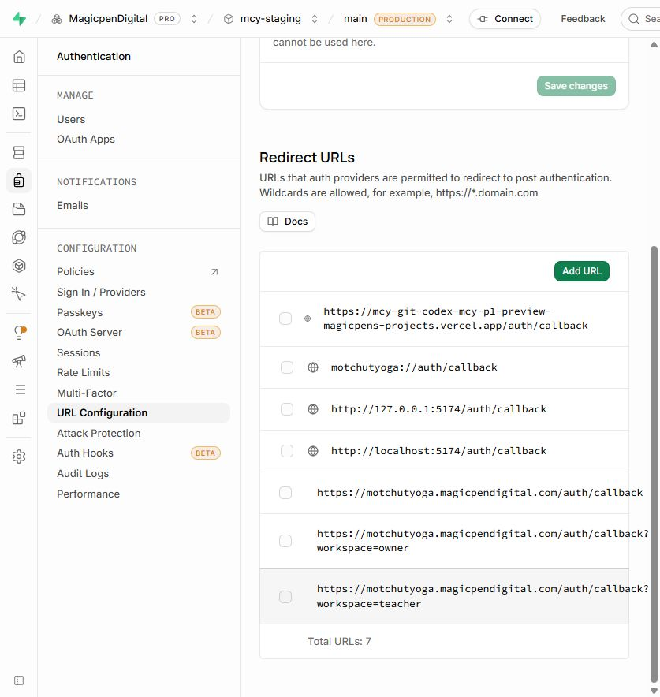

# Sửa callback đăng nhập Owner — 2026-10-11

Bản sửa đã triển khai lên Preview đang phục vụ `https://motchutyoga.magicpendigital.com`. Owner bắt đầu đăng nhập từ domain này sẽ yêu cầu callback trên cùng domain với `workspace=owner`; callback xác minh phiên trước khi trở lại workspace. **Việc bấm email mới bằng tài khoản Owner thật đang chờ người dùng xác nhận**; các kiểm thử dưới đây không thay thế bước đó.

Cập nhật thử thật: người dùng báo lỗi ở bước yêu cầu email. Read-only Auth logs trong cửa sổ 06:45–06:53:10Z cho thấy hai `POST /otp` HTTP429, code `over_email_send_rate_limit`, không phải bằng chứng callback đã chạy hoặc sai mật khẩu. Dashboard xác nhận built-in email service/SMTP off; dịch vụ này hiện chỉ hai email/giờ cho cả project. Owner có Resend, đang được hướng dẫn tạo Sending-access key/domain Verified và nhập secret trực tiếp trong Supabase; chưa xác nhận SMTP đã lưu hoặc email mới được gửi. [Email-limit receipt](MCY_OWNER_AUTH_EMAIL_LIMIT_2026-10-11.json), [hướng dẫn cấu hình Resend](../docs/release/MCY_AUTH_SMTP_RESEND_SETUP_2026-10-11.md), [quota chính thức](https://supabase.com/docs/guides/auth/rate-limits).

## Nguyên nhân và thay đổi

Dashboard Supabase trước khi sửa có Site URL là alias Vercel cũ và chỉ bốn Redirect URLs, chưa có domain MCY. Mã Owner cũng dùng callback chung không có workspace. Điều này khớp với việc email quay về Vercel, mở giao diện học viên và tab Owner ở domain khác không nhận được phiên. PKCE cần verifier của trình duyệt/origin đã bắt đầu yêu cầu; không thể dùng phiên của domain Vercel để tự động đăng nhập domain MCY. [Tài liệu PKCE chính thức](https://supabase.com/docs/guides/auth/sessions/pkce-flow), [Redirect URLs](https://supabase.com/docs/guides/auth/redirect-urls).

- `src/backend/authRouting.ts` giới hạn đích đến ở ba workspace nội bộ; không nhận URL `next`/`return` tùy ý.
- Owner/Teacher web yêu cầu email với callback cùng origin và workspace tương ứng; `shouldCreateUser=false` giữ nguyên. Chỉ HTTP/HTTPS thêm workspace; native Owner/Teacher/learner giữ chính xác các callback scheme hiện hữu.
- Thông báo gửi email phân biệt code quota `over_email_send_rate_limit` với lỗi429 chung và dịch vụ chưa sẵn sàng; dùng copy cố định, không hiển thị provider message hoặc tự retry. Email nhập vẫn giữ để thử lại có chủ đích.
- `src/backend/AuthCallback.tsx` xử lý trước khi hydrate dữ liệu học viên. SDK thực hiện một lần exchange PKCE, Promise dùng chung tránh lặp trong StrictMode. Chỉ chấp nhận email đã xác minh/phiên chưa hết hạn; code còn nguyên sau SDK initialize được coi là thiếu verifier, kể cả khi có phiên cũ.
- Thành công quay về workspace đã chọn, sau đó API tiếp tục xác minh quyền Owner/Teacher. Thất bại hiện thông báo an toàn, bỏ code/token/provider error khỏi URL, cho quay lại yêu cầu email mới. Không phản chiếu lỗi nhà cung cấp hoặc tự cấp quyền.

## Cấu hình Auth đã áp dụng

Official Supabase CLI 2.119.0 dùng workdir riêng trong `.vercel/mcy-auth-redirect-20261011`, TOML chỉ khai báo hai thuộc tính Auth. Fresh diff khớp preflight/hash trước khi push; diff sau push còn **0 thay đổi được khai báo**. Mười thuộc tính remote không khai báo, gồm email confirmation/rate limit/MFA/pooler/storage, giữ đúng giá trị trước đó. Không dùng config chung của repository hay `db push`.

Site URL: `https://motchutyoga.magicpendigital.com`.

Giữ bốn callback cũ; thêm chính xác ba callback:

```text
https://motchutyoga.magicpendigital.com/auth/callback
https://motchutyoga.magicpendigital.com/auth/callback?workspace=owner
https://motchutyoga.magicpendigital.com/auth/callback?workspace=teacher
```

Không thêm wildcard. Dashboard đọc lại đúng project `mcy-staging`/MagicpenDigital xác nhận Site URL và tổng bảy URLs. [Preflight](MCY_OWNER_AUTH_REDIRECT_CONFIG_PREFLIGHT_2026-10-11.json), [apply/readback](MCY_OWNER_AUTH_REDIRECT_CONFIG_APPLY_2026-10-11.json).



## Bằng chứng kiểm thử và review

| Kiểm tra | Kết quả | Phạm vi |
| --- | --- | --- |
| Canonical build | PASS exit0 | TypeScript, Vite, Sites; runtime 28/28, catalog đóng với 0 buổi đã duyệt |
| Full Edge UI regression cuối | PASS 113/113 exit0 | Fixture cô lập, gồm iPhone/Pixel/mobile/web, Owner/Teacher, 10 callback/error cases; một worker, 6.3 phút |
| Callback/content-review subset | PASS 21/21 trong full113 | SDK PKCE một exchange; không hydrate học viên trước callback; deny/missing verifier/expired/duplicate code/403/quota/privacy |
| Standalone email-error cases cuối | PASS 2/2 exit0 | Known quota và unknown500; không tự retry/hiển thị provider message |
| Initial focused callback/content-review | PASS 19/19 exit0, lịch sử | Trước bổ sung hai cases gửi email; không dùng làm bằng chứng source cuối |
| Bundle secret scanner | PASS 23 text files | Artifact client, không đọc/đưa server credential vào bundle |
| Sites tests | PASS 4/4 | Static artifact compatibility |
| Playwright isolation canary | PASS 1/1 | Fictional project `mcy-playwright.invalid`, không dùng staging token |
| Independent R3 source review | PASS, không còn P1/P2 | Agent `owner_repair_review`; [review](MCY_OWNER_AUTH_CALLBACK_REVIEW_2026-10-11.md) |
| Hosted HTTPS/asset probes | PASS | Public SSO302, authenticated CLI200; callback HTML/entry/callback module/Owner module khớp byte hash |
| Owner email thật trên domain | CHƯA XÁC NHẬN | Người dùng cần yêu cầu email mới rồi mở trong cùng trình duyệt |

Các lần Playwright chạy trong sandbox không khởi động được Edge vì quyền profile/crashpad; body browser tests chưa chạy ở các lần đó. Lần được cấp quyền chạy giữ nguyên assertion/isolation và đạt kết quả nêu trên. Reviewer độc lập tự chạy initial helper1/1 và follow-up14 checks; bảy browser cases ban đầu bị chặn ở launcher, không ghi chúng là PASS. Native scheme được kiểm tra bằng contract; chưa kiểm thử đăng nhập trên thiết bị thật.

Lần full113 trung gian có111 PASS/hai FAIL: mock Auth thiếu response API-version/expose header để SDK đọc `code`, và một collaboration selectOption timeout20s. Focused28 kế tiếp có27 PASS/một FAIL vì cross-origin API-version chưa được expose; collaboration case đã PASS giữ nguyên. Đã sửa đúng headers mock, không đổi assertion/timeouts; standalone2 và full113 cuối PASS. Không tuyên bố đã xác định nguyên nhân mọi timeout môi trường hoặc hết flakiness.

Build cuối còn cảnh báo kích thước entry 548.16 kB raw /168.74 kB gzip; không phải lỗi callback hay một chứng nhận hiệu năng.

## Preview đã triển khai và giới hạn

- Deployment cuối READY: `dpl_HHpJXfSUdoiVyywUKCFeW6pDu1Tu`, target Preview, branch `codex-mcy-p1-preview`.
- URL deployment: `https://mcy-m3ls5a1o1-magicpens-projects.vercel.app`; alias review tiếp tục dùng `motchutyoga.magicpendigital.com`, được kiểm tra bằng official CLI/hosted receipt.
- Artifact cuối: 58 files/8,206,150 bytes, SHA256 `c34b3192e3fe7b6ac71eb1c12ccd86c0a5cb7fcb67e93c1b75bd142c19b32099`; gồm 57 build files và routing config. [Manifest/source hashes](MCY_OWNER_AUTH_CALLBACK_WEB_ARTIFACT_2026-10-11.json), [deployment](MCY_OWNER_AUTH_CALLBACK_DEPLOYMENT_2026-10-11.json), [hosted readback](MCY_OWNER_AUTH_CALLBACK_HOSTED_2026-10-11.json).
- Preview ban đầu `dpl_BViogYtTLSb5u9PQizSiBZ4Zxd4E`/SHA7440…4813, full111/focused19, được giữ ở các receipt `_INITIAL_2026-10-11.json`; đã thay bằng bản cuối sau khi xử lý phản hồi lỗi gửi email của người dùng.
- Hosted `/auth/callback?workspace=owner` trả về đúng HTML SPA; bảo vệ Vercel vẫn bật. API role authorization giữ nguyên. Bản Preview web mới thay thế checkpoint static 56 files trước đó; receipt SQL/Edge/DB cũ vẫn là bằng chứng của scope đã áp dụng trước, không phải bằng chứng mới của lượt sửa callback.
- Lượt này chỉ đổi Auth URL config và static Preview. Không chạy migration, Edge deploy, grant/expiry extension, Owner AI config save, review/assignment write, inference hay Production promotion. AI/catalog/learner rollout gates vẫn theo [acceptance trước](MCY_CONTENT_REVIEW_STAGING_ACCEPTANCE_2026-10-11.md); không tuyên bố đã đọc lại toàn bộ DB trong lượt sửa giao diện này.
- Mốc hết hạn role fixture đã ghi trước là `2026-10-11T10:47:49.876065Z` (17:47 Bangkok). Bất kỳ kiểm thử actor tiếp theo phải xác minh token/role hiện hành; không tự gia hạn hoặc suy ra quyền từ nhãn tài khoản.

Để thử lại: tải lại [trang Owner](https://motchutyoga.magicpendigital.com/?workspace=owner), gửi yêu cầu đăng nhập mới và mở email mới nhất trong cùng trình duyệt. Không dùng lại email cũ; không cần gửi code/link/token cho agent. Nếu callback thành công nhưng API từ chối quyền, xử lý như vấn đề authorization riêng sau khi đối chiếu role thực tế, không mở quyền để che lỗi.
