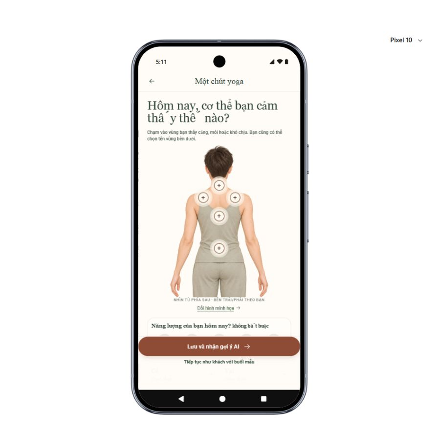
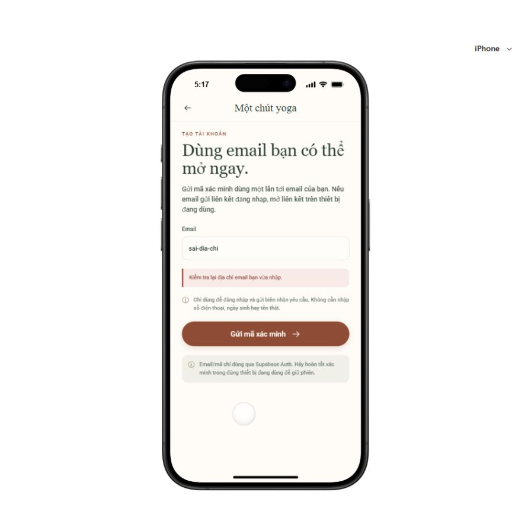
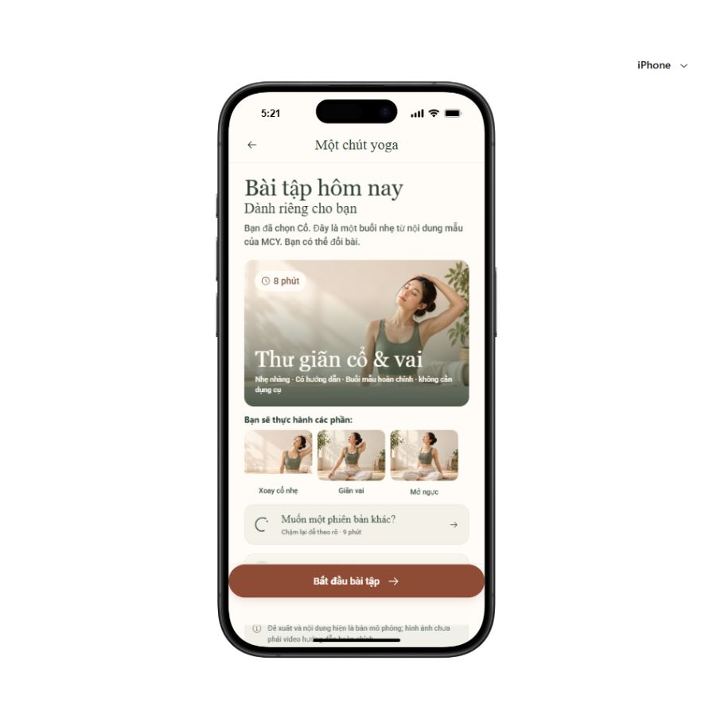
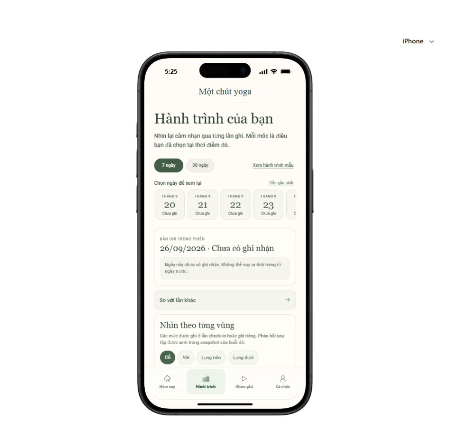
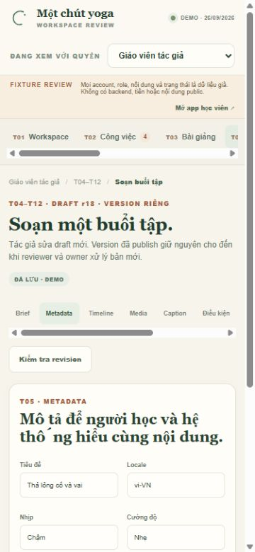
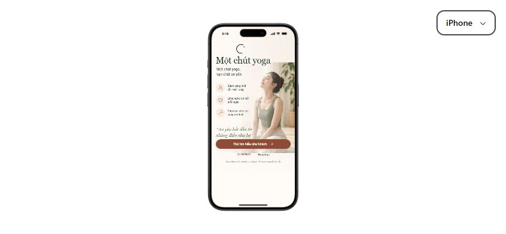
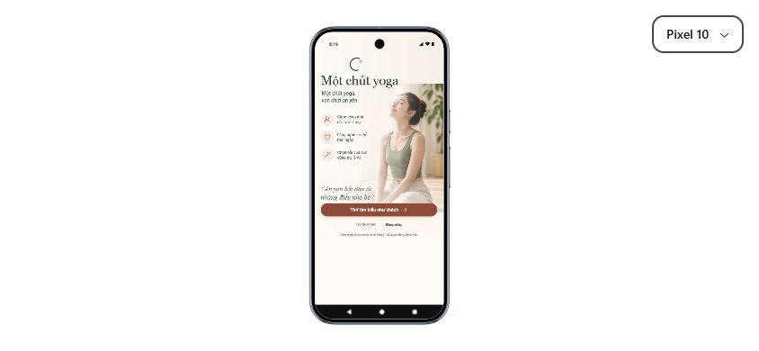

# Một chút yoga — kiểm tra mức sẵn sàng P1 và kế hoạch tiếp theo

**Ngày kiểm tra:** 26/09/2026. **Phạm vi:** app học viên web trong simulator iPhone/Pixel, mã Capacitor, Supabase staging `mcy-staging`, workspace giảng viên mẫu và thiết kế dữ liệu nội dung/AI. Đây là kiểm tra staging; chưa phải nghiệm thu phát hành.

## Kết luận để bắt đầu thử đăng ký/đăng nhập

**Có thể bắt đầu thử luồng email trên bản local và APK debug**, vì client có `VITE_SUPABASE_URL` và publishable key, gọi Supabase Auth thật, có màn OTP, nhận callback web/native và nạp lại profile/consent/check-in sau khi có session. `npm run check:runtime` và `npm run build` đạt sau các sửa đổi ở lần kiểm tra này. Màn email báo lỗi đúng khi nhập địa chỉ sai.

**Chưa thể xác nhận đăng ký/đăng nhập đầu cuối đã đạt:** staging hiện có 0 `auth.users`, chưa gửi email thử tới hộp thư của người dùng; template email thực tế, giới hạn redirect URL và khả năng nhận OTP/magic link chưa được quan sát. Supabase mặc định gửi magic link cho `signInWithOtp` nếu template chưa đưa `{{ .Token }}` vào nội dung. Màn nhập 6 số chỉ dùng được khi email thật chứa OTP. Web trên Vercel chưa có deployment/project khả dụng qua connector; Vercel team list hiện rỗng. Cấu hình native Android/iOS đã có URL scheme, nhưng callback từ email thật cần thử trên điện thoại.

P1 chỉ nên dùng tài khoản thử và dữ liệu tự nguyện trong staging. Văn bản điều khoản/quyền riêng tư đang ghi rõ là bản review 0.1, chưa được duyệt cho vận hành thật.

## Ma trận chức năng

| Mảng | Hiện trạng đã thấy | Trạng thái |
| --- | --- | --- |
| Web app học viên | React/Vite chạy tại `http://127.0.0.1:5174/`; simulator iPhone và Pixel có thể chọn; các luồng khách chính hoạt động. | Sẵn sàng review local; chưa deploy Vercel. |
| Native Android | Capacitor đóng gói fullscreen; APK debug mới nhất đã cài lại trên Air1 Ultra và WebView debugger xác nhận `https://localhost/` cùng React root có nội dung. | Sẵn để bắt đầu thử UI/auth trên máy; email callback và đồng bộ tài khoản thật chưa nghiệm thu. |
| Native iOS | Project, bundle ID và URL scheme `motchutyoga://` đã chuẩn bị. | Chưa build/ký/cài trên iPhone thật vì cần Xcode/macOS. |
| Đăng ký/đăng nhập | `signInWithOtp`, `verifyOtp`, PKCE, lưu phiên, callback web/native và hydrate account đã có. | **Sẵn để bắt đầu test**, chưa xác nhận email delivery, OTP/link, session restore và lỗi trên thiết bị thật. |
| Hồ sơ và quyền | Profile có upsert; quyền được ghi qua RPC vào consent event append-only; UI phân biệt AI, wellbeing, teacher và marketing. | Có kết nối staging; chưa kiểm bằng hai tài khoản thật, grant/revoke và các ca mất mạng. |
| Check-in | RPC `save_my_checkin` có idempotency key, đọc/xóa theo chủ tài khoản; chỉ ghi khi người dùng bật `wellbeing_data`. | Có kết nối staging; chưa kiểm thao tác đầu cuối và cô lập tài khoản A/B. |
| Buổi tập, phản hồi, hành trình | Màn mẫu hoàn chỉnh; phản hồi sau tập ở phiên khách chỉ nằm trong tab và không tạo dữ liệu Hành trình. | Chưa sync session/run/reflection với backend. |
| Workspace giảng viên | Editor brief, metadata, timeline, media, caption, rights, review có thể tương tác bằng fixture. | **Chưa ready cho giảng viên tạo bài thật**: không login/role/API, không lưu draft, upload, review hay publish thật. |
| Trợ lý học AI | Hội thoại chọn nhánh bằng từ khóa/fixture; màn ghi rõ mô phỏng. | **Chưa ready cho AI thật**: không model/service, retrieval, policy runtime hay đánh giá chất lượng. |
| Metadata và gợi ý | Schema có `session_versions`, `session_segments`, `session_suitability_rules`, `session_alternatives`, `session_publications`, `media_assets`, `practice_plans`. | Có nơi lưu ở DB; **chưa có pipeline và dữ liệu**: staging có 0 session/version/rule/segment/media; UI giảng viên chưa ghi DB; gợi ý học viên lấy fixture cục bộ. |

## Kiểm tra giao diện và tương tác

Các ảnh dưới đây ghi trong browser khi đi qua luồng. Màn auth không dùng email thật, nên chỉ xác nhận validation hiển thị. Ảnh chụp simulator là web review surface, không đại diện cho pixel-perfect native Android/iOS.

1. **Chào → check-in:** iPhone/Pixel hiển thị ảnh, logo, CTA; body map có danh sách vùng bằng chữ song song với điểm chạm. Vùng cổ chọn và ghi mức được; sheet giữ mức/ghi chú. [Màn chào](ux-audit-2026-09-26/01-welcome-iphone.jpg) · [Check-in Pixel](ux-audit-2026-09-26/02-checkin-pixel.jpg) · [Sheet vùng](ux-audit-2026-09-26/12-body-region-sheet.jpg).

   

2. **Email:** màn tạo tài khoản có nhãn email và `role=alert` cho địa chỉ sai; nút gửi được bật khi backend cấu hình. Đã sửa placeholder ghi chú để phù hợp vùng cổ/vai/lưng. [Email iPhone](ux-audit-2026-09-26/04-auth-email-iphone.jpg) · [Lỗi email](ux-audit-2026-09-26/05-auth-invalid-email.jpg).

   

3. **Kế hoạch → tập → phản hồi:** khách đi hết buổi mẫu, thấy rõ ảnh/timer chưa phải video hay thời gian tập thật; phản hồi cho phép giữ nguyên theo vùng và không suy diễn cải thiện. [Kế hoạch](ux-audit-2026-09-26/13-plan-iphone.jpg) · [Tập](ux-audit-2026-09-26/14-practice-iphone.jpg) · [Phản hồi](ux-audit-2026-09-26/15-reflection-iphone.jpg).

   

4. **Hành trình:** phiên khách không tạo mốc kết quả và không tự điền ngày trống; điều này đúng với quyền lưu hiện tại. [Hành trình](ux-audit-2026-09-26/18-journey-guest.jpg).

   

5. **Workspace giảng viên:** desktop có cấu trúc rõ; ở rộng 375 px, nav/tab chuyển thành hai hàng kéo ngang, mật độ chữ dày và điều khiển bên phải khó phát hiện. [Metadata desktop](ux-audit-2026-09-26/10-teacher-metadata.jpg) · [375 px](ux-audit-2026-09-26/11-teacher-375x812.jpg).

   

### Vấn đề cần xử lý

| Ưu tiên | Phát hiện | Ảnh hưởng và hướng xử lý |
| --- | --- | --- |
| Cao, đã sửa trong client | Nút **Bỏ nháp** trước đây gọi hoàn tất với state cũ; nếu bật lưu wellbeing, check-in có thể vẫn được ghi server. Nút **Để sau** bỏ qua bước xác nhận; tài khoản đã tồn tại cũng chưa được hỏi khi gắn nháp khách. | `OnboardingScreen` dùng state đã xóa khi bỏ nháp, không gọi `persistCurrentCheckin`, về Hôm nay; Để sau đi qua xác nhận. `ConsentScreen` giờ hỏi rõ với tài khoản quay lại và có Bỏ nháp. Cần kiểm bằng hai tài khoản thử để xác nhận không có row được tạo khi bỏ. |
| Cao, đã sửa và xác minh | Ở browser landscape 844×390, simulator từng bị cắt do scale tối thiểu 0,42. Cơ chế scale nay bám theo cả chiều rộng và chiều cao khả dụng; iPhone và Pixel 10 đều lọt trong vùng xem 844×390, trang không tràn theo hai trục. [Ảnh lỗi trước sửa](ux-audit-2026-09-26/20-journey-landscape-844x390.jpg), [iPhone sau sửa](ux-audit-2026-09-26/23-iphone-landscape-fixed-844x390.jpg), [Pixel sau sửa](ux-audit-2026-09-26/22-pixel-landscape-fixed-844x390.jpg). |
| Trung bình, đã sửa copy | Màn Hôm nay nói chưa gửi dữ liệu dù profile/consent/check-in đã nối staging; CTA check-in gọi “gợi ý AI” dù chỉ dùng mẫu. | Copy mới nói rõ backend staging và trợ lý mẫu. Không tạo kỳ vọng AI thật trong P1. |
| Trung bình, đã sửa copy; còn quyết định lifecycle | Supabase Auth tạo/xác minh user trước khi app ghi consent điều khoản. Dòng cũ “cần để tạo tài khoản” không khớp thứ tự thực tế. | UI nay nói rõ email đã xác minh và đồng ý để tiếp tục trong app. Trước production cần quyết định xử lý tài khoản Auth đã tạo nhưng chưa chấp nhận điều khoản, thay vì coi nó là onboarding hoàn tất. |
| Trung bình, chưa sửa | Màn staff 375 px dùng hai thanh điều hướng kéo ngang nhưng gợi ý kéo chưa rõ; metadata form và nhãn nhỏ. | Ở P2, thiết kế lại ưu tiên tác vụ mobile/tablet của giảng viên và đo vùng chạm/zoom chữ. |
| Trung bình, cần test thật | OTP 6 số, magic link, redirect web/native, khôi phục phiên, bàn phím/safe area, focus sau sheet và lỗi mạng chưa được đi hết với session thật. | Dùng ma trận nghiệm thu bên dưới; chưa tuyên bố auth sẵn sàng cho người dùng cuối. |

Ở 320×568, simulator co xuống khoảng 249×472 trong browser viewport thực 320×520; nội dung còn trong khung nhưng chữ rất nhỏ vì đang xem một điện thoại giả bên trong cửa sổ nhỏ. [Ảnh Hành trình 320 px](ux-audit-2026-09-26/19-journey-320x568.jpg). Bản native fullscreen phải được đánh giá riêng trên thiết bị thật.

## Cổng triển khai tiếp theo

### 1. Hoàn tất P1 để người dùng thử tài khoản

1. Xác nhận Auth email template đang gửi OTP 6 số hay magic link; đưa callback local, Vercel và `motchutyoga://auth/callback` vào redirect allowlist đúng môi trường. Đặt hai biến Vite publishable cho Vercel và giữ secret server ngoài bundle. Liên kết đúng Vercel team/project rồi deploy web preview.
2. Dùng ít nhất hai tài khoản thử A/B: tạo mới, đăng nhập lại, sai/hết hạn/gửi lại mã, mở link trên cùng thiết bị và từ app Android, reload/khôi phục phiên, đăng xuất. Kiểm tra profile, consent grant/revoke, check-in ghi/đọc/xóa chỉ của chủ; thử mất mạng và retry để không tạo trùng. Đặc biệt xác nhận **Bỏ nháp** không sinh check-in.
3. Rà câu chữ điều khoản và privacy trước khi nhận dữ liệu ngoài nhóm thử; giữ staging tách production. Kiểm tra màn lỗi backend, no session và quyền bị rút bằng tài khoản thật.
4. Đã sửa và kiểm clipping simulator trên cả iPhone/Pixel tại 844×390; tiếp tục rà các màn học viên ở 320/375/430 px, viewport cao ngắn, focus, keyboard, zoom chữ và vùng chạm. Android thật đã mở được app, nhưng cần nghiệm thu luồng auth/sync với tài khoản thử mới xem P1 là hoàn tất.

### 2. Xây nội dung giảng viên thật (P2)

Chốt quyền teacher/reviewer/owner và lời mời + MFA; xây API server kiểm quyền từng request; nối editor với draft/version CRUD, autosave/concurrency, Storage private + scan + rights, caption/timeline validation, review độc lập và publish/suspend có audit. Ghi đủ metadata của `session_versions`, `session_segments`, `session_suitability_rules` và alternatives, không cho client giảng viên ghi trực tiếp vào bảng được bảo vệ. Seed một bộ bài được chuyên môn và pháp lý duyệt trước khi mở cho học viên.

### 3. Kết nối gợi ý và trợ lý AI sau cổng nội dung

Chốt taxonomy/context và policy phiên bản; chỉ lấy session version **published, available, có media/quyền và suitability đã duyệt**. API backend tạo candidate → loại trừ/needs-review → xếp hạng theo check-in có consent → trả lý do, version và bài thay thế; hỗ trợ no-match và đường chọn tay. Sau đó mới gắn AI hội thoại có giới hạn dữ liệu, ghi provenance/policy, đo trường hợp sai/khó chịu hơn/no-match bằng đánh giá của giáo viên và reviewer. Hiện không có cơ sở để cam kết gợi ý chính xác.

## Dấu vết kỹ thuật và giới hạn kết luận

- Local `.env.local` có URL, publishable key và native scheme nhưng không đưa giá trị khóa vào báo cáo; `src/backend/supabase.ts` dùng PKCE và persistSession.
- Supabase `mcy-staging` ở trạng thái `ACTIVE_HEALTHY`; migration learner app đã áp dụng. Truy vấn read-only tại thời điểm audit cho thấy `auth.users`, `sessions`, `session_versions`, `session_suitability_rules`, `session_segments`, `media_assets`, `checkins` đều 0. RLS bật trên bảng liên quan; cần test quyền âm A/B trước production.
- Security Advisor nêu bốn RPC P1 dạng `SECURITY DEFINER` có thể gọi bởi `authenticated` và nhiều bảng RLS không có policy. Đây là ranh giới đã thiết kế để client dùng RPC owner-scoped và khóa mặc định các bảng nội dung/private; vẫn cần thử request của tài khoản khác, quyền `anon`, grant/revoke và tham số sai trước khi coi là an toàn cho production.
- Vercel connector không trả team nào, nên không xác minh được project/deployment hoặc biến môi trường hosted. `vercel.json` và build output chỉ chứng minh gói web đã chuẩn bị.
- `npm run check:runtime` đạt với 28 file được bảo vệ; `npm run build` đạt TypeScript/Vite và tạo `dist/client`, `dist/server`, `.openai/hosting.json`; `npm run test:sites` đạt 4/4. Bundle JS chính khoảng 800 KB minify, nên cần tách chunk trong đợt tối ưu hiệu năng.
- Android `cap sync` và `:app:packageDebug --offline` đạt; APK mới được ký bằng đúng debug keystore đang dùng trên điện thoại và cài cập nhật bằng `pm install -r`, không gỡ app/xóa dữ liệu. WebView mở `https://localhost/` và nội dung React hiển thị sau khi cài. `assembleDebug` toàn bộ chưa đạt vì task `extractDebugAnnotations` cần hai JAR từ Android Maven nhưng `dl.google.com` không phân giải được trong môi trường này; đây là cổng build còn lại, không chặn gói debug đã cài.
- **Cập nhật sau audit:** scale tối thiểu 0,42 trong `PhoneFrame` đã bỏ; iPhone và Pixel 10 ở viewport 844×390 đều nằm gọn trong stage, không tạo overflow. Hash runtime được cập nhật; `npm run check:runtime`, `npm run build`, `npx cap sync android` và `:app:packageDebug --offline` đạt. APK ký đúng key và cài xác minh thành công trên Air1 Ultra. Build web vẫn báo chunk JavaScript chính khoảng 802 KB minify; đây là hạng mục hiệu năng, không ngăn preview.
- Không có email thử, session thật, seed content, backend teacher/AI hoặc iPhone vật lý trong lần audit này. Các chức năng đó được đánh dấu chưa nghiệm thu thay vì suy diễn từ giao diện.

## Cập nhật sau khi người dùng thử email — 26/09/2026

- Người dùng đã xác nhận tự thử local và nhận được magic-link email, rồi mở callback thành công. Điều này nghiệm thu local flow theo quan sát người dùng; chưa nghiệm thu email link trong APK/Android hoặc trên Vercel.
- Native callback đã cấu hình scheme `motchutyoga://auth/callback`; Android cold-start dispatch tới app đã được xác minh. Bản Capacitor không chuyển về localhost. Còn phải thêm scheme/origin vào Supabase redirect allowlist và kiểm tra link thật trên thiết bị cài app.
- UI hiện chấp nhận callback magic link và nhập OTP nếu template gửi `{{ .Token }}`. Vì magic link đã chạy, phương án ngắn nhất là giữ template hiện tại. Staging là project Free tạo sau 03/06/2026; nếu cần thay template sang OTP thì cần custom SMTP.
- Vercel connector hiện vẫn thấy 0 team và chưa có project/deployment; deployment call trước đó không khả dụng (`Tool deploy_to_vercel not found`). Chưa deploy được. Repo, build/output và callback SPA đã chuẩn bị; cần project được import/liên kết, hai biến Vite public cho Preview/Production và URL Preview để allowlist callback.
- Người dùng đã mở rộng P1 sang teacher trial staging-only. Workspace giáo viên vẫn fixture; staging hiện có một test account đã xác minh với cả chín vai trò ứng dụng global và audit entry, nhưng chưa có active teacher profile, server invite/content API hay bucket media private. Cần teacher roster và chính sách loại/dung lượng media trước khi mời thêm tài khoản. Không publish nội dung thử vào app học viên.
- Supabase staging hiện dùng Free: tối đa 50 MB/file, tổng 1 GB storage. Vì vậy upload clip thử có thể dùng staging; media bài học đầy đủ cần quyết định hạ tầng trước. Không upgrade tự động.

### Kết luận cập nhật

Auth local magic link chạy; Android scheme đã sẵn nhưng email deep-link thật cần allowlist và test. Vercel deployment đang bị chặn bởi quyền/project chưa hiện trong connector. Teacher trial đã được đưa vào phạm vi triển khai tiếp, nhưng chưa thể gửi invite trước khi có owner account được xác minh và roster. Kế hoạch chi tiết đã cập nhật tại [kế hoạch completeness](MCY_PROTOTYPE_COMPLETENESS_PLAN_2026-09-26.md).
