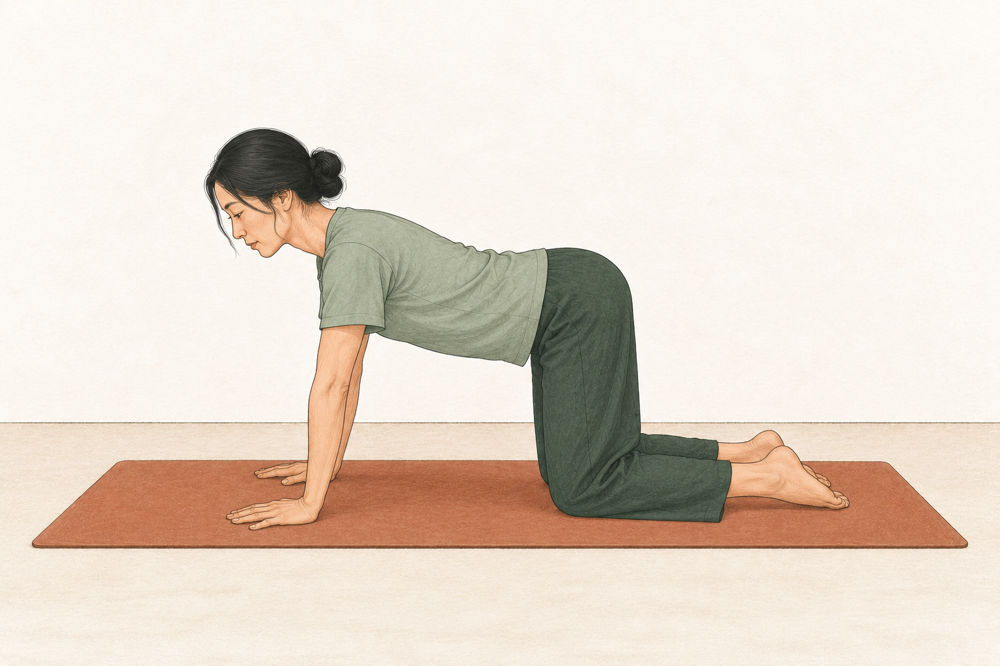
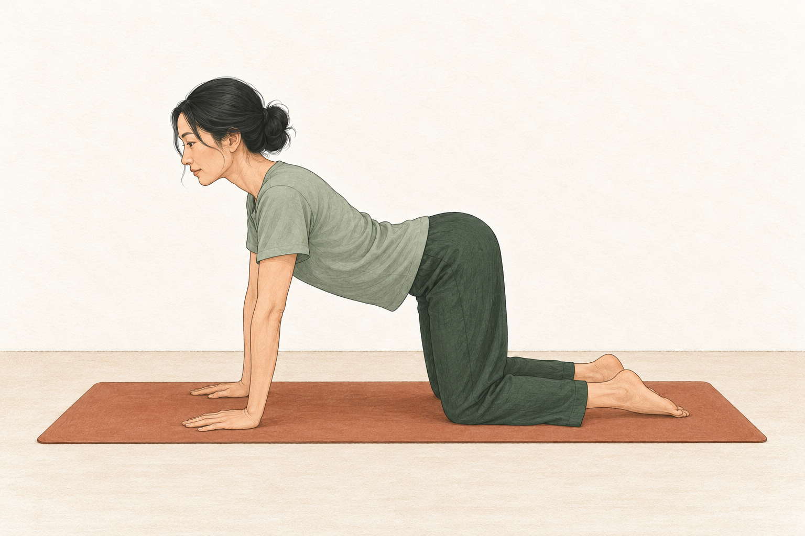
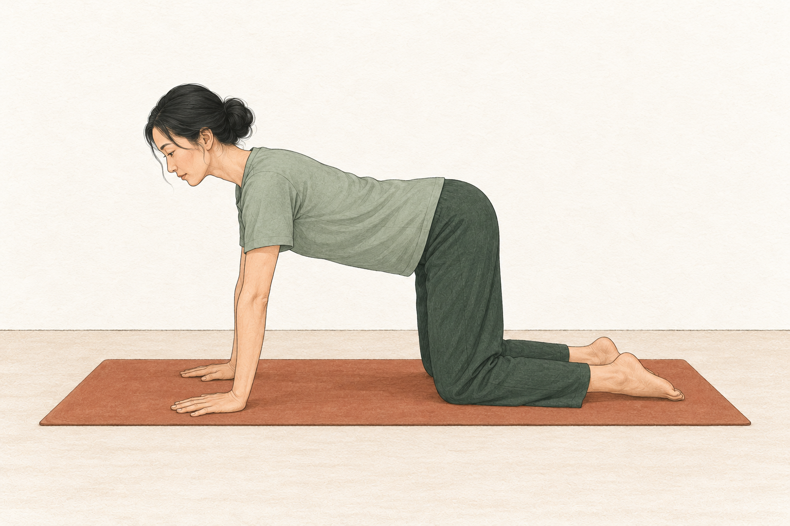
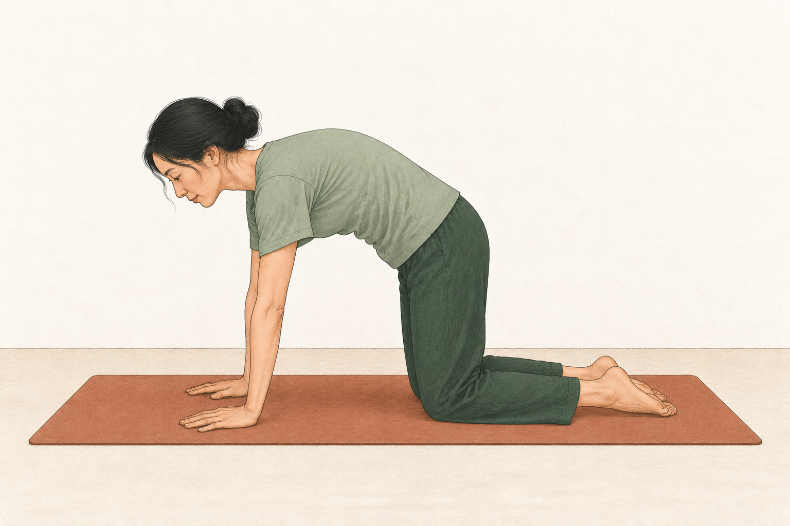
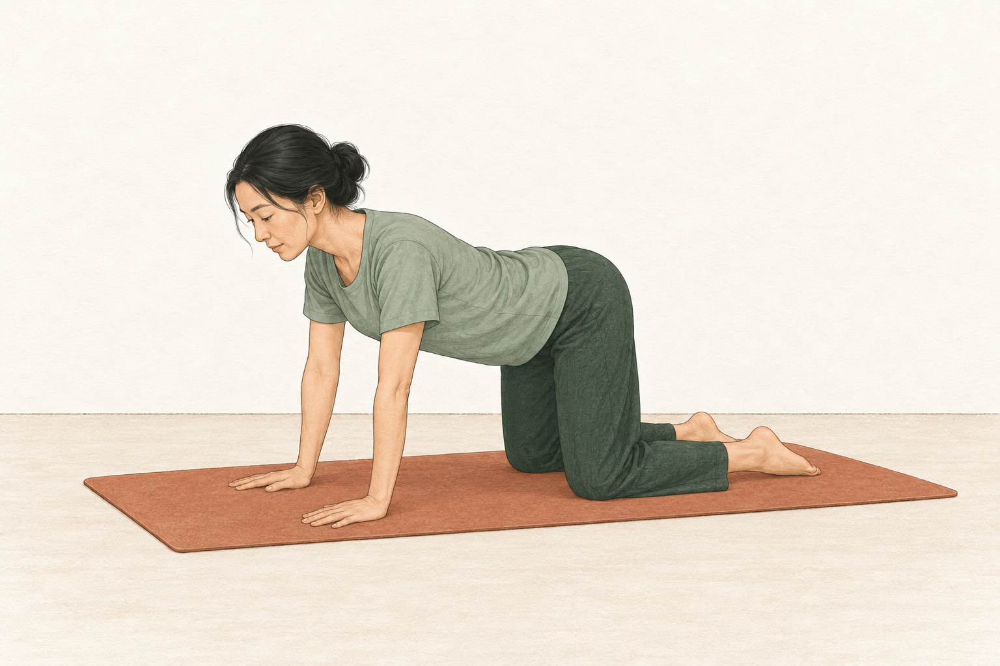

# Làm quen chuyển động Bò–Mèo — nội dung và 5 hình riêng

16/10/2026 · Bản biên tập để đánh giá · chưa thẩm định chuyên môn.

Bản này thay phần đề cương bài 02 trong bản xem trước để Owner đánh giá, chưa phải phê duyệt tích hợp hoặc phát hành cho người học.

## Mục tiêu và phạm vi

Làm quen hai hướng chuyển động của lưng và phần ở giữa: bắt đầu từ bốn điểm tựa, mở nhẹ, trở qua vị trí giữa rồi cuộn nhẹ. Bạn có thể xem toàn bộ trước và mở lại phần mình cần.

- Nhận ra nền bốn điểm tựa, hình Bò, hình Mèo và vị trí giữa.
- Hiểu cách chuyển nhỏ, trở về và chủ động dừng.

Bài làm quen dành cho người lớn đã có thể tự xuống, rời sàn và chống tay–gối thoải mái trong sinh hoạt. Nếu việc này đang làm bạn đau, tê hoặc khó thực hiện, hãy chỉ xem bài và hỏi người có chuyên môn trước khi thử.

Bò–Mèo được trình bày như hai hướng chuyển động nhỏ qua nền bốn điểm tựa. Không có yêu cầu giữ tư thế, số lần lặp hoặc độ cong phải đạt. Năm hình tĩnh đánh dấu các thời điểm, không thể hiện tốc độ hay mọi thời điểm của chuyển động.

## Chuẩn bị

- Chọn khoảng sàn phẳng, không trơn; dùng thảm không xê dịch. Có thể thêm lớp lót mỏng, ổn định dưới gối nếu thấy dễ chịu.
- Bài bắt đầu khi bạn đã ở tư thế bốn điểm tựa. Dùng cách xuống và rời sàn quen thuộc; bài này không hướng dẫn một kỹ thuật chuyển từ đứng xuống sàn.
- Đọc trước khi thử; đặt thiết bị ở chỗ dễ xem khi nghỉ, tránh xoay hoặc ngẩng cổ để nhìn màn hình lúc đang chuyển động.
- Thở tự nhiên, không nín thở. Bạn có thể chuyển rất ít hoặc dừng ở vị trí giữa.

**Khi cần dừng:** Nếu thấy đau, tê, chóng mặt hoặc không vững, ngừng chuyển động và dừng bài; nghỉ theo cách an toàn, quen thuộc. Nếu cảm giác không hết hoặc khiến bạn lo lắng, hãy tìm hỗ trợ y tế.

Thời gian đọc ước lượng; không phải thời gian giữ tư thế hoặc thời lượng tập.

## Bước 1 · Chuẩn bị bốn điểm tựa

**Nội dung chính:** Ở tư thế chống hai tay và hai gối, đặt bàn tay dưới vai và gối dưới hông, cách nhau thoải mái. Để lưng ở đường cong tự nhiên, cổ tiếp nối thân và mắt hướng về thảm.

**Xem kỹ:** Trải các ngón tay thoải mái, không khóa cứng khuỷu tay. Mu bàn chân có thể đặt trên thảm như hình nếu dễ chịu. Nền bắt đầu không đòi hỏi lưng phẳng như một đường kẻ; đừng ép cơ thể để giống hình.

**Một lựa chọn khác:** Nếu tay hoặc gối đang khó chịu, dừng thử và chỉ xem bài. Một lớp lót mỏng dưới gối là lựa chọn chuẩn bị, không phải cách bỏ qua đau hoặc tê.

**Chú thích:** Nền bốn điểm tựa. Lưng giữ đường cong tự nhiên, không cần ép phẳng.

## Bước 2 · Mở nhẹ phía trước · Bò

**Nội dung chính:** Từ nền bắt đầu, để vùng chậu nghiêng nhẹ, bụng hạ một chút và ngực mở về phía trước trong khoảng dễ chịu. Giữ cổ đi cùng đường lưng; không hất đầu hoặc cố nhìn lên trần.

**Xem kỹ:** Giữ hai bàn tay và hai gối trên thảm. Chọn một chuyển động nhỏ, không thả sụp xuống vai hoặc cố võng lưng sâu. Nếu dễ phối hợp, có thể hít vào nhẹ khi mở; nếu không, cứ thở tự nhiên và không nín thở.

**Một lựa chọn khác:** Bạn có thể mở ít hơn hình, hoặc ở lại nền bốn điểm tựa. Độ cong trong hình là một minh họa, không phải mục tiêu của mọi cơ thể.

**Chú thích:** Bò là một hướng mở nhẹ; chọn khoảng chuyển động phù hợp với bạn.

## Bước 3 · Đi qua vị trí giữa

**Nội dung chính:** Từ từ giảm độ võng và đưa lưng trở về đường cong tự nhiên như lúc bắt đầu. Để đầu đi cùng thân, vẫn giữ hai tay và hai gối trên thảm; bạn có thể dừng ở đây.

**Xem kỹ:** Đây là phần nối từ Bò sang Mèo, không phải một động tác giật hoặc đổi nhanh giữa hai hình. Tiếp tục thở tự nhiên. Chỉ chuyển sang bước tiếp khi muốn; không cần tạo một nhịp cố định.

**Một lựa chọn khác:** Nếu đã đủ cho hôm nay, bỏ qua bước Mèo và chuyển đến phần kết thúc. Việc dừng ở giữa không phải là làm thiếu bài.

**Chú thích:** Vị trí giữa nối hai hướng chuyển động và cũng là nơi có thể dừng.

## Bước 4 · Cuộn nhẹ lưng · Mèo

**Nội dung chính:** Từ vị trí giữa, để vùng chậu cuộn nhẹ và lưng tròn dần lên trong khoảng dễ chịu. Đầu đi theo chuyển động của thân; không ép cằm sát ngực hoặc cố đẩy lưng cao nhất.

**Xem kỹ:** Giữ tay và gối ở nền đỡ, tránh chuyển nhanh hoặc gồng để tạo đường cong lớn. Nếu dễ phối hợp, có thể thở ra nhẹ khi cuộn; nếu không, giữ nhịp thở tự nhiên. Bạn không cần giữ ở hình Mèo.

**Một lựa chọn khác:** Có thể cuộn ít hơn, trở về vị trí giữa hoặc kết thúc ngay. Nếu thấy đau, tê, chóng mặt hoặc không vững, ngừng chuyển động và dừng bài.

**Chú thích:** Mèo là hướng cuộn nhẹ, không phải độ cong cao nhất cần đạt.

## Bước 5 · Trở về và kết thúc

**Nội dung chính:** Giảm độ cuộn, trở về nền bốn điểm tựa với lưng ở đường cong tự nhiên rồi ngừng chuyển động. Khi đã dừng và thấy vững, nghỉ hoặc rời sàn theo cách bạn vẫn dùng thoải mái trong sinh hoạt.

**Xem kỹ:** Không cần chuyển thẳng sang một tư thế khác hoặc lặp lại để đủ số lần. Bài kết thúc chuyển động ở nền bốn điểm tựa; cách rời sàn không được minh họa ở đây. Nếu xuống hoặc rời sàn cần hỗ trợ, chỉ xem bài và trao đổi với người có chuyên môn trước khi thử.

**Một lựa chọn khác:** Bạn có thể xem lại một khung, chọn bài khác hoặc kết thúc phần đọc. Việc chuyển hết năm hình không tự ghi nhận một buổi tập.

**Chú thích:** Trở về và dừng. Góc nhìn minh họa thay đổi; bạn không cần xoay người theo hình.

## Nhìn lại và chọn tiếp

Bạn đã đến cuối phần đọc. Điều đáng nhớ là nhìn được cả đoạn chuyển và đường trở về. Bạn không cần đạt độ cong giống hình, giữ đủ lâu hay cảm thấy khác đi.

Phần nào bạn muốn nhìn kỹ hơn? Điểm bắt đầu / Bò / Vị trí giữa / Mèo / Kết thúc. Lựa chọn mở lại bước tương ứng, không ghi cảm nhận sức khỏe hoặc suy ra đã thực hành.

## Nguồn đối chiếu và giới hạn

Các nguồn được đối chiếu ngày 16/10/2026 bởi agent rà soát. Nội dung dưới đây là tổng hợp biên tập tiếng Việt, không phải giáo án được các tổ chức này phê duyệt. Không sao chép ảnh/video của nguồn.

- [ACE — Cat-Cow](https://www.acefitness.org/resources/everyone/exercise-library/15/cat-cow/): Đối chiếu nền tay–gối, hai hướng chuyển động và trở về. Bản MCY không dùng liều giữ 10–15 giây hoặc bắt buộc co ngón chân của nguồn.
- [Mayo Clinic — Cat-cow pose](https://www.mayoclinic.org/healthy-lifestyle/stress-management/multimedia/cat-cow-pose/vid-20453581): Đối chiếu vị trí tay–gối và hướng vùng chậu, lưng, đầu; có thể phối hợp hơi thở. Không lấy số lần hoặc yêu cầu hít sâu làm liều tập.
- [Cleveland Clinic — Cat-Cow Stretch](https://health.clevelandclinic.org/cat-cow-stretch): Đối chiếu cổ tiếp nối cột sống, mu bàn chân trên sàn và chuyển động chậm trong khoảng phù hợp. Không sử dụng lời hứa tác dụng sức khỏe hoặc tự áp biến thể cho người có triệu chứng.
- [NHS — Chair-based pilates video workout](https://www.nhs.uk/live-well/exercise/pilates-and-yoga/chair-based-pilates-exercise-video/): Đối chiếu lời nhắc dừng khi đau hoặc thấy không khỏe và tìm trợ giúp nếu cảm giác không hết. Đây không phải phê duyệt kỹ thuật Bò–Mèo.

**Các quyết định biên tập cần giáo viên kiểm:** cấu trúc năm bước, điểm dừng giữa hai hướng, khoảng chuyển động nhỏ theo cảm nhận, hơi thở tự nhiên khi chưa phối hợp được, phạm vi người dùng tự xuống/rời sàn và tính đầy đủ của lời hướng dẫn cùng năm hình. Không có nguồn nào chứng nhận bộ hình AI hoặc phê duyệt bài MCY.

Hình 01/03/05 cùng là nền bốn điểm tựa ở những thời điểm khác nhau; không yêu cầu lưng hoàn toàn phẳng. Hình 05 đổi góc nhìn, không yêu cầu xoay người. Năm hình tĩnh không mô tả tốc độ hay toàn bộ chuyển động; chưa có audio hoặc clip trong bản này.

Dữ liệu gốc: tabletop-lesson.json. Prompt, nguồn hình và kiểm pixels: assets/TABLETOP-IMAGES.vi.md. Việc đánh giá bản xem trước cục bộ không thay thế thẩm định chuyên môn, thử với người dùng mục tiêu hoặc các cổng phát hành hiện có.
