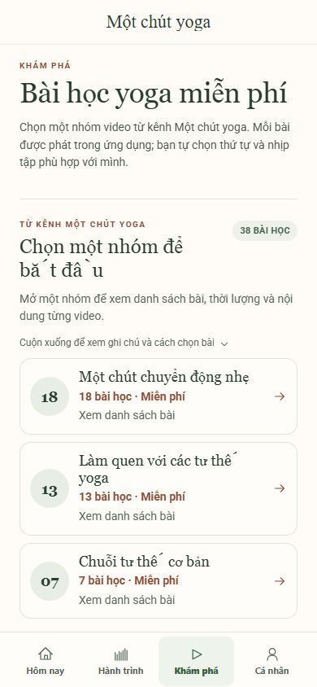
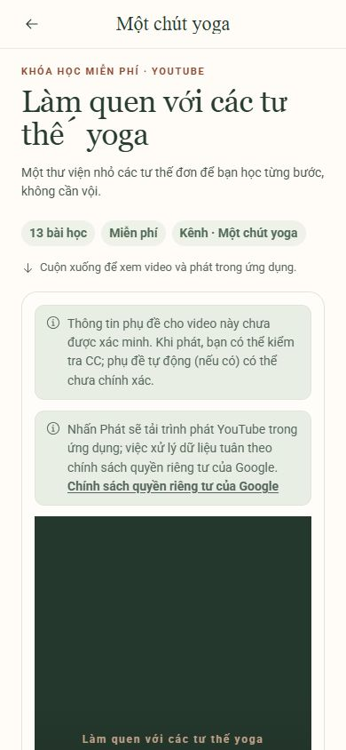
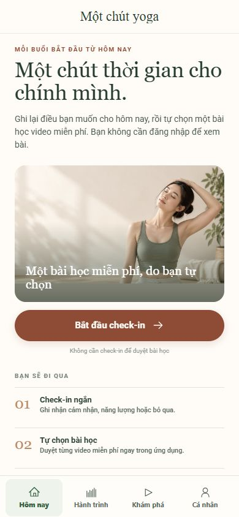

# Bổ sung quan sát giao diện — Một chút nền tảng

Ngày 16/10/2026, Asia/Bangkok. Phạm vi là bản source hiện tại chạy cục bộ, cùng phân tích cấu trúc trong [UI-UX-AUDIT.vi.md](UI-UX-AUDIT.vi.md). Đây không phải ảnh chụp APK hoặc kiểm chứng staging.

## Môi trường và giới hạn

- Chạy source hiện có bằng cấu hình riêng `audit.vite.config.mjs`, chỉ lắng nghe localhost. Hai biến Supabase bị đặt rỗng, nguồn env không dùng `.env.local`; CSP chặn kết nối ngoài origin và chặn iframe.
- Đi theo đường khách; không nhập tài khoản, không gửi check-in, không phát YouTube. Quan sát mô phỏng iPhone và mobile web 390 × 844. Không gọi thiết bị hoặc thay đổi cloud.
- Lần chạy máy chủ trong sandbox không truy cập được; lần chạy localhost được cho phép sau đó mở thành công. Không coi lỗi môi trường đầu là lỗi sản phẩm.
- Ảnh `01-current-discover.jpg` bị loại vì đang tải. Ảnh Hôm nay đầu tiên ở 390 px bị loại nếu còn hiệu ứng chuyển màn; dùng bản `settled` bên dưới. Giữ ảnh trung gian như bằng chứng quá trình, không làm căn cứ kết luận.
- Không kiểm đăng nhập, reader có nội dung thực hành được duyệt, screen reader thực, Android/iOS hoặc WCAG toàn bộ. Phân tích source về reader được ghi riêng, không gọi là quan sát trực tiếp reader đã phát hành.

## Các bước đã quan sát

### 1. Vào dưới dạng khách → chọn bài học miễn phí

Người dùng đi qua màn cảm nhận cơ thể rồi có nút “Tự chọn bài học miễn phí”. Có đường bỏ qua ghi nhận, là điểm tốt. Với mục tiêu mới chỉ đọc kiến thức, đề xuất một lối vào Khám phá rõ từ Hôm nay; không yêu cầu điền cảm nhận để được đọc. Đây là đề xuất cải thiện tìm thấy nội dung, không kết luận tất cả khách đang bị ép ghi dữ liệu.

### 2. Khám phá — nền tảng rõ nhưng taxonomy chỉ dành cho video

**Quan sát:** ba nhóm có số lượng 18/13/7 và nhãn miễn phí; phần mở đầu, hướng dẫn và thông tin nguồn đều nói về video. Bốn tab và trạng thái đang chọn rõ ràng. Hàng cuối cùng vẫn nhìn thấy ở màn 390 × 844, ghi chú nguồn nằm thấp hơn.

**Điều chỉnh:** đổi lời dẫn để bao quát cách học; thêm một mục “Minh họa từng bước” và thẻ series có mục tiêu. Giữ video là một định dạng riêng. Với ba bài mới, chưa cần tìm kiếm hoặc nhiều tầng bộ lọc. Cho người học nhận biết “đọc khoảng 3 phút” khác với thời lượng tập.

### 3. Nhóm tư thế — cần một cấu trúc riêng cho series

**Quan sát:** phần đầu chứa tên nhóm, mô tả, metadata và hai thông báo trước trình phát. Tên bài đang chọn và danh sách nằm sâu hơn. Các thông báo minh bạch về phụ đề và YouTube là có ích; chúng thuộc trải nghiệm video.

**Điều chỉnh:** tạo trang series nhẹ gồm mục tiêu và ba bài. Mở một bài mới vào tổng quan của chính bài đó, sau đó tới reader. Không sao chép các khối YouTube vào bài minh họa. Mục lục năm khung ở reader cần mở theo nhu cầu, không chiếm toàn bộ màn trước hình.

### 4. Hôm nay — giữ một hành động chính, thêm lối học phụ

**Quan sát:** CTA chính là “Bắt đầu check-in”; lời dẫn và ba bước hướng tới tự chọn video. Nhận diện ivory/forest/terracotta, serif và khoảng trắng nhất quán. Dòng “Không cần check-in để duyệt bài học” hiện là thông tin chữ; tab Khám phá là đường điều hướng rõ.

**Điều chỉnh:** giữ CTA bắt đầu hôm nay, cập nhật từ “video” sang “bài học” ở lời dẫn chung. Thêm một hàng liên kết nhỏ “Tìm hiểu trước khi tập” hoặc “Đọc tiếp trong phiên này”. Không đặt ba thẻ lớn của series lên trên CTA chính. Khi mở từ Hôm nay, nút quay về phải ghi đúng đích.

### 5. Reader, kết thúc đọc và Hành trình — đề xuất dựa trên source

Reader mới cần Trước/Tiếp, mục lục, phóng to, một ý chính/khung, mô tả chữ tương đương hình và trạng thái nhớ vị trí rõ phạm vi. Nút cuối dùng **“Bạn đã đến cuối phần đọc”** vì người dùng được phép nhảy tới khung cuối. Phản hồi hiện tại chỉ hỏi khả năng hiểu bài, là tùy chọn và nằm trong bộ nhớ của bản xem trước.

Đọc không tạo phản hồi cơ thể, phút tập hoặc check-in. Nhánh ghi cảm nhận sau thực hành chỉ được thiết kế tiếp khi có phiên bản thực hành được duyệt và người dùng chủ động xác nhận đã thử. Tài liệu nguồn về Hành trình không được dùng như bằng chứng rằng preview đồng bộ tài khoản.

## Tiếp cận và những việc phải kiểm tiếp

Hình có thông tin cốt lõi cần mô tả ngắn cùng phần chữ truyền tải thông tin thiết yếu; chỉ lặp tên tư thế trong alt là chưa đủ. Căn cứ: [W3C — Complex Images](https://www.w3.org/WAI/tutorials/images/complex/), đối chiếu 16/10/2026.

Thiết kế cần reflow ở chiều rộng tương đương 320 CSS px, hỗ trợ chữ lớn và thao tác bàn phím. Căn cứ: [W3C — Reflow](https://www.w3.org/WAI/WCAG22/Understanding/reflow.html), đối chiếu 16/10/2026. Việc chụp ảnh màn 390 px không chứng minh toàn bộ tiêu chí này đã đạt; kiểm bản preview được ghi riêng trong handoff.

Ưu tiên kiểm người học: tìm đúng bài; hiểu đang đọc chứ chưa tập; mở lại đúng khung; nhìn thấy phương án khác; thoát và biết thứ gì đã được ghi nhớ. Chưa có thử nghiệm người dùng thật trong lượt thiết kế này.
