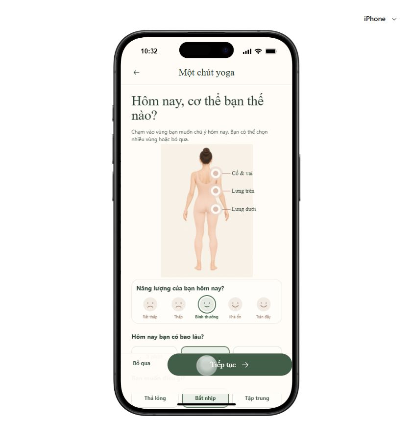
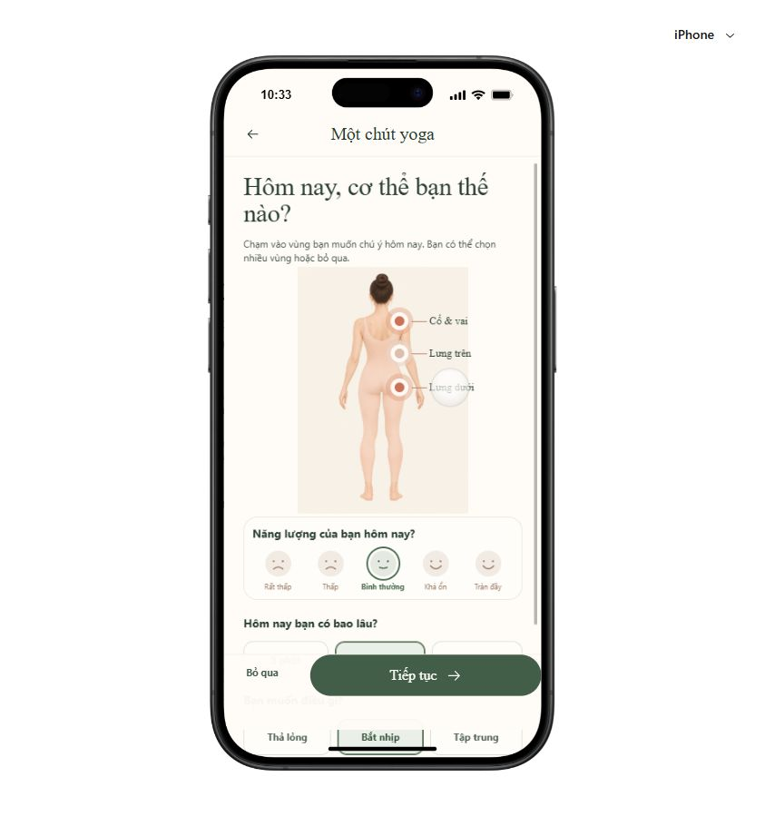
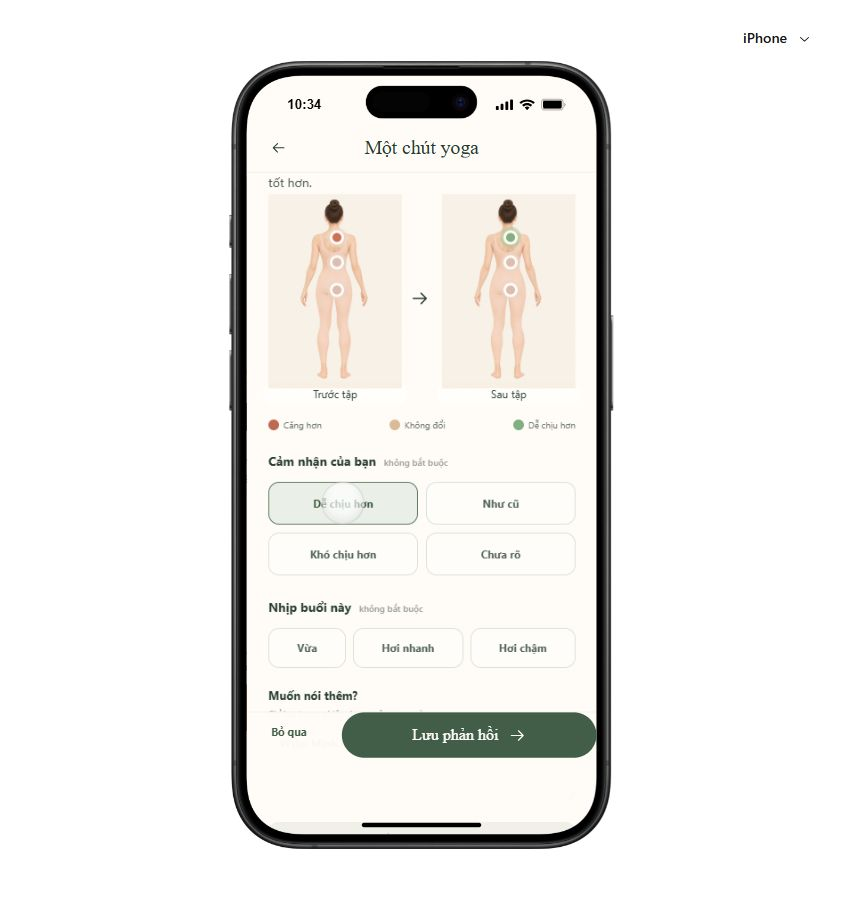
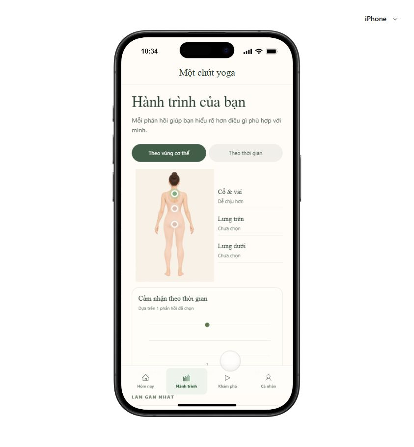
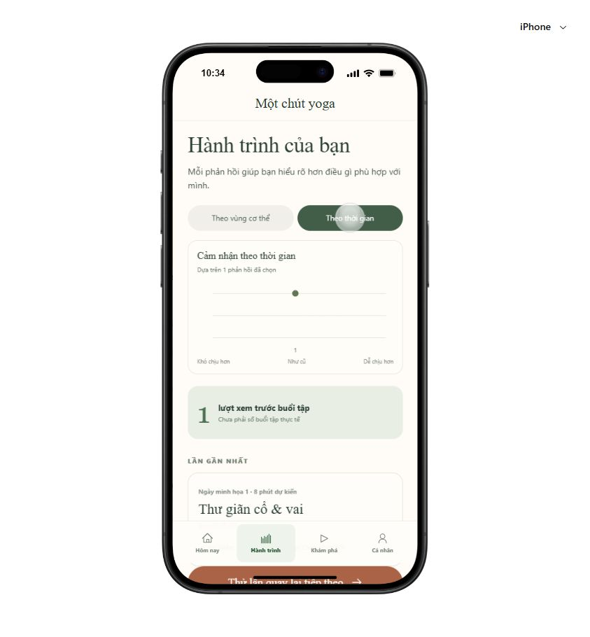

# Một chút yoga — Review check-in và kế hoạch hoàn thiện hành trình

**Ngày:** 25/09/2026  
**Trạng thái:** Đề xuất để duyệt; chưa triển khai thay đổi UI hoặc dữ liệu.  
**Phạm vi:** Chọn vùng cơ thể → phản hồi sau tập → xem lại theo thời gian; biểu cảm nhân vật; yêu cầu cho prototype kế tiếp.  
**Đích đến:** Người dùng ghi lại cảm nhận đủ dễ, xem lại đúng điều mình đã ghi, và hiểu vì sao lựa chọn buổi tiếp theo có thể thay đổi.

## 1. Phương án khuyến nghị

**Nên triển khai timeline snapshot kết hợp hình cơ thể tương tác.** Khi chọn một ngày và một lần ghi nhận, hình nhân vật, điểm đánh dấu và ghi chú cùng cập nhật theo đúng bản ghi đó. Khi bấm một vùng trên cơ thể, mở chi tiết của vùng tại thời điểm đang xem. Timeline là cách điều hướng lịch sử; hình cơ thể là cách hiểu từng bản ghi; xu hướng theo vùng là góc nhìn bổ sung.

Giữ tên màn hình **“Hành trình của bạn”**, dùng mô tả **“Nhìn lại cảm nhận qua từng lần ghi lại.”** Không đặt tên chức năng là “% cải thiện sức khỏe”: dữ liệu dự kiến là cảm nhận tự ghi, chưa phải phép đo sức khỏe hoặc bằng chứng hiệu quả điều trị.

Ba quyết định đề xuất:

1. **Check-in:** body map có vùng bấm rõ, danh sách tên vùng tương đương và mức khó chịu hiện tại theo từng vùng. Có đường đi riêng cho “không thấy khó chịu”, “chưa rõ” và “bỏ qua”.
2. **Hành trình:** timeline theo ngày + snapshot nhân vật + chi tiết từng vùng; thêm so sánh hai thời điểm. Chưa dùng phần trăm cải thiện trong vòng prototype này.
3. **Nhân vật:** giữ tư thế và nét mặt trung tính cho sơ đồ cơ thể. Biểu tượng khuôn mặt chỉ hỗ trợ câu trả lời năng lượng/cảm nhận do người dùng tự chọn, không tự suy ra vui/buồn từ vùng đau hoặc số buổi tập.

Toàn bộ đề xuất giữ bảng màu ivory–forest green–terracotta, chữ serif và chất liệu minh họa mềm của concept. Đây là cải thiện cấu trúc tương tác và tính trung thực của dữ liệu trong cùng concept.

## 2. Cách review và giới hạn bằng chứng

Đã kiểm tra prototype đang chạy tại `127.0.0.1:4173` bằng trình duyệt trong Codex, cấu hình iPhone; thao tác chọn/bỏ chọn vùng, đi đến phản hồi, lưu một phản hồi mẫu và đổi hai tab hành trình. Đã đối chiếu `src/Prototype.tsx`, `src/prototype.css`, kiểm tra DOM và kích thước nút. Các ảnh dưới đây được chụp, lưu và mở lại trong lần review này.

Trước khi review, preview cũ mất kết nối server khiến ảnh cơ thể không tải. Đã khởi động lại server và chụp lại khi ảnh tải thành công; ảnh sự cố được lưu riêng ở `00-preview-disconnected.png`, không dùng để kết luận rằng asset đang thiếu. Không sửa mã ứng dụng để phục hồi preview. `check:runtime` đạt với 28 tệp được bảo vệ.

Đây là đánh giá thiết kế có kiểm tra hành vi, chưa phải nghiên cứu với người học, kiểm định thang đo, kiểm tra đầy đủ bằng trình đọc màn hình hoặc chứng nhận WCAG. Chưa kiểm tra trực tiếp Pixel trong lần audit này. Các lỗi cấu trúc dữ liệu nêu dưới đây được xác nhận từ mã; các dự đoán về cách người dùng hiểu là giả thuyết cần thử.

### Các bước đã kiểm tra

| Bước | Màn hình/trạng thái | Đánh giá |
|---|---|---|
| 1 | Check-in chưa chọn vùng | Đúng chất liệu thương hiệu; cần sửa vị trí điểm, độ rõ và bố cục nhập liệu |
| 2 | Chọn cổ & vai cùng lưng dưới | Chọn nhiều vùng hoạt động; thiếu mức độ, tóm tắt lựa chọn và phân biệt ý nghĩa trạng thái |
| 3 | Phản hồi sau tập: “Dễ chịu hơn” | Có lựa chọn phản hồi trung thực; một câu trả lời chung đang được áp cho tất cả vùng |
| 4 | Hành trình theo vùng | Có hình cơ thể và nhãn; chỉ thể hiện bản ghi gần nhất, chưa xem lại từng mốc |
| 5 | Hành trình theo thời gian | Có thể đổi tab; cần thiết kế lại biểu đồ và bổ sung tương tác snapshot |

### Bước 1 — Check-in chưa chọn

**Điểm tốt:** Câu mở đầu nhẹ nhàng, hình cơ thể gần với concept, có tên vùng, hỗ trợ chọn nhiều vùng và không bắt buộc phải khai thông tin. Nút có `aria-label` và trạng thái `aria-pressed`.

**Vấn đề cụ thể:**

- Hình người chiếm một phần nhỏ trong khung, còn nhiều diện tích dành cho chân dù chỉ hỏi cổ/vai/lưng. Ba điểm bấm lệch sang phía phải hình người; người dùng phải dựa vào chữ để đoán vùng. Trong mã, điểm neo tính theo khung chứa, trong khi ảnh dùng `object-fit: contain`; chưa có chung hệ tọa độ theo phần hình thực sự hiển thị.
- Cổ và vai bị gộp. Chọn “Cổ & vai” chưa cho biết khó chịu ở cổ hay một bên vai; thiếu độ chi tiết để ghi chú và xem lại.
- Chấm chưa chọn vẫn có quầng màu ấm, gần với ngôn ngữ biểu diễn căng mỏi. Không rõ đây là điểm có thể bấm, vùng đang đau, hay dữ liệu có sẵn.
- Tên vùng 13px, nhãn năng lượng 9px; các nhãn năng lượng khó đọc ở kích thước preview. Điểm bấm có chiều cao CSS 34px, nhỏ hơn mục tiêu thiết kế 44–48px đề xuất cho thao tác thường xuyên trên điện thoại. Không kết luận vi phạm WCAG AA chỉ từ con số này: mức AA và mức nâng cao có yêu cầu khác nhau.
- Năng lượng “Bình thường” đang được chọn sẵn. Nếu lưu như một câu trả lời thực tế, dữ liệu sẽ lẫn giữa mặc định và người dùng đã xác nhận.
- Vùng thời gian/ý muốn nằm dưới fold; footer phủ lên nội dung và nút Tiếp tục sát mép phải. Cần sửa chiều rộng nút phụ/nút chính, nền footer và khoảng đệm cuộn. Không cần ép mọi trường vào một màn hình bằng cách thu nhỏ chữ.

### Bước 2 — Chọn nhiều vùng

**Điểm tốt:** Có thể chọn và bỏ chọn riêng từng vùng. Tên truy cập đổi thành “Bỏ chọn…”, trạng thái pressed được cập nhật.

**Vấn đề:** Khác biệt thị giác chủ yếu nằm ở màu chấm; chưa có dấu chọn hoặc danh sách “Đã chọn”. Không có mức độ/ghi chú theo vùng. “Bỏ qua” thực tế chỉ xóa vùng, còn năng lượng/thời gian/ý muốn vẫn giữ; nhãn chưa nói rõ phạm vi. Một mảng vùng rỗng đồng thời có thể nghĩa là không khó chịu, chưa chọn hoặc đã bỏ qua.

Mã hiện cho chọn lưng trên/lưng dưới nhưng chưa có buổi mẫu đáp ứng những vùng này, dẫn đến trạng thái không có gợi ý. Việc không đoán bài là đúng; cần nói rõ giới hạn nội dung và cho quay lại sửa đúng trường, không khuyến khích đổi câu trả lời thật chỉ để nhận được bài.

### Bước 3 — Phản hồi sau tập

**Điểm tốt:** Có “Dễ chịu hơn”, “Như cũ”, “Khó chịu hơn”, “Chưa rõ” và bỏ qua; không bắt buộc phản hồi tích cực.

**Vấn đề quan trọng:** Chỉ có một `outcome` cho buổi tập. Nếu chọn nhiều vùng, tất cả điểm trên hình đều đổi cùng màu. Điều này không biểu diễn được “cổ đỡ hơn nhưng lưng vẫn vậy”. Hình “trước tập” cũng chưa có mức khó chịu ban đầu; chấm màu ấm chỉ xuất phát từ việc đã chọn vùng. Chưa đủ dữ liệu để tính trước–sau hoặc xu hướng dài hạn theo vùng.

Màu sắc của trước/sau chưa dùng một ý nghĩa thống nhất: trước thể hiện lựa chọn, sau thể hiện thay đổi tương đối. Đề xuất dùng **mức hiện tại** cho màu điểm ở cả hai bên; thay đổi “nhẹ hơn/như cũ/nặng hơn” thể hiện bằng nhãn riêng.

### Bước 4 — Hành trình theo vùng

**Điểm tốt:** Hình cơ thể đi cùng tên vùng dễ liên hệ; vùng chưa chọn chưa bị gọi là đã cải thiện.

**Vấn đề:** Chỉ đọc bản ghi cuối trong lịch sử; không thể chọn ngày hoặc bấm điểm để xem note. “Dễ chịu hơn” là so với trước buổi đó, không có mức hiện tại để biết còn khó chịu hay không. Không đủ căn cứ để gọi đó là sức khỏe đã cải thiện. Điểm chưa ghi nhận vẫn hiện tương tự điểm có dữ liệu nên cần chú giải rõ hơn.

### Bước 5 — Hành trình theo thời gian

**Vấn đề:**

- Ba nhãn cảm nhận được đặt ngang dưới biểu đồ dù chúng là ba mức của trục dọc; ngày “1” cũng ở dưới, dễ nhầm ý nghĩa hai trục.
- Mã ánh xạ “khó chịu hơn/như cũ/dễ chịu hơn” thành 0/1/2 rồi nối đường. Đây là câu trả lời tương đối sau từng buổi, không phải mức khó chịu tuyệt đối theo ngày.
- “Chưa rõ” và bỏ qua bị loại khỏi tập điểm; các điểm còn lại được dàn đều theo thứ tự, nên khoảng cách ngày và khoảng thiếu phản hồi bị che khuất. Đây là kết luận từ mã, chưa chạy mẫu 30 ngày trong audit.
- Một điểm màu xanh chưa có tương tác để mở snapshot; tab thời gian bỏ hình cơ thể nên hai cách xem bị tách rời.
- Lịch sử dùng “ngày minh họa” tăng thủ công, không có timestamp/giờ/múi giờ hoặc nhiều lần ghi trong một ngày.

**Ưu tiên sửa:** Ngữ nghĩa dữ liệu trước; sơ đồ tương tác và khả năng đọc tiếp theo; biểu đồ và animation sau cùng.

## 3. So sánh các phương án hành trình

| Phương án | Điểm mạnh | Hạn chế | Kết luận |
|---|---|---|---|
| Chỉ biểu đồ đường | Gọn, dễ nhìn xu hướng nếu có dữ liệu phù hợp | Mất ngữ cảnh vùng/note; dễ tạo cảm giác chính xác quá mức | Chỉ nên là góc nhìn phụ |
| Feed dọc, mỗi ngày một hình người | Dễ kể câu chuyện và đọc ghi chú | Lặp hình, cuộn dài, khó so ngày 1 với ngày 30 | Dùng cho danh sách bản ghi chi tiết |
| Timeline ngang + một snapshot đang chọn | Liên tục về thị giác, dễ quay lại từng ngày; giữ nhân vật ở trung tâm | Cần chỉ rõ ngày đang chọn và có điều hướng thay thế thao tác kéo | **Chọn làm trải nghiệm chính** |
| Nhân vật tự đổi biểu cảm/đỏ–xanh qua 30 ngày | Có cảm xúc, dễ minh họa quảng bá | Dễ biến thiếu dữ liệu thành tiến bộ, trộn cảm xúc với sức khỏe | Không dùng làm cách trình bày dữ liệu chính |

## 4. Yêu cầu check-in mới

### 4.1. Luồng thao tác

1. Tiêu đề: **“Hôm nay, cơ thể bạn cảm thấy thế nào?”**
2. Câu hỏi ngay trên sơ đồ: **“Bạn đang thấy căng, mỏi hoặc khó chịu ở đâu?”** Mô tả: “Chạm vào vùng trên hình hoặc chọn tên bên dưới.”
3. Sơ đồ tập trung từ đầu tới hông, ghi “Nhìn từ phía sau”; không dùng chân để chiếm diện tích khi chưa có vùng chân trong phạm vi.
4. Bốn vùng trong prototype đề xuất: **Cổ · Vai · Lưng trên · Lưng dưới**. Tách cổ/vai nhưng chưa xây bản đồ giải phẫu nhiều chục vùng. Vai là một nhóm; người dùng có thể thêm “bên trái/bên phải/hai bên” ở chi tiết, không bắt buộc.
5. Chạm vùng mở `BottomSheet`: tên vùng, mức khó chịu hiện tại, vị trí bên nếu có, note không bắt buộc, “Lưu vùng này”. Không thay trạng thái chính trước khi lưu; hủy sheet giữ nguyên dữ liệu.
6. Sau khi lưu, hiển thị dòng tóm tắt: “Vai · Nhẹ · Bên trái” với Sửa/Xóa. Chạm chấm đã có dữ liệu là mở chi tiết, không vô tình xóa. Xóa qua thao tác rõ ràng trong sheet/danh sách.
7. Có lựa chọn riêng **“Hiện tại không thấy khó chịu”**, **“Chưa xác định được”** và **“Bỏ qua phần cơ thể”**. Các lựa chọn này không được cùng tồn tại với vùng khó chịu trong một lần check-in; đổi lựa chọn phải hiển thị rõ và cho hoàn tác.
8. Phần tiếp theo giữ thời gian và năng lượng; ý muốn thả lỏng/bắt nhịp/tập trung có thể chuyển vào trao đổi AI để màn check-in ngắn hơn. Footer chính: **“Tiếp tục chọn buổi tập”**.

### 4.2. Mức khó chịu

Đề xuất thang mô tả đơn giản cho vòng thử nghiệm này: **Không khó chịu · Nhẹ · Vừa · Nhiều**, cùng lựa chọn **Chưa rõ**. Câu hỏi luôn là **“Ở vùng này, ngay lúc này bạn thấy khó chịu ở mức nào?”**

Đây là thang sản phẩm để thử mức dễ hiểu, chưa được gọi là thang lâm sàng đã kiểm định. Không gán các mức này thành phần trăm, không cộng các vùng thành một điểm sức khỏe. Ghi chú “đau”, “căng” hay “mỏi” không được AI âm thầm chuyển thành mức độ.

Mức “Không khó chịu” cần thiết khi người dùng muốn tiếp tục theo dõi vùng đã từng khó chịu. Nó khác hoàn toàn với không chọn vùng. Nếu lần trước có vùng theo dõi, hiển thị “Bạn muốn ghi lại vùng vai hôm nay không?” và cho xác nhận; không tự chép câu trả lời cũ sang ngày mới.

Không chọn sẵn mức độ hoặc năng lượng. Thời gian có thể có giá trị đề xuất để chọn bài, nhưng phải được lưu là giá trị mặc định cho đến khi được xác nhận; mặc định không trở thành quan sát sức khỏe.

### 4.3. Hình minh họa và khả năng truy cập

- Giữ nhân vật trưởng thành, trung tính, hình mềm và nền hòa với ivory; tránh cảm giác búp bê hoặc bản đồ chẩn đoán. Một nhân vật dùng xuyên suốt check-in, phản hồi và snapshot.
- Neo điểm vào hệ tọa độ chuẩn của asset. Khi khung đổi kích thước/crop, ảnh và lớp điểm cùng biến đổi; không đặt ba điểm theo tỷ lệ của một khung độc lập với ảnh.
- Điểm thị giác có thể nhỏ, nhưng vùng thao tác ít nhất 44×44 CSS px; ưu tiên 48×48 nếu không chồng nhau. Danh sách tên vùng là đường chọn tương đương, hữu ích cả khi ảnh không tải.
- Chưa chọn: vòng rỗng. Đã chọn: dấu kiểm/viền rõ và nhãn chữ. Mức khó chịu: màu + chữ, không chỉ màu. Các dấu note có nhãn truy cập, không thay thế mức độ.
- Nhãn năng lượng/tên vùng mục tiêu 13–14px; phần thân văn bản 14–16px; kiểm tra tương phản và khả năng tăng cỡ chữ. Đây là mục tiêu thiết kế, không phải ngưỡng WCAG về cỡ chữ.
- Footer nằm trong safe area, hai nút không tràn chiều rộng; nội dung cuộn được hoàn toàn lên trên footer. Không hiển thị trường mờ xuyên qua nền footer.
- Đọc tên vùng, trạng thái, mức độ bằng trình đọc màn hình; focus trở về vùng vừa chỉnh sau khi đóng sheet. Lỗi ảnh phải có danh sách thay thế, không để điểm nổi trên khoảng trống.

Mục tiêu vùng chạm 44px và việc dùng thêm chữ/hình dạng được tham chiếu từ [W3C: Target Size Enhanced](https://www.w3.org/WAI/WCAG22/Understanding/target-size-enhanced.html) và [W3C: Use of Color](https://www.w3.org/WAI/WCAG22/Understanding/use-of-color.html). Mức 44px thuộc tiêu chí nâng cao AAA; [mức tối thiểu AA là 24px với các ngoại lệ](https://www.w3.org/WAI/WCAG22/Understanding/target-size-minimum.html). Kế hoạch chọn 44–48px vì mục tiêu thao tác dễ trên điện thoại, không đánh đồng ba con số này.

## 5. Timeline snapshot được thiết kế thế nào?

### 5.1. Bố cục màn Hành trình

Thứ tự nội dung đề xuất:

1. “Hành trình của bạn” và mô tả ngắn.
2. Phạm vi **7 ngày / 30 ngày / Chọn khoảng ngày**; vòng prototype có thể chỉ cần 7 và 30 ngày hoạt động đầy đủ.
3. Dải ngày có thể vuốt, chọn bằng nút, có nút trước/sau và “Đến hôm nay”. Dải này biểu diễn ngày, không biểu diễn mức sức khỏe.
4. Ngày đang xem viết rõ, ví dụ **“25/09 · 08:10 · Trước tập”**. Nếu có nhiều bản ghi, cho chọn từng giờ/loại; không gộp chúng thành một trạng thái trong ngày.
5. Một hình cơ thể lớn của snapshot được chọn, có các điểm dữ liệu và nhãn. Bấm điểm mở sheet chi tiết.
6. Danh sách ngắn dưới hình: “Cổ · Nhẹ”; “Vai trái · Chưa rõ”; có note thì hiện ký hiệu và một dòng trích.
7. Nút **“So với lần khác”**. Góc nhìn phụ **“Xu hướng vùng này”**, chỉ xuất hiện với định nghĩa dữ liệu rõ ràng.

Bố cục này giữ hình nhân vật khi đổi ngày. Không điều hướng sang một màn hoàn toàn khác mỗi lần chạm mốc. Animation chuyển dữ liệu nhẹ, không chạy cơ thể từ đỏ sang xanh như một quá trình đã được chứng minh.

### 5.2. Quy tắc chọn ngày và chọn bản ghi

- Mặc định mở lần ghi nhận mới nhất trong khoảng đang xem, hiển thị ngày/giờ/loại ngay trên hình. Không gọi bản ghi hôm qua là “hôm nay”.
- Một ngày có nhiều lần: mỗi lần là một snapshot, mặc định bản cuối; người dùng đổi giữa “Check-in 08:00”, “Sau tập 08:20”, “Ghi thêm 21:00”.
- Ngày không có dữ liệu vẫn là một ngày thật trên dải. Bấm vào hiện “Chưa có ghi nhận ngày này”, cơ thể ở trạng thái trống; không giữ màu của ngày trước.
- “Đã tập nhưng bỏ qua phản hồi” vẫn là hoạt động có thể xem, với phần sau tập thiếu dữ liệu. Không bỏ ngày đó khỏi lịch sử và không biến nó thành “không đổi”.
- Ngày nghỉ vẫn có thể ghi một check-in độc lập; không cần bắt đầu hoặc hoàn thành bài để được ghi nhận.
- Mốc đang chọn có viền/dấu chọn và nhãn ngày; không dùng màu xanh để ám chỉ ngày tốt, không phạt thiếu ngày bằng chuỗi bị mất.
- Khi đổi bộ lọc vùng, giữ ngày nếu còn trong khoảng; báo rõ phần không có dữ liệu. Không tự chuyển sang ngày thuận lợi hơn.

### 5.3. Chi tiết một điểm note

Sheet hiển thị: vùng và bên; ngày/giờ; loại bản ghi; mức khó chịu; note gốc; liên kết buổi tập nếu có; Sửa/Xóa trong môi trường demo. Ghi chú chung của buổi và ghi chú riêng từng vùng là hai trường khác nhau.

Mỗi vùng có tối đa một observation trong một snapshot theo tổ hợp vùng/bên/chỉ số. Nếu nhiều note, hiện số note trong chi tiết thay vì chồng nhiều chấm trên cùng vị trí. Note dài mở đầy đủ; nội dung do người dùng viết không bị AI thay thế. Tóm tắt AI nếu có phải tách riêng, nêu nguồn và cho người dùng chỉnh/xác nhận.

### 5.4. So sánh hai mốc

Người dùng chọn mốc A và B; mặc định gợi ý hai check-in cùng loại, cùng vùng và cùng thang. Trên mobile dùng một hình với chuyển A/B và bảng giá trị bên dưới để giữ điểm đủ lớn; có thể thêm hai hình nhỏ cho tổng quan. Khung rộng có thể đặt hai hình cạnh nhau.

Ví dụ hợp lệ: **“Vai trái: Vừa ngày 01/10 → Nhẹ ngày 02/10.”** Nếu ngày 30 người dùng chọn mức không khó chịu: **“Ngày 30/10: bạn ghi nhận không còn khó chịu ở vai trái tại thời điểm này.”** Đây không tự động có nghĩa đã khỏi lâu dài hoặc kết quả do yoga gây ra.

Nếu thiếu một phía: hiển thị đúng giá trị có dữ liệu và “Chưa ghi nhận” ở phía còn lại; không tạo nhãn tăng/giảm. Không so mức của vai trái với vai phải hoặc cổ với vai như cùng một chuỗi. Bản ghi cũ “Cổ & vai” giữ ở nhóm cũ, không tự chia thành hai quan sát mới.

### 5.5. Xu hướng theo vùng

- Đổi tên biểu đồ thành **“Mức khó chịu bạn ghi lại ở vùng vai”**, nếu đó là dữ liệu đang vẽ. Trục dọc là các mức mô tả; trục ngang là ngày thực.
- Không dùng `Dễ chịu hơn = 2` để tạo biểu đồ mức khó chịu. Phản hồi tương đối chỉ nên hiển thị như các nhãn ở từng buổi.
- Mặc định xu hướng ngày lấy lần check-in đầu tiên trong ngày, gồm trước tập hoặc check-in độc lập có cùng câu hỏi “ngay lúc này”; không trộn các điểm sau tập vào chuỗi này. Nêu quy tắc ngay trong phần giải thích và cho mở các lần còn lại. Giờ và bối cảnh khác nhau vẫn là hạn chế khi diễn giải.
- Chỉ so cùng vùng/bên/chỉ số/phiên bản thang. Với thang mô tả, ưu tiên dải điểm rời trên các hàng có tên mức; chưa dùng đường cong mượt, trung bình số học hoặc tổng điểm toàn thân.
- Không có dữ liệu: trạng thái trống. Một điểm: một quan sát, chưa gọi là xu hướng. Nhiều điểm nhưng quá thưa: hiện số lần ghi và các khoảng thiếu, không tự lấp dữ liệu.
- Một phản hồi “nhẹ hơn” sau buổi tập và mức “Vừa” trước buổi tiếp theo có thể cùng đúng. UI phải cho phép xem cả hai, không làm chúng mâu thuẫn giả.

## 6. Có nên hiển thị “cải thiện 10%”?

**Chưa nên trong prototype kế tiếp.** Hiện không có điểm ban đầu và điểm hiện tại cho từng vùng. Ngay cả khi thêm thang “Nhẹ/Vừa/Nhiều”, chênh một bậc không tương đương một tỷ lệ phần trăm xác định.

Đề xuất câu chữ:

| Tình huống | Cách trình bày |
|---|---|
| Có hai mức cùng thang | “Từ Vừa xuống Nhẹ, theo hai lần bạn ghi lại.” |
| Chỉ có phản hồi sau tập | “Sau buổi này, bạn cho biết dễ chịu hơn.” |
| Người dùng tự ghi “đỡ khoảng 10%” | Giữ nguyên trong note, ghi là ước lượng của người dùng; không biến thành chỉ số hệ thống |
| Không phản hồi | “Chưa có phản hồi”; không vẽ mức 0 |
| Ngày 30 ghi không khó chịu | “Bạn ghi nhận không khó chịu tại thời điểm này”; không dùng “đã chữa khỏi” |

Nếu giai đoạn sau thực sự cần thang 0–10, cần xác định đo đau, căng mỏi, ảnh hưởng sinh hoạt hay một khái niệm khác; thống nhất câu hỏi/thời điểm và kiểm chứng cách hiểu. Khi đó vẫn nên ưu tiên “6/10 → 4/10, giảm 2 điểm tự đánh giá” thay vì gọi là “sức khỏe cải thiện 33%”. Không khẳng định mọi cách tính tỷ lệ đều vô giá trị; vấn đề là sản phẩm hiện chưa có cơ sở và ngữ nghĩa để dùng nó đúng.

Có thể thêm một câu hỏi tuần về hoạt động người dùng quan tâm, ví dụ “Ngồi làm việc có thoải mái hơn không?”, nhưng lưu như chỉ số riêng và thử sau. Nghiên cứu phát triển PROMIS phân biệt cường độ đau với mức đau ảnh hưởng hoạt động; hai khái niệm liên quan nhưng không đồng nhất. Đây là cơ sở để không gộp tất cả thành một điểm sức khỏe, không phải đề xuất tự nhận MCY đã dùng thang PROMIS. [Nghiên cứu gốc](https://pmc.ncbi.nlm.nih.gov/articles/PMC2916053/)

## 7. Khuôn mặt nhân vật và cảm xúc

**Khuyến nghị: không tự đổi nét mặt của nhân vật body map theo trạng thái đau/căng mỏi.** Có bốn lý do thiết kế:

1. Sơ đồ đang nhìn từ phía sau; thêm biểu cảm sẽ phải đổi góc hoặc thêm một khuôn mặt phụ, làm tăng thứ người dùng cần giải mã.
2. Một người có thể còn đau nhưng vẫn có tinh thần tốt; năng lượng thấp cũng không đồng nghĩa buồn. Một khuôn mặt không đại diện được “cổ đỡ, lưng nặng hơn”.
3. Nhân vật cười khi hoàn thành buổi có thể tạo áp lực trả lời tích cực hoặc bị hiểu là hệ thống đã đánh giá cơ thể tốt lên.
4. Nhân vật quá hoạt hình cùng tên “A Little Yoga” có thể làm giả thuyết nhầm thành sản phẩm trẻ em mạnh hơn; cần thử với người lớn thay vì mặc định rằng sự dễ thương là tốt hơn.

**Cách dùng biểu cảm phù hợp:** Giữ các khuôn mặt nhỏ ở câu hỏi năng lượng, luôn có nhãn bằng chữ và được người dùng chọn. Thiết kế các mức phân biệt được nhưng tiết chế; không dùng khóc/cười lớn. Nếu sau này thêm avatar cảm xúc, dùng câu hỏi riêng “Bạn đang cảm thấy thế nào?” và avatar phản ánh đúng lựa chọn đó. Không suy luận từ camera, thời gian tập, điểm vùng hoặc AI.

IASP cũng tách rõ mức đau tự báo cáo với biểu hiện vui/buồn trong hướng dẫn FPS-R dành cho trẻ em. Đây là tham khảo về ngữ nghĩa, **không phải** cơ sở để lấy thang khuôn mặt trẻ em áp dụng hoặc tuyên bố kiểm định cho MCY người lớn. [IASP: Faces Pain Scale – Revised](https://www.iasp-pain.org/resources/faces-pain-scale-revised/)

## 8. Dữ liệu cần chuẩn bị cho prototype

Chưa kết nối backend. Trước tiên dùng mô hình TypeScript và dữ liệu trong phiên; các trường dưới đây làm hợp đồng cho giai đoạn sau, không mặc nhiên chốt công nghệ.

| Thực thể | Trường cốt lõi | Ý nghĩa |
|---|---|---|
| `BodyRegionDefinition` | `regionId`, tên, `view`, tọa độ neo chuẩn, `taxonomyVersion` | Tên vùng độc lập ngôn ngữ và hệ tọa độ dùng chung |
| `BodySnapshot` | `snapshotId`, `observedAt`, `recordedAt`, `timezone`, `localDate`, `context`, `sessionId?`, `bodyResponseStatus`, `energy?`, `energyResponseStatus`, `overallNote?`, `schemaVersion`, `source` | Một lần ghi tại một thời điểm; phân biệt ngày ghi thực tế và ngày được nhớ lại |
| `RegionObservation` | `observationId`, `snapshotId`, `regionId`, `laterality`, `metricId`, `scaleVersion`, `responseStatus`, `level?`, `note?` | Mỗi vùng/bên có trạng thái riêng |
| `PracticeSession` | `sessionId`, `contentId`, `startedAt?`, `endedAt?`, `status`, `preSnapshotId?`, `postSnapshotId?`, `paceFeedback?` | Liên kết nội dung, trước/sau và dừng sớm; không đồng nhất mở player với hoàn thành tập |
| `Revision` | `revisionId`, đối tượng, `editedAt`, giá trị trước/sau hoặc phiên bản | Cho sửa/xóa và cập nhật mọi màn đọc từ dữ liệu hiện hành |
| `DemoScenario` | `scenarioId`, tên, `isSynthetic=true`, tập bản ghi mẫu | Tách dữ liệu mẫu 30 ngày khỏi lựa chọn do người review tạo |

Quan hệ: một snapshot có nhiều observations; mỗi observation thuộc một vùng; một session có tối đa một cặp trước/sau được chỉ định, các ghi nhận bổ sung vẫn có thể liên kết session; snapshot độc lập không cần session. Vùng vai trái và phải là hai observations khi người dùng chủ động tách; “không chỉ rõ bên” là một giá trị hợp lệ.

Các trạng thái phải tách biệt:

- `reported`: có mức do người dùng nhập, bao gồm mức “không khó chịu”.
- `uncertain`: người dùng nói chưa rõ.
- `skipped`: chủ động bỏ qua phần/câu hỏi.
- Không có observation: vùng đó chưa được hỏi hoặc chưa ghi nhận; không gán giá trị 0.
- `bodyResponseStatus=none_now`: người dùng chủ động chọn “hiện không thấy khó chịu”; chỉ đánh dấu không khó chịu cho vùng theo dõi đã được họ xác nhận trong bản ghi, không tạo hàng loạt dữ liệu cơ thể giả.

Không cần lưu “phần trăm cải thiện”, màu điểm hoặc nét mặt như dữ liệu sức khỏe. Chúng là kết quả render từ observation và quy tắc giao diện; sửa/xóa dữ liệu phải cập nhật tất cả màn hình phụ thuộc. Phản hồi tổng thể vẫn có thể giữ như thông tin riêng, tuyệt đối không rải xuống các vùng.

`source` phân biệt dữ liệu mẫu với thao tác tự nhập trong phiên demo. Khi thêm backend mới cần `userId` và kiểm soát quyền sở hữu, nhưng bước này chưa triển khai. Với analytics chỉ thiết kế event và ghi thử cục bộ; không gửi note, vị trí cơ thể, mức đau hoặc nội dung hội thoại vào telemetry marketing.

Events tối thiểu cho kiểm thử: `checkin_started`, `body_section_completed` (reported/uncertain/skipped, không kèm chi tiết sức khỏe), `region_editor_opened`, `snapshot_saved`, `timeline_day_selected`, `snapshot_opened`, `comparison_opened`, `prototype_task_completed`. Chúng giúp xác định bỏ dở ở đâu, không dùng để suy ra người dùng đã khỏe hơn.

## 9. Bộ tình huống demo phải có

Tạo lựa chọn **“Xem hành trình mẫu 30 ngày”** trong khu vực dành cho người review; trên dữ liệu luôn hiện “Dữ liệu minh họa”. Không tự đưa lịch sử giả vào tài khoản/trạng thái trống của người dùng.

| Mốc minh họa | Cổ | Vai trái | Điều cần kiểm chứng |
|---|---|---|---|
| Ngày 1 · trước tập | Vừa | Nhẹ | Có baseline theo vùng |
| Ngày 1 · sau tập | Nhẹ | Nhẹ | Một vùng đỡ, một vùng không đổi |
| Ngày 2 · trước tập | Nhẹ | Vừa | Không mặc định mọi vùng cùng tốt lên |
| Ngày 4 · trước tập | Vừa | Vừa | Diễn biến có thể tăng trở lại |
| Ngày 7 | Không có dữ liệu | Không có dữ liệu | Khoảng trống không được nội suy |
| Ngày 11 · dừng sớm | Nhiều | Chưa rõ | Lưu đúng phản hồi; không tự tăng độ khó buổi sau |
| Ngày 20 | Chủ động bỏ qua | Chủ động bỏ qua | Không vẽ thành “không khó chịu” |
| Ngày 30 · check-in | Không khó chịu | Nhẹ | Có cải thiện ở vùng này nhưng chưa ở mọi vùng |

Các mốc là kịch bản thử giao diện, không dự báo tiến trình của người học. Ngày không được liệt kê vẫn không có dữ liệu; không tạo 30 lần ghi để làm dày biểu đồ. Thêm ca: 0 bản ghi; 1 bản ghi; hai buổi cùng ngày; đổi múi giờ; nhập hồi tưởng; sửa/xóa mốc A đang được so sánh; note dài; vùng mới; ảnh lỗi; tất cả phản hồi không đổi; dữ liệu chỉ có sau tập.

## 10. Phạm vi triển khai sau khi được duyệt

### Chặng A — Chốt cấu trúc và thiết kế chi tiết

Đầu ra: đặc tả bốn vùng; bộ trạng thái thang cảm nhận; bố cục check-in/sheet/phản hồi/timeline/so sánh; một asset cơ thể có tọa độ neo; quy tắc màu/chữ/dấu chọn; schema và dữ liệu mẫu. Review trên iPhone và Pixel trước khi nối tương tác. Giữ nhân vật trung tính, chưa làm animation khuôn mặt hoặc mô hình 3D.

Điểm cần xác nhận: câu hỏi có bị hiểu thành chẩn đoán không; người dùng có hiểu “mức hiện tại” khác “thay đổi sau tập” không; bốn vùng có đủ cho nội dung khởi đầu không.

### Chặng B — Hoàn thiện prototype tương tác

Thứ tự ưu tiên:

1. Sửa body map, vùng bấm, footer và các trạng thái check-in; có danh sách thay thế.
2. Lưu snapshot theo vùng; phản hồi sau tập không chọn sẵn mức. Có nút rõ “Giữ như trước” cho từng vùng nếu người dùng chủ động xác nhận; không tự copy ngầm.
3. Timeline ngày + chọn giờ/bản ghi + mở note; ngày trống và phản hồi bỏ qua.
4. So sánh hai snapshot; góc nhìn xu hướng theo vùng với khoảng thiếu dữ liệu đúng nghĩa.
5. Fixture 30 ngày, sửa/xóa/reset dữ liệu demo; thông báo rõ dữ liệu chỉ trong phiên.
6. Điều chỉnh trao đổi AI mô phỏng để nêu đúng vùng, mức và nguồn thông tin. Không có nội dung phù hợp thì giữ trạng thái không gợi ý, cho sửa thông tin hoặc chỉ ghi nhận; không tự suy đoán bài điều trị.

Ranh giới: app-owned UI trong `src/Prototype.tsx`, `src/prototype.css`; asset ứng dụng trong `public/assets/` ngoài các thư mục runtime được bảo vệ. Dùng `FlowStack`, `MobileScroll`, `BottomSheet`, `Carousel`, trường nhập nhận biết keyboard. Không thay PhoneFrame, StatusBar, keyboard, device picker hay lock runtime. Không thêm backend, camera, thanh toán, AI thật hoặc triển khai công khai trong chặng này.

### Chặng C — QC và thử với người học

QC kỹ thuật: kiểm tra runtime trước preview/handoff; build; kiểm thử các chuyển trạng thái dữ liệu quan trọng; kiểm tra trực tiếp iPhone/Pixel; bàn phím, sheet, quay lại, kéo cuộn không kích hoạt nhầm; font lớn và điều hướng bàn phím. Nếu một lỗi nằm trong runtime được bảo vệ, ghi nhận riêng để xin phạm vi sửa runtime, không tự thay lock để vượt kiểm tra.

Thử định tính chi phí thấp với **5–7 người lớn** từ đối tượng mục tiêu, ưu tiên người mới, người đang học online và người không quen ứng dụng sức khỏe. Đây là vòng phát hiện vấn đề, không phải mẫu chứng minh hiệu quả yoga. Không cần yêu cầu họ cung cấp dữ liệu sức khỏe thật: dùng tình huống vai trái mỏi giả định.

Nhiệm vụ thử: chọn đúng vùng và mức; sửa một lựa chọn; ghi hai vùng có kết quả khác nhau; tìm note ngày 2; so ngày 1 với ngày 30; giải thích ngày 7 trống; giải thích avatar trung tính và nhãn mức khó chịu. Hỏi họ hiểu màn hình bằng lời của mình trước khi gợi ý.

Mục tiêu vận hành đề xuất: ít nhất 4/5 người ở nhóm 5 người đầu hoàn thành chọn vùng và tìm snapshot không cần hướng dẫn; check-in thông thường trong khoảng 30–45 giây sau khi đã quen; không ai trong vòng thử hiểu ngày bỏ trống là đã khỏi hoặc hình xanh là chẩn đoán. Đây là ngưỡng quyết định nội bộ đề xuất, chưa phải kết quả đã đạt. Nếu không đạt, sửa đúng điểm gây nhầm và thử lại trước khi mở rộng.

## 11. Tiêu chí nghiệm thu prototype

| ID | Tình huống | Kết quả bắt buộc |
|---|---|---|
| AC01 | Chọn cổ rồi vai; sửa riêng vai | Hai vùng giữ giá trị độc lập, không tự ghi đè |
| AC02 | Bỏ qua / chưa rõ / không khó chịu | Ba trạng thái khác nhau trong lưu trữ và hiển thị |
| AC03 | Chọn năng lượng chưa xác nhận | Không được lưu “Bình thường” như câu trả lời người dùng |
| AC04 | Cổ nhẹ hơn, vai không đổi sau tập | Hình và nhãn phản ánh riêng từng vùng |
| AC05 | Bấm từng mốc ngày/giờ | Hình, note và tiêu đề đổi cùng snapshot; không có dữ liệu ngày cũ còn sót |
| AC06 | Ngày không ghi nhận | Hiện thiếu dữ liệu; không chấm xanh, không giá trị 0, không nối xu hướng xuyên khoảng trống |
| AC07 | Bỏ phản hồi sau tập | Giữ hoạt động đã xảy ra; phần phản hồi vẫn thiếu |
| AC08 | Chọn hai mốc không tương thích | Giải thích thiếu/cần đổi mốc; không tạo số cải thiện |
| AC09 | Sửa/xóa một snapshot | Timeline, body map, so sánh và xu hướng cập nhật nhất quán |
| AC10 | Có nhiều bản ghi cùng ngày | Có thể truy cập tất cả; quy tắc bản mặc định được thể hiện rõ |
| AC11 | Dữ liệu mẫu 30 ngày | Có nhãn minh họa; tách khỏi dữ liệu người review nhập |
| AC12 | Thiếu nội dung cho vùng đã chọn | Không gợi bài giả; có đường quay lại đúng phần hoặc lưu check-in |
| AC13 | Ảnh lỗi / font lớn / chỉ bàn phím | Vẫn chọn và đọc dữ liệu qua danh sách; CTA không che trường cuối |
| AC14 | Kéo dải ngày hoặc cuộn từ ảnh/nút | Không chọn nhầm vùng/mốc sau drag; có nút thay thế thao tác kéo |
| AC15 | Cảm nhận nặng hơn hoặc chưa rõ | Không tự làm nhân vật vui hơn, không tự tăng cường độ bài |
| AC16 | Handoff | Build và check runtime đạt; có ảnh bằng chứng và danh sách hạn chế còn lại |

Gói bàn giao để bước sang giai đoạn tiếp theo gồm prototype đã kiểm tra, hợp đồng dữ liệu, ma trận tình huống trên, kết quả thử người học, và danh sách quyết định đã duyệt. Chỉ sau đó mới chốt backend/AI thật và phạm vi MVP.

## 12. Các quyết định chờ bạn duyệt

| Quyết định | Khuyến nghị |
|---|---|
| Kiểu hành trình | Timeline ngày + snapshot cơ thể + chi tiết note, xu hướng là góc nhìn phụ |
| Đo cảm nhận | Theo từng vùng, thang mô tả 4 mức + chưa rõ/bỏ qua; chưa có % cải thiện |
| Phạm vi body map | Cổ, vai, lưng trên, lưng dưới; bên trái/phải là thông tin tùy chọn |
| Khuôn mặt | Nhân vật cơ thể trung tính; giữ biểu tượng năng lượng có nhãn, do người dùng chọn |
| Mức hoàn thiện tiếp theo | Chặng A–C ở phạm vi prototype và thử định tính; chưa tích hợp dịch vụ production |

Sau khi được duyệt, các quyết định được chấp nhận mới được ghi vào AGENTS.md như hướng thiết kế đã xác nhận. Bản kế hoạch này không tự chuyển đề xuất thành yêu cầu triển khai đã được phê duyệt.
