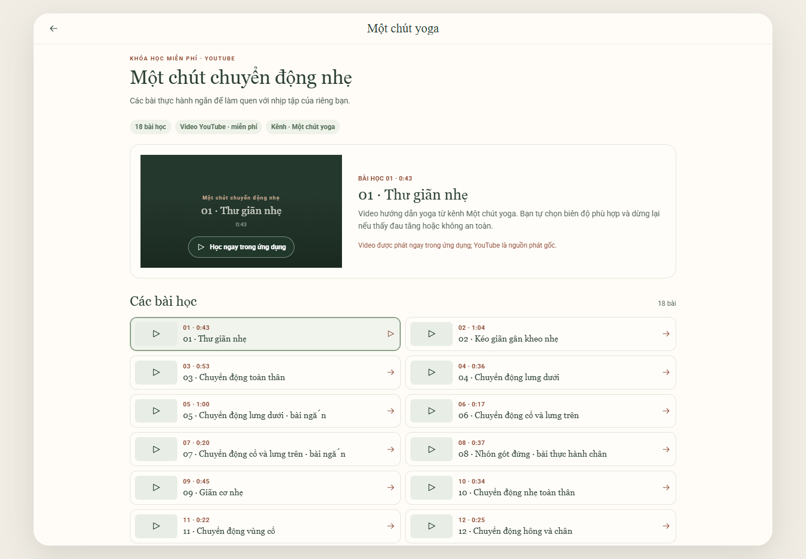

# MCY accessibility audit — 01/10/2026

## Verdict

Đã tìm và sửa một lỗi điều hướng bàn phím mức P1 trong app learner: FlowStack giữ màn trước để chạy animation, nhưng nội dung cũ vẫn tham gia cây trợ năng và có thể giữ focus sau khi điều hướng. Bản sửa nằm trong phần app-owned (`src/Prototype.tsx`, `src/prototype.css`), không thay đổi protected runtime.

Audit này chỉ bao phủ luồng Khám phá → khóa học miễn phí → quay lại trên Edge local ở desktop 1440×1000. Không phải chứng nhận WCAG 2.2 AA hay toàn app.

## Các bước và sức khỏe

1. **Từ check-in mở danh mục miễn phí — TỐT.** Người dùng có thể chọn duyệt bài mà không cần tài khoản; heading và ba nhóm khóa học hiện trong trang. Đây là đường vào kiểm thử, không đánh giá toàn bộ check-in.
2. **Mở chi tiết một khóa — ĐÃ SỬA.** Trước sửa, AX tree còn liệt kê nút “Cách chọn bài học video” của danh mục đã rời; focus cũng còn ở card cũ. Khi thử Tab/Shift+Tab quanh iframe YouTube, focus đi về phần tử của màn trước. Điều này gây nhiễu screen reader và cho phép focus rơi khỏi màn đang hiển thị.
3. **Duyệt chi tiết bằng bàn phím — PASS trong Edge/Playwright.** Nội dung màn trước nay có `aria-hidden` và `inert`; focus sau điều hướng được đưa tới heading của màn hiện tại. Tab tiếp theo vẫn nằm trong route đang hoạt động; CSS tính được focus ring `3px solid #8E4B35`.
4. **Quay lại danh mục — PASS trong Edge/Playwright.** Focus chuyển tới heading danh mục. Route chi tiết đã rời stack và được dọn sau transition; không còn nút bài học từ chi tiết trong thứ tự truy cập.
5. **Kiểm tra ảnh desktop sau khi animation kết thúc — TỐT.** Khung chi tiết cân đối, poster 16:9 trước Play, playlist hai cột và không có phần màn cũ lộ ra sau khi transition settle. Ảnh được chụp bằng Playwright ở 1440×1000 và mở kiểm tra:

## Thay đổi và kiểm chứng

- Bọc nội dung từng `FlowScreen` bằng boundary có `aria-hidden` + `inert` khi route không hoạt động; giữ animation thị giác hiện hành.
- Thêm focus manager app-owned: khi route key đổi, chờ heading được render rồi focus heading; nếu người dùng đã chuyển focus chủ động thì không giành lại.
- Khôi phục focus-visible 3px bằng token terracotta qua selector app-scoped. Không sửa `src/styles.css`, `src/mobile/`, hay lock hash.
- Thêm regression cho push/pop, cây role truy cập được, `inert`, route nhận focus và computed focus token.

| Gate | Kết quả | Phạm vi |
|---|---|---|
| `npm run check:runtime` | PASS, 28 protected files | Chạy qua lifecycle trước test/build; runtime giữ nguyên. |
| Test mới FlowStack keyboard/focus | PASS 1/1 | Edge local; focus/cây trợ năng và ảnh desktop. |
| TypeScript + Vite bundle | PASS có workaround; không phải full `npm run build` | `tsc --noEmit` và Vite build mới đều qua; Vite dùng `--configLoader runner --emptyOutDir false` để tránh EPERM và giữ `qa-compare.html`. Packaging script bị sandbox từ chối ghi đè `dist/server/index.js`; hash hiện tại khớp worker source. |
| `npm run check:bundle-secrets` | PASS, 11 text files | Pattern check bundle, không phải secret scanner tổng quát. |
| `npm run test:sites` | PASS 4/4 | Worker/static packaging tests. |
| Full `npm run test:runtime` sau các sửa tiếp theo | PASS 36/36 | Chrome local, tuần tự; process exit 0. Bao gồm runtime fixtures, learner flows, responsive checks, FlowStack keyboard/focus, Owner portal accessibility và native-auth URL cache. |
| `git diff --check` | PASS | Có cảnh báo line-ending LF→CRLF ở các file đã sửa trước đó; không có whitespace error. |

Lần revalidation mới nhất cũng xác nhận `npm run check:runtime` PASS (28 protected files), AI safety/model tests PASS 7/7, Owner control-plane PASS 9/9 và `npm run test:sites` PASS 4/4. Lệnh `npm run build` chưa được chứng minh là chạy liền mạch dưới sandbox hiện tại; xem chi tiết Vite/packaging workaround trong [UI/UX audit](MCY_UI_UX_AUDIT_2026-10-01.md).

## Giới hạn còn lại

- Chưa kiểm VoiceOver, TalkBack, NVDA, Safari/iOS, Android WebView, dynamic text 200%, forced-colors/high contrast hoặc zoom thực.
- Chưa có axe/contrast scanner trong dependencies; không tự thêm dependency chỉ để audit này.
- Focus ring được xác minh bằng computed style và keyboard interaction; screenshot tổng quan không thay thế kiểm thị giác/phần cứng trợ năng.
- Không kết luận toàn bộ tên accessible hoặc thứ tự screen reader ngoài route này; YouTube player là iframe bên thứ ba.
- AI tiếp tục tắt theo quyết định Owner. Đây không phải kiểm thử backend, quyền giáo viên, nội dung/video, hosted Preview hay release.
