# MCY UI/UX audit — 01/10/2026

## Kết luận

Trên bản build local, phần giao diện learner đạt chất lượng thị giác tốt cho MVP: nhận diện nhất quán, desktop giữ canvas có giới hạn, mobile chuyển sang một cột, các hành động chính dễ nhận biết, và video YouTube thật phát trong màn học. Không thấy tràn ngang hoặc lỗi bố cục ở các viewport đã chụp.

**Chưa phải sign-off production.** Lượt này xác nhận giao diện và một video trên Edge local; chưa xác nhận 38 video, playback trên hosted Preview/native WebView, khả năng truy cập với công nghệ hỗ trợ, hay hành vi Owner sau đăng nhập. Poster chữ xanh trước khi bấm Play là thiết kế app-owned có chủ ý để không tải thumbnail bên thứ ba trước consent; nó không phải player giả. Sau thao tác Play, iframe YouTube thật được nạp trong ứng dụng.

## Phạm vi và cách kiểm tra

- Local build tại `http://127.0.0.1:4175/?mode=web`, Microsoft Edge điều khiển bằng Playwright.
- Learner: desktop 1440×960; mobile web 390×844. Luồng từ welcome → check-in hai bước → danh mục miễn phí → chi tiết/video trong app → reflection.
- Owner: chỉ chụp trạng thái chưa đăng nhập ở 1440×900. Không nhập email, không gửi magic link và không thử đăng nhập Owner.
- Mỗi ảnh được mở kiểm tra sau khi lưu. Ảnh bắt giữa chuyển cảnh bị loại; player desktop được chụp lại sau khi video thật xuất hiện.
- Đây là audit UX/thị giác dựa trên screenshot và DOM, không phải chứng nhận WCAG hay thử nghiệm thiết bị thật.

## Các bước và đánh giá

1. **Welcome desktop — Tốt.** Thứ bậc ảnh, wordmark, lợi ích và CTA rõ; nền ivory/forest/terracotta và serif editorial đúng hướng thương hiệu. Canvas không bung thành một landing page toàn chiều ngang.

   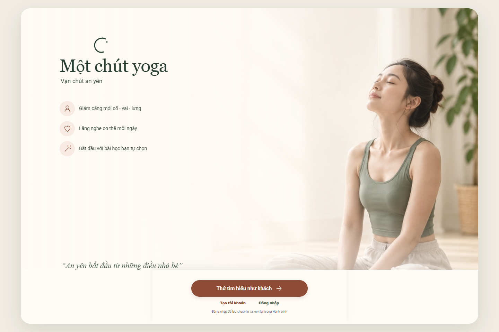

2. **Check-in cảm nhận cơ thể — Tốt.** Ở desktop, minh họa toàn thân và danh sách vùng cân bằng trong hai cột. Trên mobile, hình và các điểm chạm nằm gọn phía trên footer; caption không bị che. Có song song đường chọn qua hình và qua danh sách chữ.

   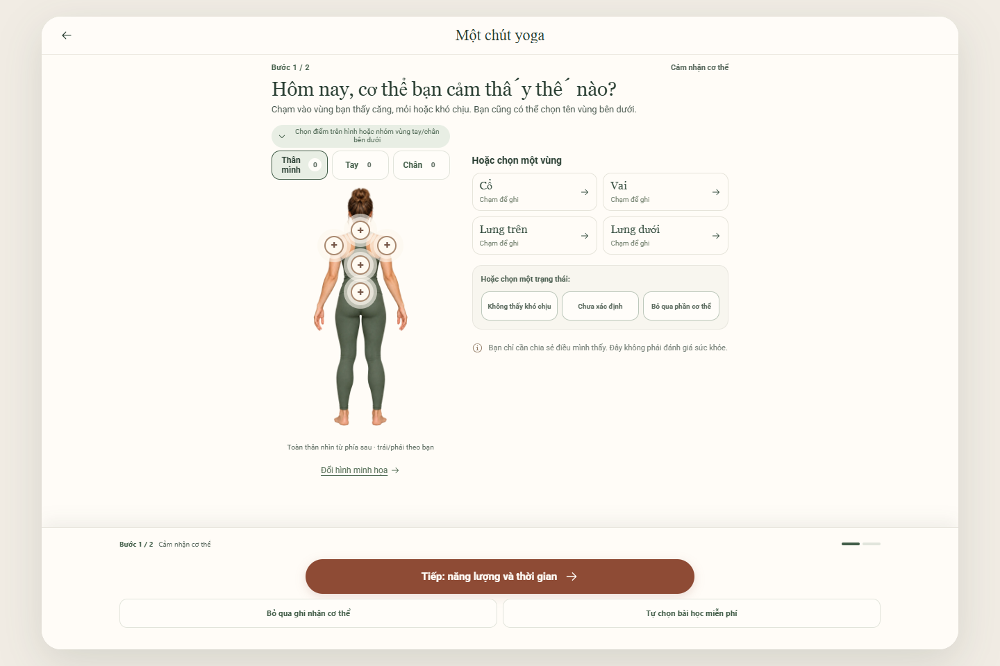

   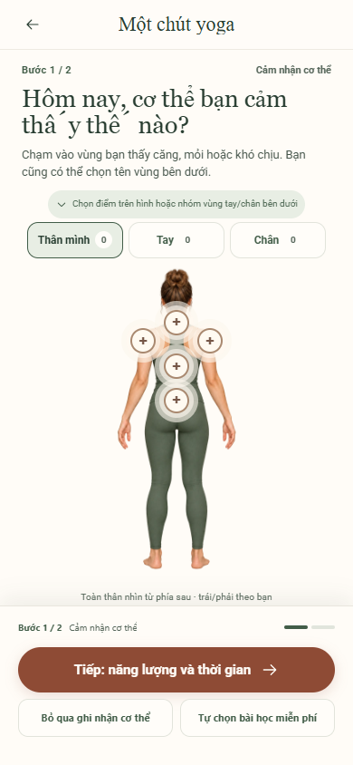

3. **Check-in năng lượng/thời lượng — Tốt.** Phân biệt bước 2/2 rõ; AI tắt được nói thẳng; lựa chọn năng lượng không bắt buộc; cue cuộn trên mobile giúp phát hiện phần nội dung dưới fold. Footer giữ CTA và lối quay lại.

   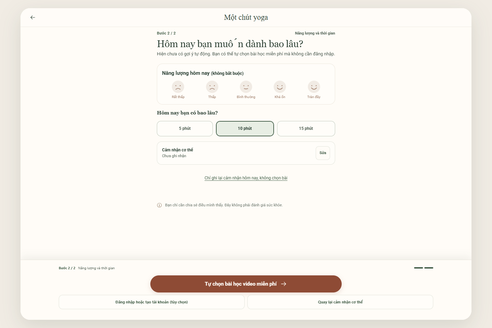

   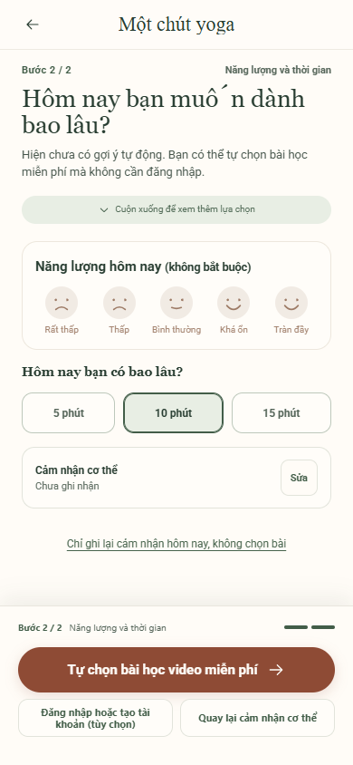

4. **Danh mục video miễn phí — Tốt.** Ba nhóm 18/13/7 bài, tổng 38; mô tả rõ học từng video trong app và nêu nguồn YouTube. Desktop dùng hai cột; mobile chuyển thành một cột có cue cuộn. Card thứ ba tiếp tục dưới fold đúng với bố cục cuộn.

   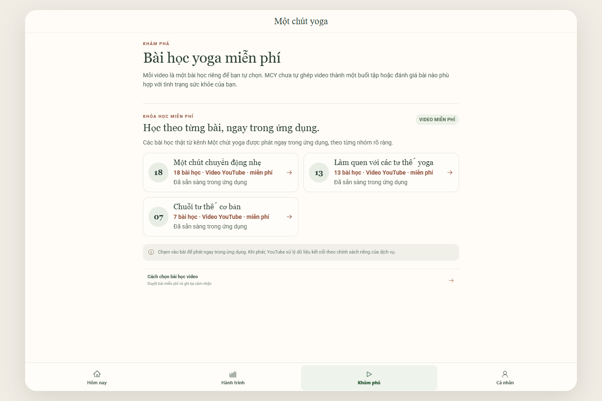

   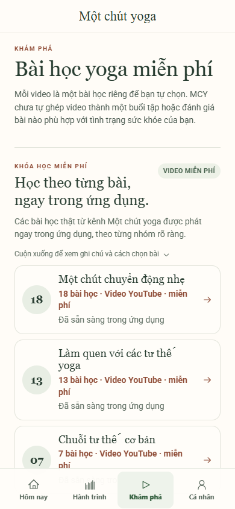

5. **Chi tiết bài học trước khi phát — Tốt, còn điểm polish.** Thông báo phụ đề và quyền riêng tư nằm trước player; CTA “Học ngay trong ứng dụng” rõ. Video dọc được bố trí cạnh mô tả trên desktop và xếp dọc trên mobile. Poster trước khi phát là thẻ nhận diện bằng chữ, không phải hình thu nhỏ của clip; điều này giữ nguyên nguyên tắc chưa dùng thumbnail khi quyền media chưa được duyệt, nhưng mức độ nhận biết từng clip sẽ thấp hơn.

   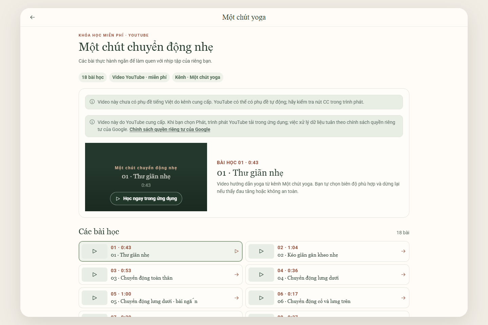

   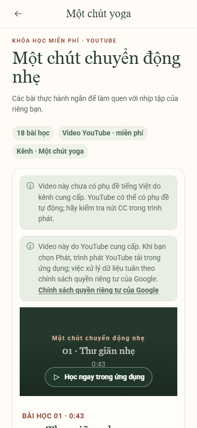

6. **Video YouTube trong app sau khi bấm Phát — Khá, cần kiểm playback rộng hơn.** Mobile đã hiện hình ảnh clip sau khoảng 2,5 giây. Lượt desktop đầu sau 2,5 giây còn khung tối; ảnh kiểm tra lại sau 8 giây đã hiện clip và phụ đề gắn trong video. Đây là tải thật qua iframe `youtube-nocookie.com`, không phải mockup, nhưng thời gian xuất hiện không ổn định giữa các lượt. Hãy kiểm thêm mạng yếu/hosted/native và quyết định trạng thái tải chỉ dựa trên tín hiệu player đáng tin cậy.

   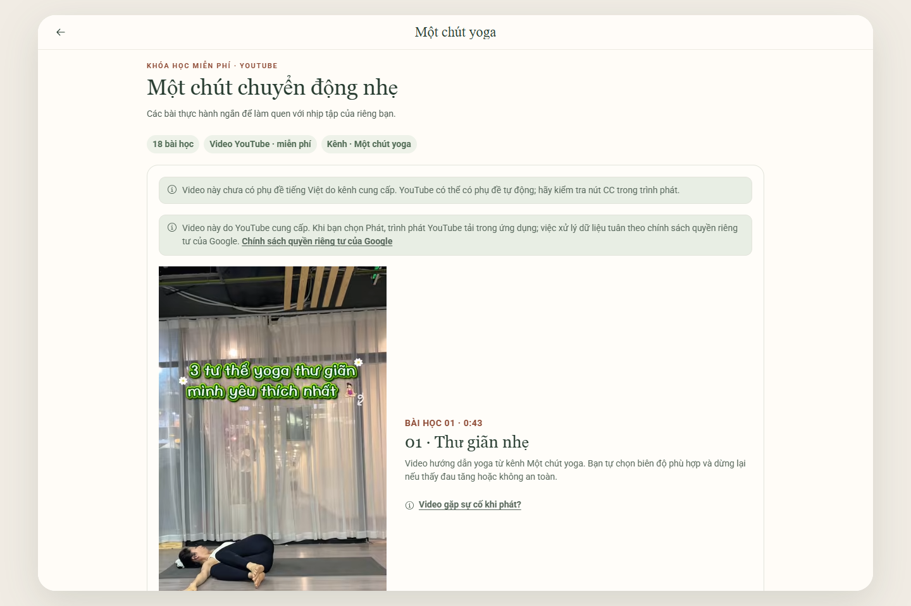

   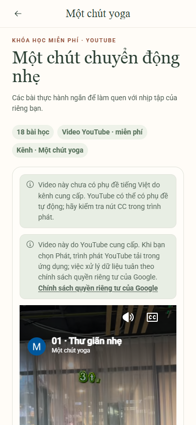

7. **Reflection sau khi người học tự xác nhận đã tập — Tốt.** Trạng thái trước tập không tự điền vùng/cảm nhận khi chưa có ghi nhận; chú giải nói rõ màu/điểm không được suy ra là “không khó chịu”. Người học có thể ghi thêm vùng khác, bỏ qua hoặc ghi nhận phản hồi. Ảnh xác nhận bố cục, không xác nhận đồng bộ dữ liệu; phản hồi hiện vẫn theo các gate session-only đã nêu trong readiness audit.

   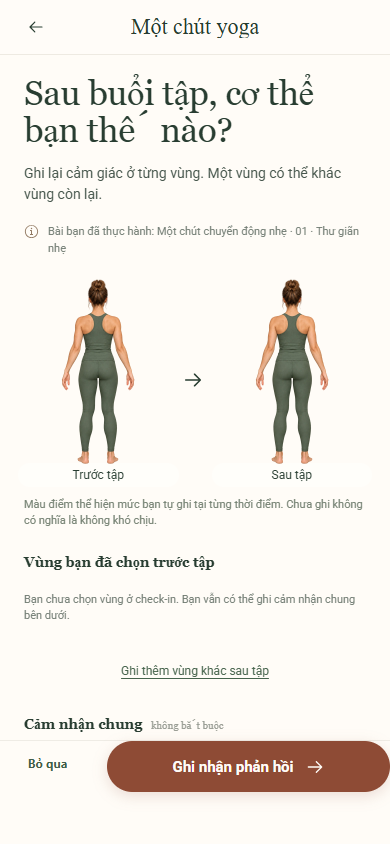

8. **Owner chưa đăng nhập — Tốt cho trạng thái sign-in; phần quản trị thật chưa audit được.** Bề mặt Owner riêng, tối giản, giải thích vai trò do server xác thực và không tự cấp qua trình duyệt. Chưa xem màn hình cấu hình AI bên trong vì không có Owner session/actor fixture trong phạm vi lượt này; AI vẫn tắt theo quyết định hiện hành.

   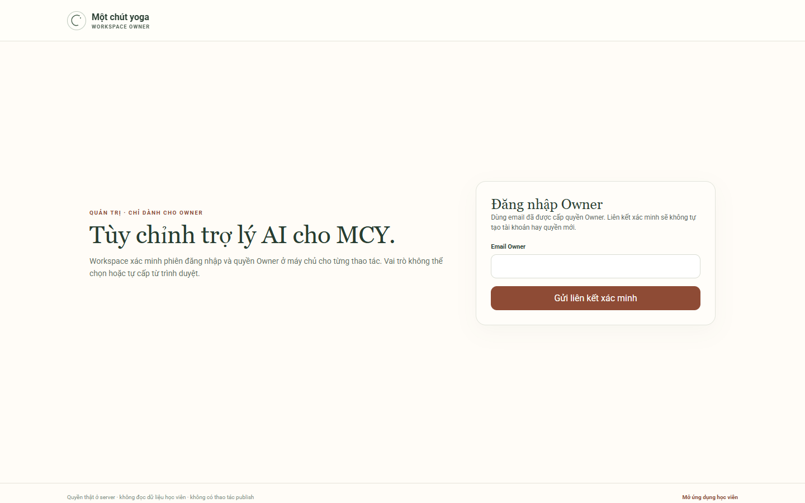

9. **Điều hướng bài trước/sau — Tốt, bổ sung 01/10.** Dòng vị trí “Đang chọn bài 1 / 18” đặt ngay sau nội dung bài; hai nút ngang hàng có vùng chạm 48px. Trên mobile, các nút giữ được nhãn đầy đủ và không tràn; desktop tận dụng chiều ngang ở cạnh player. Nút lùi khóa ở bài đầu. E2E xác nhận sang bài kế không tự tải/phát iframe và lùi lại giữ đúng lựa chọn. Chụp `mcy-course-featured` từ source hiện tại; hai ảnh dưới là ảnh gốc được mở kiểm tra.

   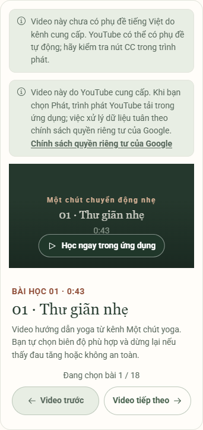

   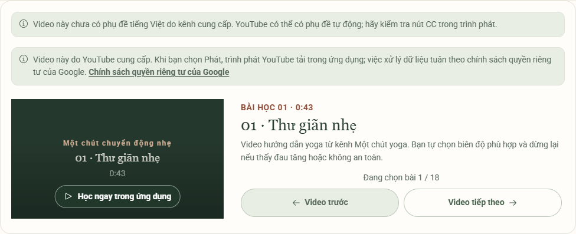

   Regression sau cập nhật: Playwright Edge 39/39 PASS; production build PASS; `check:runtime` 28/28 PASS. Build hiện vẫn có cảnh báo learner JS chunk 837.65 kB (247.08 kB gzip), nên audit này không kết luận hiệu năng đạt ngân sách production. Ảnh là local source preview ở `http://127.0.0.1:4182/?mode=web`, chưa phải hosted deployment hoặc kiểm tra thiết bị thật.

## Điểm cần ưu tiên

- **P1 — Playback:** điều hướng bài trước/sau đã có; thời gian tải khung hình đầu vẫn thay đổi theo lượt (2,5–8 giây ở hai lượt thử một clip). Chưa có bằng chứng đây là độ trễ phổ biến hay riêng workstation/network; không coi một video là xác nhận 38 video hoặc WebView native. Cần thử hosted build, mạng chậm, retry, audio/captions và nhiều ID trước khi đóng C07.
- **P1 — Nội dung:** poster chung, caption, quyền sử dụng/thành phần media, tên người dạy lấy từ hồ sơ tài khoản và nội dung/safety review đều còn gate. Không tự đặt credit Huyền My trong UI trước khi profile/role được xác minh.
- **P1 — Owner:** screenshot chỉ cho thấy trạng thái trước đăng nhập, không chứng minh API, role guard hoặc thao tác lưu cấu hình Owner hoạt động end-to-end.
- **Accessibility:** hình cho thấy hierarchy, vùng chạm và footer rõ; screenshot không chứng minh thứ tự đọc, contrast toàn app, zoom 200%, bàn phím toàn luồng, VoiceOver/TalkBack/NVDA hoặc reduced motion. Không đưa ra tuyên bố đạt WCAG.
- **Devices/release:** physical iPhone Safari, Android WebView, install hiện hành, hosted Preview/Production, CI required checks và rollback chưa được kiểm chứng ở lượt này.

## Giới hạn bằng chứng

Không đăng nhập Owner, không gửi dữ liệu học viên/AI, không thay YouTube metadata, và không phát hành bản hosted. Ảnh chỉ chứng minh trạng thái nhìn thấy trong bản local tại thời điểm chụp. Chi tiết các gate backend, provider, quyền nội dung và thiết bị tiếp tục theo dõi ở [MCY MVP readiness audit](../MCY_MVP_READINESS_AUDIT_2026-09-29.md).
