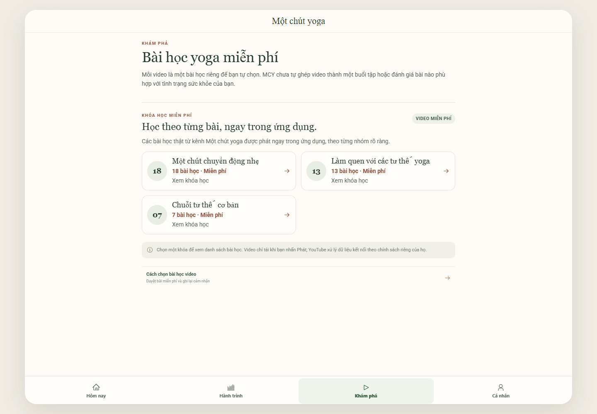
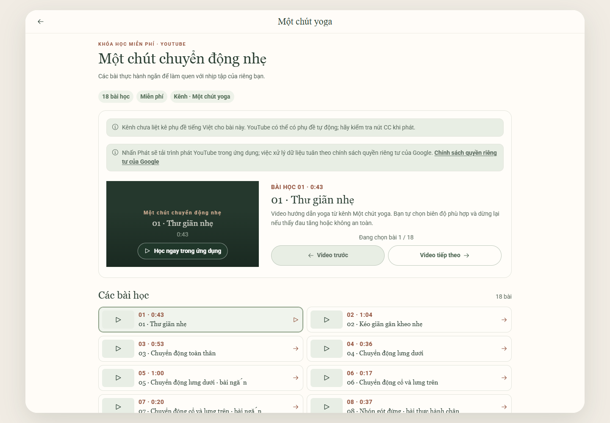
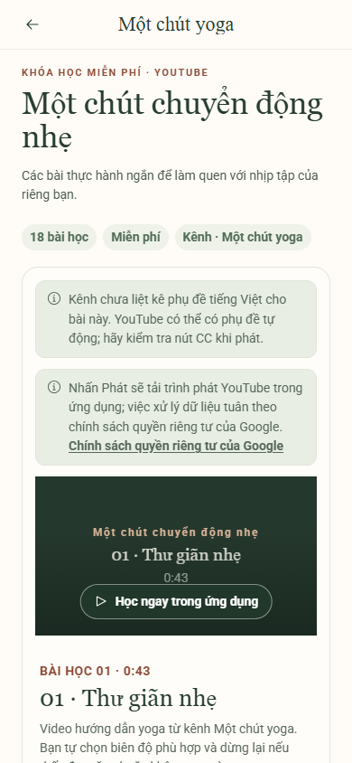

# Audit UI/UX khóa học video miễn phí — 02/10/2026

## Phạm vi và trạng thái chung

Rà soát luồng người học khách: welcome → tự chọn nội dung → danh mục khóa miễn phí → chi tiết bài đầu tiên, ở Microsoft Edge với `?mode=web`, kích thước 390×844 và 1440×1000. Build được phục vụ từ Vite cô lập trên localhost; Supabase URL/key là fixture giả, không dùng staging, tài khoản hoặc dữ liệu người học. Chưa nhấn Phát trong lượt chụp để tránh phát sinh request YouTube ngoài ý muốn.

**Đánh giá:** hướng hình ảnh tổng thể nhất quán với hệ thống hiện tại: nền ngà, chữ xanh rừng, điểm nhấn đất nung, serif cho tiêu đề và sans cho nội dung; desktop giới hạn chiều rộng thay vì kéo dàn trải. Luồng khóa học video khác màn thực hành có hướng dẫn là hợp lý: video YouTube là nội dung phát trực tiếp, không được giả thành timer, các động tác hay tiến độ do MCY ghi nhận. Tuy nhiên, bề mặt chờ phát hiện vẫn hơi giống placeholder vì chỉ có nền xanh phẳng và chữ; đó là điểm polish còn thiếu, không phải dữ liệu video giả.

## Các bước đã xem

1. **Mở danh mục miễn phí.** Có ba nhóm thật với 18, 13 và 7 bài (38 tổng). Card có số lượng, trạng thái miễn phí và điều hướng rõ; copy nêu MCY chưa tự ghép video hoặc đánh giá mức phù hợp sức khỏe.

   

2. **Mở bài học đầu tiên.** Trang chi tiết giữ nội dung trong cột khoảng 1040 px trên viewport desktop 1440 px; danh sách bài học hiển thị hai cột. Ở mobile 390 px, vùng video 312 px; chiều rộng tài liệu bằng viewport, không tràn ngang. Player chưa được tải trước khi người học chủ động chọn Phát.

   

   

3. **Kiểm tra trạng thái trước khi phát và disclosure.** Không có iframe, request YouTube/YouTube-nocookie/ytimg nào trước thao tác Phát. CTA dùng đúng “Xem khóa học” thay vì “Mở khóa học”, tránh gợi ý khóa học đang bị paywall. Thông báo phụ đề và privacy đã rút gọn, nhưng vẫn phân biệt nội dung do kênh liệt kê với phụ đề tự động của YouTube. Tên class nội bộ `placeholder/thumb` cũng được đổi thành `poster/icon` để không mô tả nhầm trạng thái chờ là mock hoặc ảnh thu nhỏ thật.

4. **Không ép nội dung video vào template bài tập MCY.** Đây là một template media riêng nhưng dùng cùng tokens, typography, spacing và header. Giữ rõ ranh giới này là đúng; tái sử dụng lớp vỏ thị giác, không tái dùng những trạng thái timer/hoàn thành không tồn tại.

## Phát hiện và việc cần làm

- **P2 — ảnh đại diện bài học còn thiếu:** khung nền chữ có title và thời lượng thật, cùng CTA phát trong ứng dụng, nhưng không có hình động tác nên trông giống một thẻ chờ/placeholder. Không thay bằng ảnh stock/AI hoặc thumbnail chung vì dễ làm người học tưởng đó là nội dung thực tế của bài. Chỉ thêm poster khi có ảnh/khung hình được duyệt, ghép đúng với từng video và có chứng cứ quyền dùng; ưu tiên cùng origin để giữ hành vi không liên hệ YouTube trước thao tác Phát. Cần rà soát quyền, gắn tác giả từ hồ sơ đã xác thực, caption và chất lượng hướng dẫn trước khi public. Đây là hạng mục polish/content gate còn mở, không phải lý do giả vờ rằng video chưa có.
- **P2 — copy đã sửa trong lượt này:** “Xem khóa học”; mô tả trạng thái phụ đề và thời điểm tải player được viết lại ngắn, tự nhiên hơn. Không đổi dữ liệu khóa học, quyền phát hay hành vi player.
- **Không thấy tràn ngang hoặc desktop phóng nội dung tràn toàn màn hình:** 1440 px không tràn; vùng nội dung chính được giới hạn. Các preset iPhone/Pixel, Safari/iOS, native WebView và màn hình chữ lớn không được kiểm tra lại trong audit desktop/mobile-web này.

## Kiểm chứng

- Microsoft Edge, flow cô lập thủ công: **PASS** — catalog 3 card; copy mới; disclosure mới; poster thật theo nghĩa “trạng thái chờ phát”, không có class mock/thumb cũ; nút Phát nhìn thấy; iframe count 0; request YouTube trước Phát = 0; document width mobile 390/390 và desktop 1440/1440.
- `npx tsc --noEmit`: **PASS**.
- `npm run check:runtime`: **PASS**, 28 protected files.
- `npm run test:sites`: **PASS**, 4/4.
- Vite production candidate ở `%TEMP%`, 580 modules: **PASS**; secret scan **PASS**, 13 text files. Vẫn có cảnh báo entry >500 kB. Đây không phải canonical `npm run build`/Sites package.
- Bốn bài E2E chọn lọc cho catalog lazy-load, hướng dẫn, bố cục desktop/mobile và retry/fallback đều in `ok`; runner không thoát sạch sau test cuối và phải ngắt. Theo review matrix, không gọi nhóm E2E này là PASS suite; trạng thái tổng thể là **CHƯA XÁC NHẬN (teardown/exit)**. Bài timeout 12 giây không nằm trong bốn bài xác nhận hoàn tất.
- Chưa kiểm tra playback YouTube thật trong lượt này, và không coi `iframe.onload` là bằng chứng video phát. Hồ sơ playback một clip trên thiết bị/web ở các audit trước vẫn chỉ có phạm vi một clip/phiên, không thay cho kiểm thử 38/38.

## Kết luận

UI hiện **đạt mức tốt cho trải nghiệm MVP có kiểm soát**, nhưng chưa đủ căn cứ để gọi toàn bộ học liệu hoặc ứng dụng là production-ready. Phần khác form so với template bài tập là khác biệt có chủ đích của loại nội dung; cần hoàn thiện poster có quyền, caption/attribution, playback nhiều thiết bị và các gate release còn lại. Không deploy, đổi staging, mở AI, mời giáo viên hay phát hành trong audit này.
